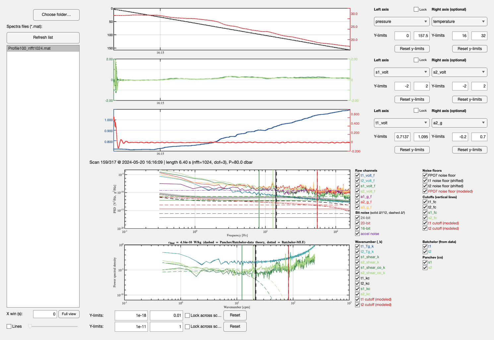
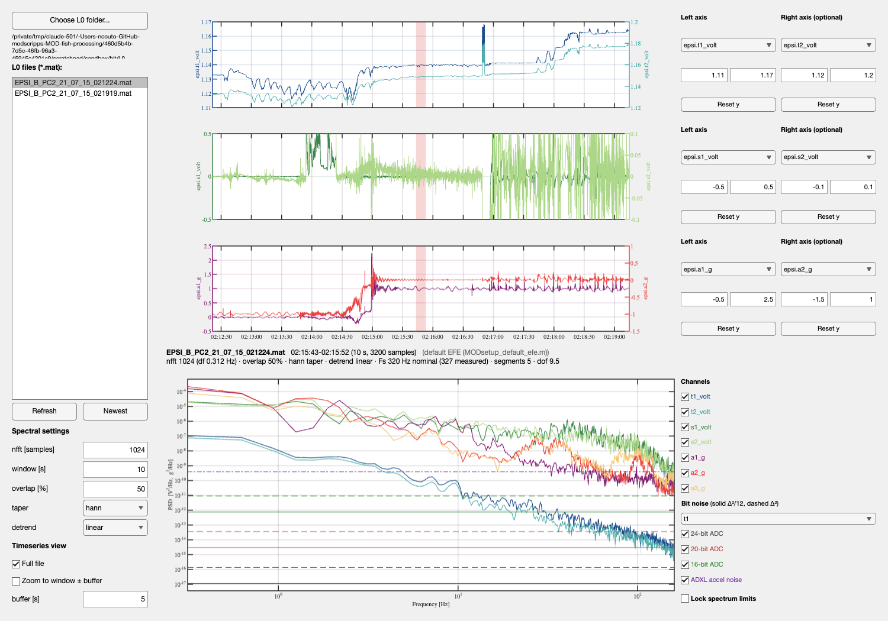
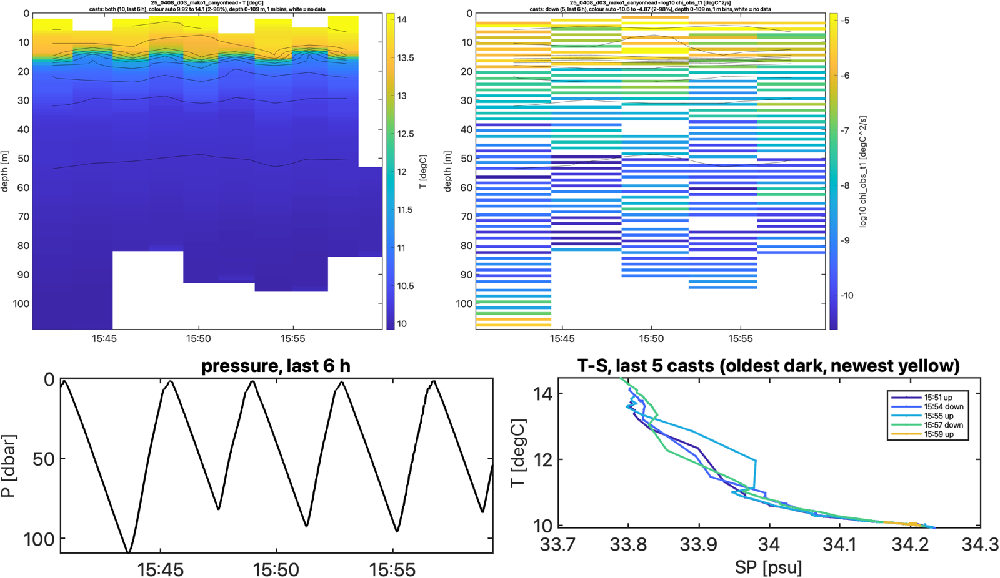
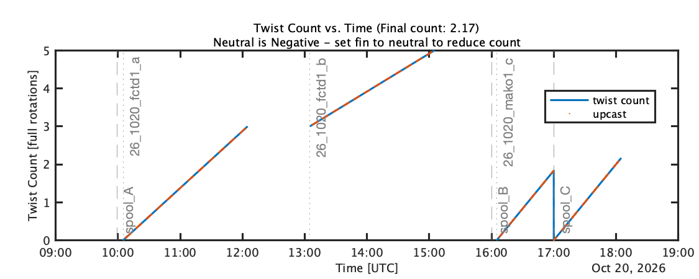
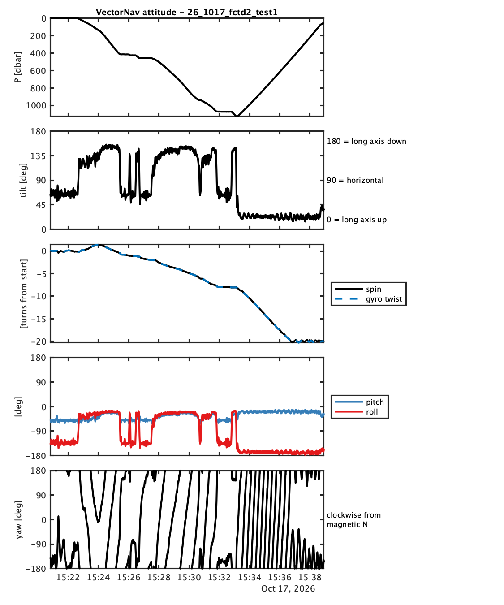
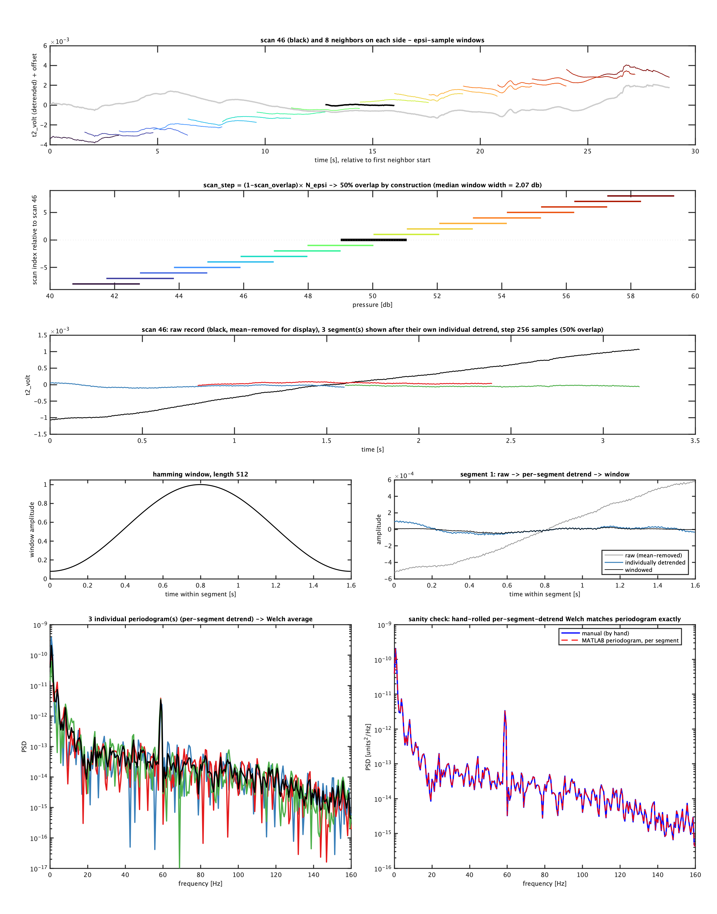
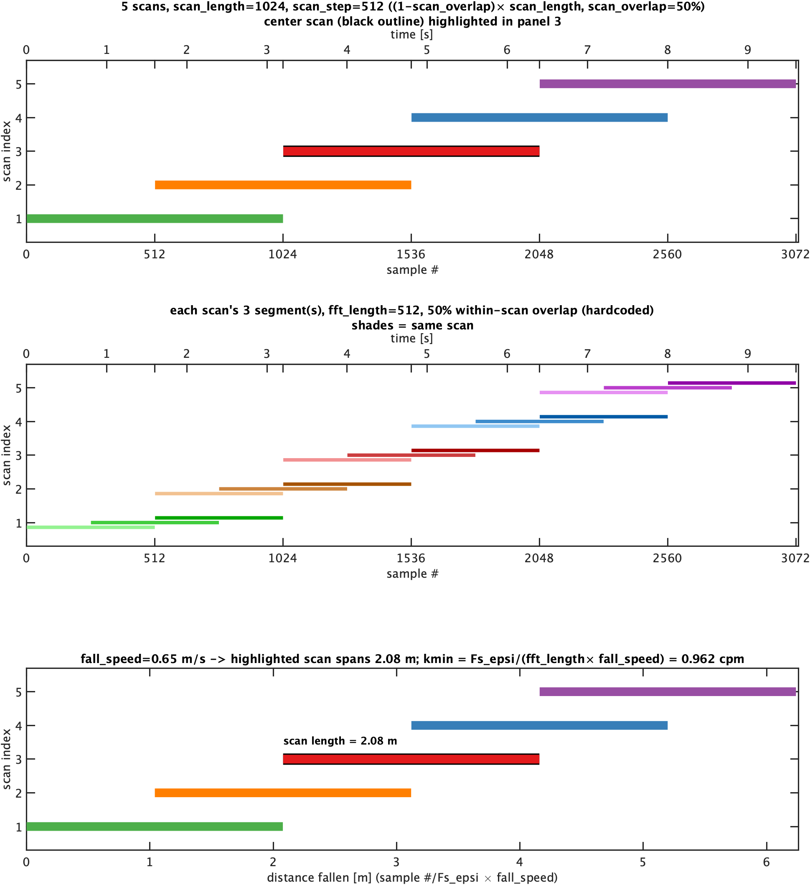
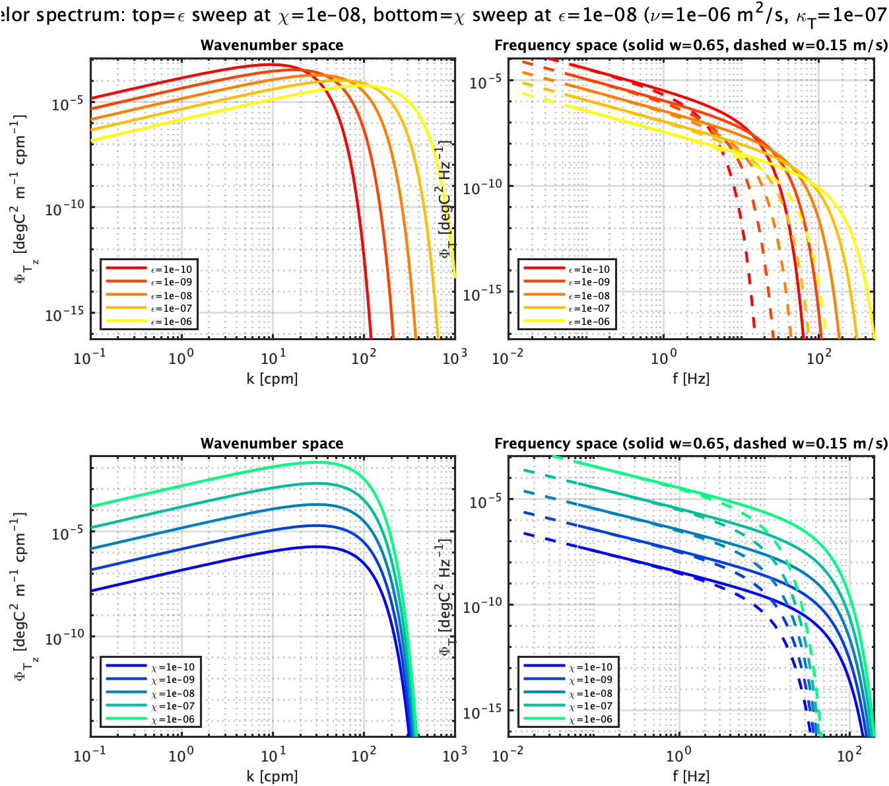
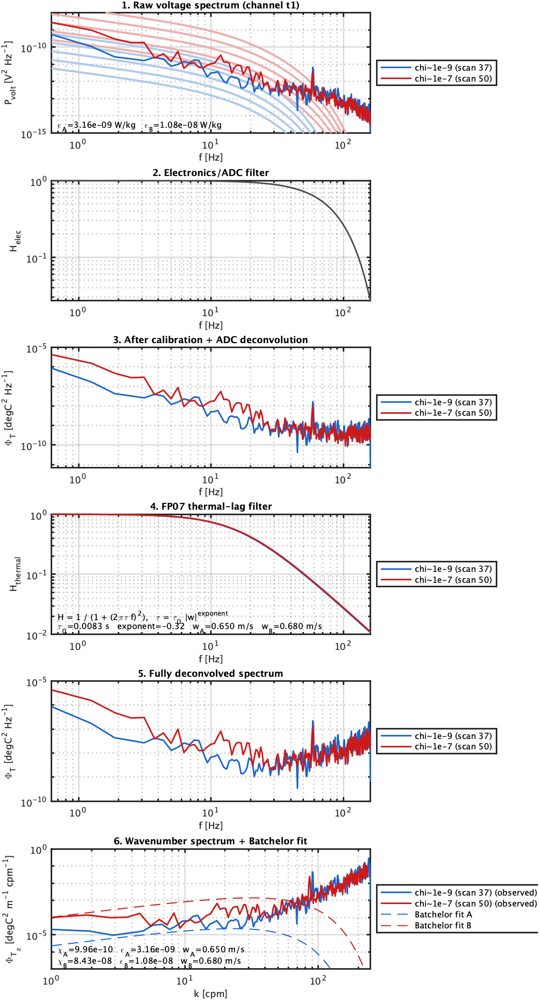
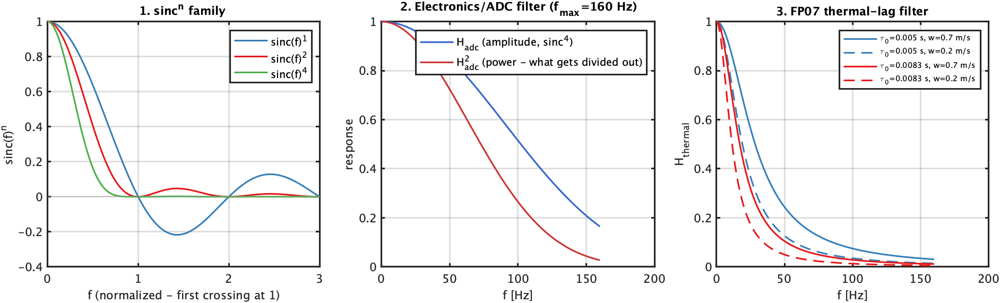

# Plots and Visualization

Catalog of the plotting tools in this repo: the interactive apps in `visualization/` and the
one-shot diagnostic figures in `plots/`. As opposed to [Concepts](../concepts/index.md) (physics
background) and [Workflow](../workflow/modraw_to_L0_conversion.md) (what each processing step
does), this section is about the plotting/exploration tools themselves - what each one shows and
how to call it.

**Convention:** every time a `MODvis_*`/`*App` or `MODplot_*` script is added or changed, add or
update its entry below with an example image and a short usage note (see `PLAN.md`, Section 11).

## Interactive apps (`visualization/`)

### MODvis_timeseries.m

Browse a folder of `.mat` files (L0, L1, L2, or `Profile*`) and plot up to 6 rows of any field
that carries a `dnum` timestamp - each row optionally split across a left/right `yyaxis` pair.
Supports nested fields (`epsi.t1_volt`, `ctd.P_raw`, `gps.latitude`, ...). Formerly
`L0ExplorerApp.m`.

```matlab
app = MODvis_timeseries();                 % opens a folder chooser
app = MODvis_timeseries('/path/to/L0');    % or point it at a folder directly
app = MODvis_timeseries('<survey>/processed/realtime');  % a processing run: opens its L1
```

Given a processing run's folder ([Processing data](../workflow/processing_data.md#processing-runs)),
it opens that run's L1 - its own, or the L1 of the run named in `L1_from`.

*No example screenshot committed yet.*

### MODvis_spectra.m

Browse a folder of `.mat` files carrying per-scan spectra - either this repo's own L2/profile
output or a legacy `MOD_fish_lib`/EPSILOMETER `Profile*.mat`. Shows pressure and up to 2 raw
channels per row for context, and plots the full 7-channel raw spectrum for any scan you click.
Every curve has a checkbox to show or hide it.

```matlab
app = MODvis_spectra();
app = MODvis_spectra('/path/to/profiles');
app = MODvis_spectra('<survey>/processed/nfft512');  % a processing run: its L2, with the matching L1
```

An L2 file holds scans only; the raw channels come from the L1 file with the same name. Given an
`L2/` folder or a processing run's folder, it finds that L1 with `MODutil_level_folders.m`: the
run's own `L1/`, the `L1_from` run's `L1/`, or `profiles_L1/` for `profiles_L2/`.



The frequency-spectrum panel's y-axis is in V²/Hz for the t/s channels and g²/Hz for the
accelerometers. Reference lines on it:

- **Noise floors** (legacy `Profile*.mat` only): FPO7 bench noise, shifted per channel, and modeled
  - see [From raw volts to a trustworthy wavenumber spectrum](../concepts/spectral_filtering_and_noise_floors.md#4-where-the-noise-floor-comes-in).
  Shaded up to 3x (the cutoff search's `SN_min`).
- **Bit noise** (any file with `Fs_epsi`): flat ADC quantization-noise floors for 24/20/16 bits,
  each drawn solid at Δ²/12/(Fs/2) and dashed at Δ²/(Fs/2), plus the accelerometer sensor noise
  at (20e-6)² g²/Hz - see
  [ADC bit noise](../concepts/spectral_filtering_and_noise_floors.md#adc-bit-noise-reference-lines).
  All channels share one axes but not one ADC step size, so the dropdown under the "Bit noise"
  heading picks **which channel's LSB** the lines use (default `t1`, which gives the same levels
  as `MODSOM_liveplot`'s `Faster_app.py`; `s1`/`s2` are 4x higher, `a1`-`a3` are in g). The LSB
  comes from the sibling L1 file's `epsi_conversion`, or the standard EFE board if the file has
  none - the dropdown's tooltip says which. (The screenshot above predates the dropdown.)

### MODvis_spectra_L0.m

Quick-look EFE spectra straight from L0 files, against ADC bit noise - the `MODSOM_liveplot`
use case, with **no setup.yml needed** (L0 is already in volts/g with the standard EFE board -
see [EFE channels: volts/g at L0](../workflow/modraw_to_L0_conversion.md#efe-channels-voltsg-at-l0)).
Laid out like `MODvis_spectra.m`: timeseries rows on top, one frequency spectrum below. Opens
the newest file in the folder; **Newest** re-lists and jumps to it again.

```matlab
app = MODvis_spectra_L0('/path/to/L0');                  % folder: newest file
app = MODvis_spectra_L0('/path/to/L0/modsom_012.mat');   % or one file
app = MODvis_spectra_L0('/path/to/L0', 'nfft', 2048, 'window_s', 30);   % starting values
app = MODvis_spectra_L0('/path/to/L0', 'metadata', metadata);   % re-apply setup.yml names/config
```



- **Top: 3 timeseries rows**, each with a left and an optional right field - any `epsi` or `ctd`
  vector in the file (e.g. `ctd.P_raw`, `epsi.s1_volt`, `epsi.a3_g`). Rows share one time axis.
  Defaults: t1/t2, s1/s2, a1/a2 (a missing channel, e.g. `s2` renamed `c1`, falls back to the
  first epsi field on the left axis and nothing on the right).
- **Click any row** to center the spectrum window there; the window is shaded on every row. On
  load it's the last `window` seconds of the file. Rows are pinned to the same plot width, so the
  shading lines up whether or not a row has a right axis.
- **Timeseries view** (left panel): **Full file** shows the whole `.mat`; **Zoom to window ±
  buffer** zooms to the spectrum window plus `buffer` seconds each side and follows each click.
  They're mutually exclusive; a manual zoom/pan unchecks both and leaves your view alone.
- **Y-limits per side**: each row has min/max boxes and a **Reset y** button for its left axis and
  for its right axis. The boxes always show that side's current limits; typing sets that side only
  (a min ≥ max is rejected), Reset returns it to auto. MATLAB's own zoom/pan tools only act on one
  side of a two-y-axis row, so these are the reliable way to set both. Limits go back to auto when
  the file or that row's field changes; clicking a new window keeps them. The right-side boxes are
  disabled when the right axis is `(none)`.
- **Bottom: one frequency spectrum** of every checked channel over that window, using
  `mod_scan_welch_psd.m` - the same per-segment-detrended Welch estimator as L2.
- **Every spectral setting is editable in the left panel** - nfft, window length, overlap %,
  taper (Hann/Hamming) and per-segment detrend (linear/constant/none). Changing one recomputes
  and redraws. Name-value arguments only set the starting values, which match the liveplot: nfft
  1024, 10 s, 50% overlap, Hann. Detrend defaults to linear, like this repo's L2 spectra.
- The window's times and length, the active settings, Fs (nominal, and measured from the
  timestamps), number of segments, dof and df are printed above the spectrum, so a screenshot
  records them. dof (1.9 × segments) is only shown at 50% overlap, where that rule holds.
- **Bit noise**: the dropdown picks **which channel's ADC LSB** the 24/20/16-bit lines use (t1/t2
  unipolar 2.5 V; s1/s2 bipolar 2.5 V, 4x higher; a1-a3 in g via 0.4 V/g). For an N-bit ADC,
  Δ = LSB × 2^(24-N), solid at Δ²/12/(Fs/2), dashed at Δ²/(Fs/2). The ADXL accelerometer
  sensor noise, (20e-6)² g²/Hz, is a separate checkbox - it's a property of the sensor, not the ADC.
- The checkbox column is color-keyed to every curve, so there's no legend. Grid lines and ticks
  are at whole decades only.
- **Lock spectrum limits** keeps the spectrum's current x/y limits - including a manual zoom -
  when it's redrawn (new click, new settings, new file). Unchecking returns to auto limits.
- **Export spectra (.mat)**: **Export this scan** saves the shaded window's spectra; **Export all
  scans** tiles the current file into back-to-back windows of `window` seconds (a leftover partial
  window at the end is dropped), for comparing deployments or averaging over a file. Both use the
  current spectral settings, include every channel whether or not it's checked, and open a save
  dialog (starting next to the L0 folder, not in it). `E = load(file)` gives:

    | Field | Contents |
    |---|---|
    | `spectra.t1_volt`, `.s1_volt`, `.a1_g`, ... | PSD, one row per scan: 1 × Nf for one scan, M × Nf for all |
    | `f` | 1 × Nf frequency [Hz], 0 to Fs/2, shared by every scan and channel |
    | `units.<field>` | `V^2/Hz` or `g^2/Hz` |
    | `scan.i0`, `scan.i1` | M × 1 sample indices into the L0 file's `epsi` (`epsi.t1_volt(i0:i1)` is the scan); also `scan.dnum_start`/`dnum_end` |
    | `file`, `folder` | the L0 file the spectra came from |
    | `nseg.<field>`, `dof.<field>` | M × 1 Welch segments used (NaN segments skipped; none left → all-NaN row), dof = 1.9 × nseg (NaN unless 50% overlap) |
    | `noise.<field>` | flat floors [same units as the spectra]: `bit24`/`bit20`/`bit16` = Δ²/12/(Fs/2), `bit24_full_lsb`/... = Δ²/(Fs/2), `lsb`, and `adxl` for accelerometers |
    | `settings` | `nfft`, `window_s`, `window_samples`, `overlap_pct`, `taper`, `detrend`, `Fs`, `Fs_measured`, `df` |
    | `epsi_conversion`, `README`, `exported` | the file's counts ↔ volts/g record, a plain-text description, export time |

    ```matlab
    A = load('EPSI_B_PC2_21_07_15_021224_spectra_all.mat');
    loglog(A.f, mean(A.spectra.s1_volt, 1, 'omitnan'))   % mean over scans
    ```

    From a script, `app.exportScans('this' | 'all', outfile)` skips the dialog.
- Also opens older L0 files (raw `channel1..N` counts) and L1 files.

### MODvis_realtime_monitor.m

The live monitor for the realtime worker on DEV3, laid out after the 2018 FastCTD GUI. It only
reads the worker's files and refreshes every 10 s; it writes only `realtime/control.json` (Pause,
Stop) and saved PNGs, and **Start** launches the worker as its own `matlab -batch` process, so
closing the monitor never stops processing.

**To open it on DEV3,** double-click `Start Realtime Monitor.command` (repo folder, next to
`Start Realtime Processing.command`). It starts a second MATLAB with the monitor, next to the
worker's, on `processed_root` from `acquisition/config.yml` (or a folder given as an argument from
a Terminal). Double-clicking MATLAB itself doesn't work while the worker runs - macOS only brings
the running MATLAB forward; `open -n /Applications/MATLAB_R20XX.app` does open a second one.
From a MATLAB that's already open:

```matlab
app = MODvis_realtime_monitor();                                  % processed_root from acquisition/config.yml
app = MODvis_realtime_monitor('/path/to/Current_Cruise/Processed'); % or a folder
```

- **Top:** worker state, survey, vehicle, winch spool, file counts, casts, lag, problems,
  missing parameters, last update (red when there are problems or missing parameters).
- **Left:** 4 colour sections of the survey's grid (`processed/realtime/grid/grid.mat`), one
  column per cast, depth vs time, with sigma0 contours. All 4 share the depth and time limits;
  each has its own variable (any field in `grid.variables`; epsilon and chi as log10),
  colormap and colour range. Colormaps: Matlab's parula and turbo, and cmocean's (thermal,
  haline, dense, deep, algae, ...; `toolbox/cmocean/`); they start as dense, thermal, haline
  and turbo. Click one to pick a time: the L1/L2 file holding it is shown.
- **Middle,** 3 rows x 2 columns beside sections 1-3, then the log beside section 4. Left:
  pressure vs time over the cruise twist count (`Processed/twist/twist_time_series.mat`, every
  survey on the winch spool, restarting at each spool change), on the same time limits and
  linked, so zooming one zooms both; they stretch to fill the width (row 3 is free). The twist
  title gives the count now, the spool and when it went on; spool changes are dashed, survey
  starts dotted, upcasts orange. Right, square: the last 5 casts' T profiles and C profiles, each
  offset like a waterfall, and their T-S. The log is the survey's `processing.log` (or
  `cruise_log.txt`), problem lines in red - click a line to see all of it.
- **Right:** Start / Pause / Stop; Preflight (the worker's last preflight for the survey, from
  `status.json`); for all sections: casts (both/down/up), depth limits, and the time window -
  a span in hours ending at the current time (UTC) or at a typed time, as in the FastCTD GUI
  (span 0 = all casts); per section: variable, colormap, colour min/max; the T and C profile
  offsets;
  the log; open the run in `MODvis_timeseries` or `MODvis_spectra`; Save PNG
  (`realtime/figures/`). Empty = auto. Each setting is written on the plot it changes.



The middle plots above, from the 2026-10-17 FCTD2 ocean test (copies of its raw files processed in
a sandbox; 2 casts). They were exported one by one and placed as in the window, because
`exportapp` of the whole window clips some panels in the Matlab used for testing (Save PNG
reports it if it fails).

### MODvis_twist_timeseries.m

Plots cable twist count (gyro method) vs. time, highlighting upcast samples (when the fin is
normally adjusted). Given the cruise twist count, it also marks each spool change (dashed, with
the spool) and each survey start (dotted, with its name); the line is broken at gaps. The
monitor's twist panel uses it.

```matlab
T = load(fullfile(processed_root, 'twist', 'twist_time_series.mat')).TwistTimeseries;  % cruise
% or one survey (from 0 at its start, no spool resets):
% T = load(fullfile(survey, 'processed', 'realtime', 'meta', 'twist_time_series.mat')).TwistTimeseries;
ax = MODvis_twist_timeseries(T);
```



### MODvis_vnav_attitude.m

Which way the fish was pointing, from a survey's (or any) L1 folder: pressure, tilt, spin next to
the gyro twist count, pitch and roll, and yaw, on one linked time axis. What the angles mean, with
diagrams: [Which way the fish points](../concepts/vehicle_attitude.md). For L1 files made before
the angles were added at L1, it works them out from the vnav (nothing is written).

```matlab
fig = MODvis_vnav_attitude(survey_folder);                % processed/realtime/L1
fig = MODvis_vnav_attitude(L1_folder, [t_start t_end]);   % datetime or datenum
```



### SpectraExplorerApp.m

Browse `Profile*.mat` files and step through depths, viewing t1/t2 temperature-gradient spectra
and chi side by side with the QC diagnostics used to judge whether a chi value is trustworthy
(cutoff/kmin wavenumbers, modeled vs. observed noise, raw/noise-subtracted/MLE chi comparison).

```matlab
app = SpectraExplorerApp();                    % opens a folder chooser
app = SpectraExplorerApp('/path/to/profiles');
```

Full panel-by-panel reference: [SpectraExplorerApp: Chi Inspector manual](CHI_INSPECTOR_MANUAL.md).

*No example screenshot committed yet.*

## Diagnostic plots (`plots/`)

### MODplot_scan_context.m

One L1 file, one scan: shows how that scan's window overlaps its neighbors, and how
`mod_scan_get_spectra.m` segments/detrends/windows/averages within it (checked against MATLAB's
own `periodogram` as a sanity check).

```matlab
fig = MODplot_scan_context(data, metadata, target_pressure, channel);
```

{: style="max-width: 800px;" }

### MODplot_scans_and_segments.m

Purely theoretical companion to `MODplot_scan_context.m`: no L1 file needed, just
`fft_length`/`scan_length`/`fall_speed`, for exploring a candidate windowing combination before
committing it to `setup.yml`.

```matlab
fig = MODplot_scans_and_segments(fft_length, scan_length, fall_speed);
```



See [Choosing fft_length, fft_segments_per_scan, and scan_overlap](../concepts/spectral_windowing.md)
for the full writeup this figure supports.

### MODplot_chi_spectra_noise_floor.m

One scan's FPO7/chi noise-floor diagnostic: wavenumber spectrum on top, frequency-space
precursor below, each against 3x the noise floor for three noise models (unadjusted, adjusted,
theoretical), plus each model's own cutoff and resulting Batchelor fit.

```matlab
fig = MODplot_chi_spectra_noise_floor(spec);
```

*No example image committed yet.*

### MODplot_profile_spectra_summary.m

Whole-profile diagnostic: fall speed, epsilon, and chi profiles over a pressure range, with 4
representative scans picked out and each one's epsilon/chi spectrum shown against a theoretical
Panchev/Batchelor curve built from that scan's own fitted values.

```matlab
fig = MODplot_profile_spectra_summary(data, pressure_range);
```

*No example image committed yet.*

### MODplot_theory_spectra_demo.m

Purely theoretical: draws the Batchelor and Panchev model spectra on both their native
wavenumber axis and a frequency axis (via Taylor's frozen-turbulence hypothesis), with no real
data - "what a fully deconvolved spectrum should look like" before it meets a noise floor.

```matlab
[figBatchelor, figPanchev] = MODplot_theory_spectra_demo();
```



See [From raw volts to a trustworthy wavenumber spectrum](../concepts/spectral_filtering_and_noise_floors.md)
for the full writeup (both this figure and the Panchev counterpart).

### MODplot_chi_deconvolution_steps.m

Real-data companion to `MODplot_theory_spectra_demo.m`: takes two real FP07 scans (meant to be
one low-chi, one high-chi example) and shows the actual pipeline arithmetic - calibration, ADC
deconvolution, thermal-lag deconvolution, Jacobian to wavenumber space - one panel per step.

```matlab
fig = MODplot_chi_deconvolution_steps(scanA, scanB, metadata, channel);
```



Same doc as above has the full panel-by-panel walkthrough with the real scan numbers/chi/epsilon
values used.

### MODplot_fpo7_filters_explained.m

Purely illustrative, no real data: what the electronics/ADC filter and the FP07 thermal-lag
filter actually look like, and why - a generic sinc^n family, the real sinc^4 electronics
filter (amplitude vs. squared power), and the thermal-lag filter across two time constants and
two fall speeds (both a longer tau and a slower fall speed steepen it).

```matlab
fig = MODplot_fpo7_filters_explained();
```



See [From t1_volt to chi: a worked walkthrough](../concepts/temperature_to_chi_walkthrough.md)
for the full writeup.
