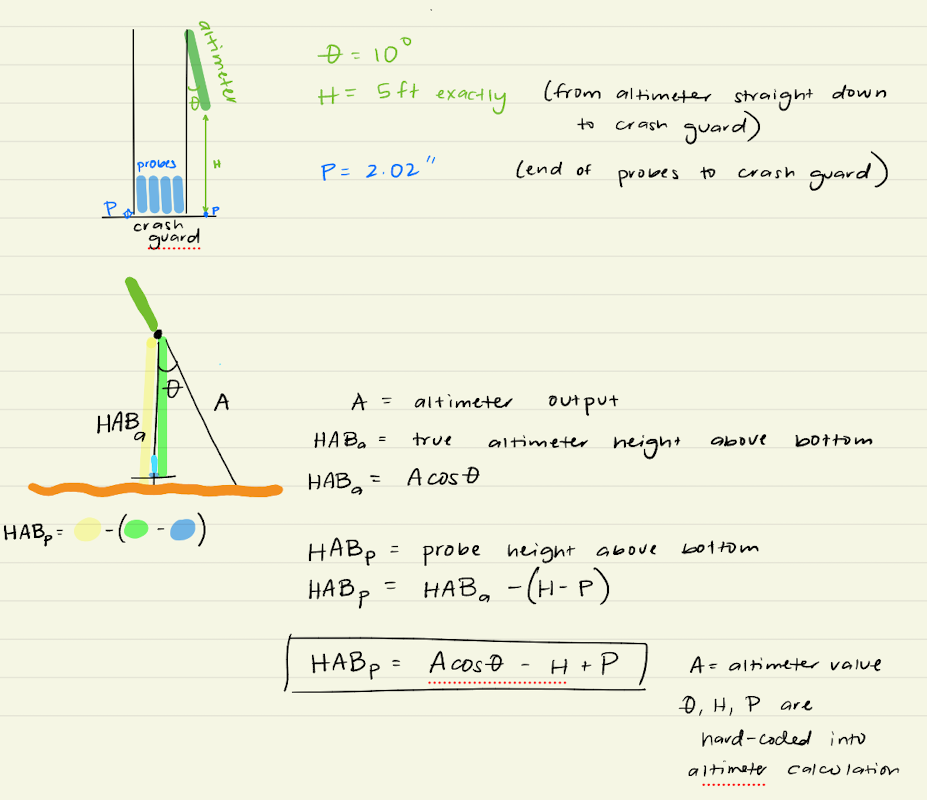

# L0 → L1: Converting raw counts to physical units

**Status:** working, tested against real deployment files. Second step of the `MOD_fish_lib` → `MOD_fish_processing` reorganization (see `PLAN.md` at the repo root). Built on branch `l0_to_l1_conversion`.

## What this step does

Takes an L0 `.mat` file (raw counts/hex, no calibrations - see [L0: converting .modraw to .mat](modraw_to_L0_conversion.md)) and converts it to physical units:

- **epsi** - already volts (thermistor/shear channels) or g (accelerometer channels) at L0, using the standard EFE board; L1 re-applies this deployment's setup.yml channel names/config from the exact counts (e.g. renames a repurposed `s2` to `c1`)
- **ctd** - raw hex → pressure [dbar], temperature [°C], conductivity [S/m], salinity [psu], plus derived potential temperature, potential density, `dP/dt`, depth, `dz/dt`
- **alt**, **isap** - raw distance → height above bottom (`hab`)
- **vnav** - attitude added: `tilt`, `spin`, `pitch`, `roll`, `yaw` [deg] (`mod_L1_add_vnav_attitude.m`, below), and the cable twist count as `data.twist`

Every other field (`gps`, `seg`, `spec`, `avgspec`, `dissrate`, `apf`, `fluor`, `ttv`, `ctd_cal`, `ctd_header_sn`, `ctd_cal_error`) passes through unchanged.

Doing this requires a deployment configuration - which physical sensor is on which AFE channel, what its full-scale voltage range is (the SBE calibration comes with each L0 file, `ctd_cal`) - so this is also where a `setup.yml` file first enters the pipeline (see PLAN.md Section 2 for the metadata design).

Explicitly **not** done at this step (still open - see PLAN.md Section 6.2 and Section 7):
- `MODsetup_read_yaml.m` looks up each shear probe's `Sv` into `metadata.AFE.(channel).cal`, but nothing yet *applies* it - shear channels stay as volts, not `1/s`. The physical-unit conversion (`Sv × volts / fall_speed`) needs a fall speed, normally `ctd.dzdt` - not resolved yet for deployments with no CTD
- FPO7 channels stay as volts here too, same as shear - the in-situ `volts_to_C` fit (`MODprocess_L1_apply_fpo7_calibration.m`, branch `chi_processing`) now exists and runs automatically at the end of `MODprocess_all_L0_to_L1.m` for deployments with a real onboard CTD, but it only *derives and stores* the calibration (`metadata.AFE.(channel).volts_to_C`) - it doesn't convert `epsi.(channel)_volt` itself. That conversion happens downstream, applied to spectra rather than the raw timeseries - see [FP07 calibration and chi](L2_calc_chi.md)
- No despiking
- No SOM instrument transfer function filters

## Functions

### `MODsetup_read_yaml.m`

```matlab
metadata = MODsetup_read_yaml(setup_yml)
```

Reads a deployment's `setup.yml` and returns a `metadata` struct:

| Field | Contents |
|---|---|
| `paths.data_root`, `.raw`, `.L0`, `.L1`, `.meta`, `.calibrations_root` | Derived fresh from `setup.yml`'s `data_root` field - **never saved to disk**, since paths are machine-specific |
| `fish_flag` | `'FCTD'` or `'EPSI'` - selects which `altimeter` geometry block in the yaml applies |
| `manifest.has_isap`, `.has_alt`, `.has_gps`, `.has_fluor` | Presence flags from `setup.yml`'s `instrument_manifest` block. `false` when the key is missing entirely, same as an explicit `false`. Not consumed by L0→L1 today (those fields just pass through from L0 unchanged) - a record of what's on the vehicle for later steps. There is no `has_vnav` (since 2026-10-17): twist is made whenever the raw files have VNAV |
| `PROCESS.latitude` | Used for `ctd.z` (depth from pressure) when a file has no GPS fix |
| `PROCESS.channels` | AFE sensor names in ADC slot order, e.g. `{'t1','t2','s1','s2','a1','a2','a3'}` - order comes from `instrument_manifest.afe.channel_N` keys, sorted numerically by `N` (not from yaml field order) |
| `AFE.(channel).full_range`, `.ADCconf` | Per channel, from `setup.yml`'s `afe.channels` detail block (keyed by sensor name) |
| `AFE.(channel).type` | From `setup.yml`'s `instrument_manifest.afe.channel_N.type` |
| `AFE.(channel).SN` | Only set when the manifest's `channel_N.sn` is present and non-empty |
| `AFE.(channel).cal` | Only set for `shear` type channels with an `SN` - `Sv`, the most recent row of `calibrations_root/SHEAR_PROBES/<SN>/Calibration_<SN>.txt`. `[]` if that file doesn't exist yet. **Not set at all for `fpo7`** - `dTdV`/`volts_to_C` isn't a fixed property of the probe you can look up; it's fit in-situ per deployment against real CTD temperature data. (This `MODsetup_read_yaml.m` step still can't answer it, same as ever - but see `AFE.(channel).volts_to_C` below, which now does, from a later step) |
| `AFE.(channel).volts_to_C` | **Not set by `MODsetup_read_yaml.m`** - fit by `MODprocess_L1_apply_fpo7_calibration.m` (`[slope, intercept]`, `polyfit(volts, T, 1)` against real CTD T, gated on real onboard CTD - branch `chi_processing`), saved to `meta/fpo7_calibration.mat` with the probe SN, and added to metadata by `MODsetup_add_derived_metadata.m` (only for a channel that's still fpo7 with the same SN). Listed here since it lives in the same `metadata.AFE.(channel)` struct as the fields above; see [FP07 calibration and chi](L2_calc_chi.md) |
| `CTD.name`, `.sample_per_record` | Only set when `setup.yml` has a `ctd:` block - deployments with no CTD don't need one |
| `CTD.SN` | Only set when `instrument_manifest.ctd.sn` is present and non-empty. No SBE calibration is read here: each L0 file carries its own (`ctd_cal` - the raw file's `$DCAL`, else `calibrations_root/SBE/<SN>.CAL`; see [SBE calibration](modraw_to_L0_conversion.md#sbe-calibration-dcal-else-the-cal-file)). `CTD.SN` is the last choice of SN for that `.CAL` file |
| `GEOMETRY.alt_angle_deg`, `.alt_dist_from_crashguard_ft`, `.alt_probe_dist_from_crashguard_in` | From `setup.yml`'s own `altimeter.fctd`/`altimeter.epsi` block matching `fish_flag` if it has one, otherwise from the shared `setup/platform_instrument_geometry.yml` table by `fish_flag` (and `vehicle_name` for EPSI). Table keys match ignoring case, and a numbered unit with no entry of its own uses its family's (`MAKO1` → `Mako`). Left unset if neither has an entry - deployments with no `alt`/`isap` hardware don't need one |

Also saves `metadata.mat` into `meta/` alongside `setup.yml` - a portable deployment record with `paths` stripped out, so it means the same thing on any machine. Re-derive `metadata.paths` by calling `MODsetup_read_yaml` again rather than trusting a stale `metadata.mat`.

Processing parameters (spectral, profile_detection, chi, epsilon, grid, `afe.sample_rate`, `ctd.sample_rate`/`compute_spectra`) are read by one loop over `MODsetup_metadata_field_registry.m`: each registry entry is copied from its `yaml_section.yaml_key` to its `metadata_path` when the yml declares it. A parameter added to the registry is read with no other change.

**Derived values** - not in the yml, but needed by later steps - are added by `MODsetup_add_derived_metadata.m`, which `MODprocess_all_L0_to_L1` and `MODprocess_all_L1_to_L2` both call at the start (and after rereading the yml): the AFE electronics filters (`MODsetup_define_filters.m`) and the FP07 `volts_to_C` fit from `meta/fpo7_calibration.mat`. So metadata straight from `MODsetup_read_yaml` works in any session. `meta/metadata.mat` is only a record: the next `MODsetup_read_yaml` call rewrites it without the fit.

Deliberately minimal: it only resolves the fields this L0→L1 step actually uses. It does not yet build the grouped `metadata.manifest.shear_channels`/`.fpo7_channels`-style lists from PLAN.md Section 5 - nothing downstream needs those yet. Add fields as later steps need them, not preemptively.

**`setup.yml`'s `instrument_manifest` block says what's physically on the vehicle at a glance; electrical/sampling specifics (full_range, ADCconf, sample_per_record, ...) live in separate detail sections further down, keyed by the same names the manifest declares.** An instrument entirely absent from `instrument_manifest` is treated as not on the deployment - nothing errors on a missing key, so `ctd`/`altimeter`/`isap`/`alt`/`gps` are all optional depending on what hardware the deployment actually carries. See `data_for_reorg/epsi_mako_w_fluor/25_0408_d03_mako1_canyonhead/meta/setup.yml` for a real example with a CTD, altimeter (`isap`), `vnav`, and a fluorometer:

```yaml
data_root: /path/to/deployment          # only path in the file - everything else derives from it
calibrations_root: /path/to/MOD_fish_calibrations

fish_flag: FCTD
latitude: 32.8

instrument_manifest:
  ctd:
    sn: '0674'
  afe:                                  # keyed by ADC slot - the order the SOM firmware samples in
    channel_1: {name: t1, type: fpo7}
    channel_2: {name: t2, type: fpo7}
    channel_3: {name: s1, type: shear}
    channel_4: {name: s2, type: shear}
    channel_5: {name: a1, type: acc}
    channel_6: {name: a2, type: acc}
    channel_7: {name: a3, type: acc}
  isap: true
  fluor: true
  # no alt or gps hardware on this deployment - keys omitted entirely

ctd:
  type: S49
  sample_per_record: 2

afe:
  channels:                              # electrical details, keyed by sensor name
    t1: {full_range: 2.5, ADCconf: Unipolar}
    t2: {full_range: 2.5, ADCconf: Unipolar}
    s1: {full_range: 2.5, ADCconf: Bipolar}
    s2: {full_range: 2.5, ADCconf: Bipolar}
    a1: {full_range: 1.8, ADCconf: Unipolar}
    a2: {full_range: 1.8, ADCconf: Unipolar}
    a3: {full_range: 1.8, ADCconf: Unipolar}

altimeter:
  fctd:
    angle_deg: 45
    dist_from_crashguard_ft: 4
    probe_dist_from_crashguard_in: 0
```

And `data_for_reorg/epsi_deepsolo/26_0520_ljc/meta/setup.yml` for a real example with **no** CTD or altimeter hardware - just epsi with shear/fpo7 probe calibration lookup and a `vnav`:

```yaml
data_root: /path/to/deployment
calibrations_root: /path/to/MOD_fish_calibrations

fish_flag: EPSI
latitude: 32.9

instrument_manifest:
  afe:
    channel_1: {name: t1, type: fpo7,  sn: 274}
    channel_2: {name: t2, type: fpo7,  sn: 311}
    channel_3: {name: s1, type: shear, sn: 261}
    channel_4: {name: s2, type: shear, sn: 421}
    channel_5: {name: a1, type: acc}
    channel_6: {name: a2, type: acc}
    channel_7: {name: a3, type: acc}
  # no ctd, isap, alt, or gps hardware on this deployment - keys omitted

afe:
  channels:
    t1: {full_range: 2.5, ADCconf: Unipolar}
    t2: {full_range: 2.5, ADCconf: Unipolar}
    s1: {full_range: 2.5, ADCconf: Bipolar}
    s2: {full_range: 2.5, ADCconf: Bipolar}
    a1: {full_range: 1.8, ADCconf: Unipolar}
    a2: {full_range: 1.8, ADCconf: Unipolar}
    a3: {full_range: 1.8, ADCconf: Unipolar}
```

`instrument_manifest.afe` is keyed by physical ADC slot (`channel_1`..`channel_7`), not by sensor name - that distinction matters because the raw stream only carries slot numbers. L0 names them with the standard EFE board's names (`MODsetup_default_efe.m`) unless given metadata; `MODsetup_read_yaml.m` is what resolves slot → this deployment's logical name (`t1`, `s1`, `c1`, ...), which L1 then applies (`mod_efe_conversion.m`). Slot order for `metadata.PROCESS.channels` comes from numerically sorting the `channel_N` keys, not from yaml field order - the old schema relied on yaml field order, which YAML libraries preserve but don't sort, so a `channel_10` would have sorted before `channel_2` under that approach the moment a deployment passed 9 channels. See PLAN.md Section 5 for the larger `metadata.manifest` idea this could still grow into (`shear_channels`/`fpo7_channels`-style grouped lists) once something actually needs to loop over "all shear channels" rather than check `metadata.AFE.(ch).type` one channel at a time - not built yet, since nothing consumes it.

MATLAB has no built-in YAML reader (checked in R2024b: no `yaml.*` namespace, `readstruct` only accepts `'json'`/`'xml'`/`'auto'` as `FileType`), so `MODsetup_read_yaml.m` uses the vendored third-party `toolbox/YAMLMatlab_0.4.3/` (MIT licensed).

### `MODprocess_single_L0_to_L1.m`

```matlab
data = MODprocess_single_L0_to_L1(L0_data, metadata)
```

Pure transformation - takes an L0 struct and a `metadata` struct, returns the same fields with `epsi`/`ctd`/`alt`/`isap` converted to physical units. No file I/O.

The three conversion steps (`apply_setup_efe`, `process_ctd_fields`, `calibrate_altimeter_hab`) live as **local subfunctions inside this file**, not as separate `modProcess_L1_apply_*.m` files - nothing calls them standalone today. Split one out the moment something else needs to call it directly. (`process_ctd_fields` was named `calibrate_ctd` until the DeepSolo work below - renamed because for SBE41/external-CTD sources it does no calibration at all, only derivation of secondary fields.)

Notes on the CTD conversion specifically:
- SBE49 "eng" format (raw hex counts) goes through the full SBE calibration polynomials (temperature, pressure, conductivity), then Practical Salinity via `gsw_SP_from_C`. The coefficients are the L0 file's `ctd_cal` (its `$DCAL`, else the `.CAL` file - see [SBE calibration](modraw_to_L0_conversion.md#sbe-calibration-dcal-else-the-cal-file)), and `ctd.cal_source` says which. `TOFFSET` (added to T), `CSLOPE` (times C) and `POFFSET` (added to P, dbar) from `$DCAL` are applied; they're 0, 1 and 0 on every SBE so far, and a `.CAL` file has none.
- SBE41 "PTS" format arrives from L0 already as ASCII-parsed P/T/SP (conductivity left `NaN`) - no calibration equations needed, only the derived fields below.
- External CTD (DeepSolo/Wirewalker - see below) arrives the same way as SBE41: already physical units, only needs the derived fields - **except DeepSolo's fallrise pressure file, which has no T/C at all** (see below).
- `dPdt`, `z` (depth), `dzdt` are computed unconditionally for all sources (they only need `P`, and `z` also needs latitude). `SR` (Reference Salinity), `CT` (Conservative Temperature), `sigma0` (potential density anomaly), and `SP` (Practical Salinity, if not already reported) are only computed **when both `T` and `C` are present** - `gsw_SR_from_SP`/`gsw_CT_from_t`/`gsw_sigma0`/`gsw_SP_from_C` genuinely can't run without them. DeepSolo's fallrise data (P-only) is the one case today that takes this branch and gets `dPdt`/`z`/`dzdt` but not `SP`/`SR`/`CT`/`sigma0` - this is expected, not a bug. See [Units and the sw_->gsw_ migration](../concepts/units_and_seawater.md) for why `SR` (not exact Absolute Salinity) is used throughout.
- Depth (`z`) needs a latitude: interpolated from `data.gps.latitude` if the file has GPS fixes, otherwise falls back to `metadata.PROCESS.latitude` from `setup.yml`. `gsw_z_from_p` returns height (negative down); `process_ctd_fields` negates it to keep this repo's positive-down `z`/`dzdt` convention.

Notes on the EFE channels (`apply_setup_efe`) specifically:
- Since 2026-09-29, L0 already holds EFE data in volts/g with channel names, converted with the standard EFE board config (or whatever metadata L0 was given) - see [EFE channels: volts/g at L0](modraw_to_L0_conversion.md#efe-channels-voltsg-at-l0). L1's job is only to re-apply **this deployment's setup.yml**: it recovers the exact integer counts from `L0_data.epsi_conversion` (`mod_efe_volts_g_to_counts.m`) and reconverts them with `metadata` (`mod_efe_counts_to_volts_g.m`). Counts round-trip exactly, so when nothing differs the result is bit-identical to L0.
- On a standard board the only thing that normally changes is the **name** of a repurposed slot - e.g. `instrument_manifest.afe.channel_4: {name: c1, type: microconductivity}` turns L0's `s2_volt` into L1's `c1_volt` (a console line says so). If setup.yml's `full_range`/`ADCconf` for a slot ever differ from what L0 used, the channel is reconverted from the counts with setup.yml's values and that is printed too.
- Any name/config setup.yml doesn't supply falls back to that slot's standard-board default (`mod_efe_conversion.m`), and `data.epsi_conversion` (carried to L1, updated) records which values came from where.
- **Older L0 files** that still hold raw counts in `epsi.channel1`..`channelN` are converted straight from those counts - same result.
- The conversion itself is linear (affine) per channel, `value = counts * scale + offset`:
  - **Unipolar**: `volt = FR/gain * count / 2^24`
  - **Bipolar**: `volt = FR/gain * (count/2^23 - 1)`
  - **Accelerometers** (`type: acc`, 1.8 V full range): `g = (volt - 0.9) / 0.4` (0.9 V at 0 g, 0.4 V/g sensitivity)

  `gain` (1), the accelerometer offset/sensitivity, and the standard board's slot table all live in `setup/MODsetup_default_efe.m`.
- There is no `_count` field in L1 (until 2026-08 there briefly was - `epsi.t1_count` etc. - but it was an unconsumed copy that doubled L1's size, so it was dropped). The counts are always recoverable from `epsi_conversion`.
- Shear (`type: shear`) and FPO7 (`type: fpo7`) channels stop at `_volt` - conversion to their real physical units (`1/s` for shear, `°C` for FPO7) isn't implemented yet (see "Explicitly not done at this step" above).

#### External CTD (DeepSolo, Wirewalker)

Some vehicles' CTD data never appears as `$SB49`/`$SB41` blocks in the `.modraw`/L0 stream at all - it comes from an independent file logged separately by the CTD instrument itself. `metadata.vehicle_name` (from `setup.yml`, e.g. `DeepSolo` or `Wirewalker`) is the flag that selects this path. When it matches and `metadata.paths.ctd` (`<survey>/ctd/` - `data_root/ctd/` for a hand-written setup.yml) exists on disk:

1. `MODprocess_all_L0_to_L1.m` calls `MODprocess_read_external_ctd.m` **once** per session (not per file) to read and normalize the whole deployment's CTD data into one struct.
2. For each L0 file, it slices that struct down to the file's own time range (by the min/max `dnum` found in the file's `epsi`/`vnav` data) and passes the chunk into `MODprocess_single_L0_to_L1` as a third, optional argument.
3. Inside `MODprocess_single_L0_to_L1`, that chunk becomes `data.ctd` (since the file's own `L0_data.ctd` is empty for these vehicles) and runs through the same derived-field path SBE41 uses.

If that `ctd/` folder doesn't exist yet, this is treated as "no CTD for this deployment yet," not an error - the rest of L0→L1 (epsi, vnav, ...) still runs normally.

**DeepSolo is implemented** (2026-07-26), against `ctd/DeepSoloFallrise.mat` - the float's own continuous pressure record through each dive/climb cycle (**not** the separate pressure-binned up/down CTD profiles DeepSolo also reports, which carry T/S but aren't time-aligned to the epsi timebase and aren't read here - see PLAN.md Section 4 for why). This file has **only `dnum`/`P`** - no T/C/S at all, which is why `process_ctd_fields` above has to tolerate a T/C-less `ctd` struct. **Wirewalker has no real parser implemented yet** - still no sample file available to build one against.

Whatever instrument produces the file, its reader must normalize into:

| Field | Units | Notes |
|---|---|---|
| `dnum` | MATLAB datenum | The master clock - `time_s` and everything else timing-related is derived from this in `process_ctd_fields`, not read from the file |
| `P` | dbar | Always present |
| `T` | °C (IPTS-68) | Optional - absent for DeepSolo's fallrise file |
| `C` | S/m | **not** mS/cm - `process_ctd_fields`'s `ctd.C*10` conversion requires S/m so that `*10` gives mS/cm for `gsw_SP_from_C`. Optional - absent for DeepSolo's fallrise file |
| `SP` | psu (PSS-78) | optional - derived from `C`/`T`/`P` via `gsw_SP_from_C` if not reported, but only when `T`/`C` are both present |

Sample rate varies by source and isn't enforced by the reader - chunking works off `dnum` spacing directly. DeepSolo's fallrise file is sparse and irregular (~60-120 s between samples, occasional multi-hour gaps - see [L1 → L2: direction-gated spectra](L1_to_L2_conversion.md) for how that sparsity is handled downstream).

`calibrate_altimeter_hab` uses the same `GEOMETRY` fields for both `alt` (the MOD altimeter) and `isap` (ISA500) - inherited as-is from the source function, which assumed the same mount geometry for both. Verified against real `isap` data and, as of `data_for_reorg/epsi_mako/blt2021_0715`, real `alt` data too.

#### Altimeter → probe height-above-bottom (`hab`) math



The altimeter sits above the crash guard, mounted at an angle from vertical (`GEOMETRY.alt_angle_deg`, θ). `GEOMETRY.alt_dist_from_crashguard_ft` (H) is the vertical distance straight down from the altimeter to the crash guard. The probes it's protecting extend down from the guard but are recessed above the guard's own bottom edge by `GEOMETRY.alt_probe_dist_from_crashguard_in` (P) - i.e. the probe tips sit *higher* than the very bottom of the guard by P.

Given the altimeter's raw slant-range reading (`alt.dst`/`isap.dst`, already in meters - call it `A`):

- True altimeter height above bottom: `HAB_a = A·cos θ`
- Crash guard's bottom edge is `H` below the altimeter, so its height above bottom is `HAB_a - H`
- The probe tips sit `P` above the guard's bottom edge, so **probe height above bottom**: `HAB_p = (HAB_a - H) + P = A·cos θ - H + P`

This is exactly what `calibrate_altimeter_hab` computes: `hab = dst.*cos(theta) - (feet2meters(H) - inches2meters(P))`, i.e. `dst*cos(theta) - H + P` once `H`/`P` are converted to meters. Confirmed against `blt2021_0715`'s real geometry (θ=10°, H=5 ft, P=2.02 in).

### `mod_L1_add_vnav_attitude.m`: tilt, spin, pitch, roll, yaw

```matlab
vnav = mod_L1_add_vnav_attitude(vnav)
```

Called automatically inside `MODprocess_single_L0_to_L1.m`, just before the twist count, whenever
`data.vnav` is present and non-empty. It works out which way the fish points from the
accelerometer (up) and magnetometer (magnetic north), for `$VNMAR` data; for `$VNYPR` data it keeps
the sensor's own yaw/pitch/roll and works out tilt and spin from them. Adds `vnav.tilt` and
`vnav.spin` and fills `vnav.pitch`, `vnav.roll`, `vnav.yaw` (all degrees). What each one means,
with diagrams, and when to trust them: [Which way the fish points](../concepts/vehicle_attitude.md).
`spin / 360` is an independent (magnetometer) check on `twist.count_gyro`.

### `mod_L1_add_twist.m` and cable twist counting

```matlab
data = mod_L1_add_twist(data)
```

Called automatically inside `MODprocess_single_L0_to_L1.m` (after `process_ctd_fields`, so it has calibrated pressure to interpolate) whenever `data.vnav` is present and non-empty - a no-op (with a warning) otherwise, so deployments without a VecNav just don't get a `twist` field.

The physical problem: the instrument cable twists as it profiles. On the FastCTD a fin can be adjusted to counteract this, but the operator needs the current twist count **during** the deployment to know when and how much to adjust it. Epsi rarely twists much on its own - the cable twisting mostly comes from FastCTD - but a cruise often switches between both instruments on the same winch cable, so the twist count is tracked per file and per deployment regardless of vehicle type: whenever the raw files have VNAV data (not gated on `fish_flag` or the yml).

Algorithm (ported from `MOD_fish_lib/FastCTD_MATLAB/GV_PlotUpAccumulation.m`):

1. Drop bad vnav samples (NaN/Inf/non-monotonic `dnum`).
2. Interpolate CTD pressure onto the vnav timebase (`interp1(ctd.dnum, ctd.P, vnav.dnum)`) - `NaN` if there's no CTD on this deployment. Used downstream to mark upcast/downcast on the twist plot.
3. For each sample, rotate the compass and gyro vectors into the gravity-aligned z-axis frame using `SN_RotateToZAxis` (a local subfunction inside `mod_L1_add_twist.m`, written by San Nguyen - finds the Euler rotation that takes the local acceleration vector to `[0 0 |a|]`). Not split into its own file since nothing else calls it.
4. **Compass method (cross-check):** normalize the rotated horizontal compass components to a unit vector, `unwrap(angle(...))` gives the instantaneous heading in radians.
5. **Gyro method (primary):** cumulative sum of the rotated z-axis gyro rate × `dt`, divided by `2*pi` to convert radians to full rotations - the unit operators actually count fin/spool adjustments against.

`data.twist` fields: `time_s`, `dnum`, `pressure` [dbar], `count_gyro` [full rotations, primary], `count_compass` [radians, cross-check]. Count starts from ~0 for each file - `MODprocess_L1_accumulate_twist_timeseries.m` (below) handles cross-file chaining, so reprocessing one file never corrupts the accumulated deployment timeseries.

### `MODprocess_L1_accumulate_twist_timeseries.m`

```matlab
TwistTimeseries = MODprocess_L1_accumulate_twist_timeseries(L1_cache, meta_dir)
```

Called automatically at the end of `MODprocess_all_L0_to_L1.m`, whenever any L1 file has twist (its raw file had VNAV data; the yml isn't asked) - re-chains every L1 file's per-file `twist` field into one continuous, non-resetting rotation count for the whole deployment, sorted by file start time (each file's own count restarts at 0, so this offsets each by the running cumulative total from all prior files). Saves `meta/twist_time_series.mat`.

No spool-swap resets here (since 2026-10-17): the count starts from 0 at the survey start and just keeps going. There is one winch spool for every vehicle and one spool log per cruise, `Processed/spool_swap_log.csv`, so resets are applied only in the cruise twist count, `MODprocess_cruise_twist.m` ([Processing data](processing_data.md#stages) stage 5), which joins every on-spool survey's file into `Processed/twist/twist_time_series.mat`. A survey's own `meta/spool_swap_log.csv` (or legacy `SpoolSwapLog.csv`) is no longer read.

The per-file `twist` fields come from the L1 file cache (see the next section), not from loading every L1 file.

### `MODvis_twist_timeseries.m`

```matlab
ax = MODvis_twist_timeseries(TwistTimeseries, ax)
```

Plots `count_gyro` vs. time, highlighting upcast samples (`diff(pressure) < 0`). Given the cruise twist count (`Processed/twist/twist_time_series.mat`), it also marks each spool change (dashed, with the spool's name) and each survey start (dotted, with its name); the line is broken at gaps. "Neutral is Negative" - setting the fin to neutral makes the count go down. The realtime monitor's twist panel uses it; run it by hand on either file (`load(f).TwistTimeseries`).

### `MODprocess_L1_make_pressure_timeseries.m` and `mod_L1_detect_profiling_direction.m`

```matlab
L1_cache = MODprocess_L1_update_file_cache(L1_dir, metadata.paths.L1_meta);
PressureTimeseries = MODprocess_L1_make_pressure_timeseries(L1_cache);
PressureTimeseries = mod_L1_detect_profiling_direction(PressureTimeseries, metadata);
```

`meta/time_index.mat`, `meta/pressure_time_series.mat`, `meta/twist_time_series.mat` and `meta/gps_time_series.mat` (in a processing run's `processed/<run>/meta/`, next to the L1 they come from - see [Processing data](processing_data.md#processing-runs)) are all built from `meta/l1_file_cache.mat` (`MODprocess_L1_update_file_cache.m`), which keeps each L1 file's time span, `ctd.dnum`/`ctd.P`, `twist` and GPS fixes and reloads only L1 files that are new or changed - so these deployment-wide files don't reload every L1 file on every realtime pass. Results are identical to building them from every L1 file (checked against the previous code on a `blt2021_0715` sandbox, cold and warm cache). L1 files themselves are never changed.

Called automatically at the end of `MODprocess_all_L0_to_L1.m` (right after the twist accumulation step), whenever this deployment has any CTD data - builds `meta/pressure_time_series.mat`, the deployment-length pressure record with a smoothed `dPdt` and an `is_down` (descending) classification per sample. This is deliberately an L1-level product, not an L2 one - see [L1 → L2: direction-gated spectra](L1_to_L2_conversion.md) for the full writeup of the classification algorithm and why it lives here rather than in L2.

### `MODprocess_all_L0_to_L1.m`

```matlab
L1_files = MODprocess_all_L0_to_L1(L0_dir, metadata, L1_dir, reprocess_all)
[L1_files, problems, processed] = MODprocess_all_L0_to_L1(..., 'newest_min_redo_s', 120, 'continue_on_error', true, 'fpo7_refit_new_files', 10)
```

Orchestrator: loops over every `.mat` file in `L0_dir`, calls `MODprocess_single_L0_to_L1` on each, saves one `.mat` per L0 file into `L1_dir`. `L1_dir` is optional - defaults to a sibling `L1/` folder next to `L0_dir` (created if it doesn't exist). `metadata` should be read once per session with `MODsetup_read_yaml` and passed in, not re-read per file.

Skips a file if its L1 `.mat` already exists and is newer than the L0 file it came from - except the most recently modified L0 file, which is always reprocessed (mirrors `MODprocess_all_modraw_to_L0.m`'s same rule one level up, in case the raw file behind it was still being written when L0 last ran). Pass `reprocess_all = true` to force every file to redo regardless.

Options for realtime use (the worker, `MODprocess_deployment.m`, sets them; the defaults keep the behaviour above):

- `'newest_min_redo_s'` (default 0) - above 0, the newest file is redone only when it's out of date, and at most once per that many seconds (`MODutil_needs_redo.m`, shared by all three per-file drivers), so a growing raw file isn't redone - with everything after it - on every pass.
- `'continue_on_error'` (default false) - true: a file that fails is returned in `problems` (`.file`, `.stage`, `.identifier`, `.message`) and the next file is done; `processed` lists the files (re)done.
- `'fpo7_refit_new_files'` (default 0, refit every call) - N: refit the FP07 calibration only once N more L1 files exist than at the last fit (the fit reads every L1 file). `meta/fpo7_calibration.mat` records `n_L1_files`.

Also where the external-CTD read-once-and-slice-per-file logic lives (`slice_external_ctd`, a local subfunction) - see "External CTD (DeepSolo, Wirewalker)" above.

At the end of every call, also calls `MODprocess_L1_accumulate_twist_timeseries` (it writes nothing when no L1 file has twist) once to re-chain every L1 file's twist field into `meta/twist_time_series.mat` - see "`MODprocess_L1_accumulate_twist_timeseries.m`" above. Cheap (just concatenates fields already computed per-file), so this keeps the deployment-level twist count always current without a separate manual step.

Also, if any L1 file has CTD pressure (the data decide, not the yml), calls `MODprocess_L1_make_pressure_timeseries` + `mod_L1_detect_profiling_direction` once to build/update `meta/pressure_time_series.mat` - see "`MODprocess_L1_make_pressure_timeseries.m` and `mod_L1_detect_profiling_direction.m`" above.

**Update (branch `chi_processing`):** if that CTD is the *onboard* one (SBE49 or SBE41; no external-CTD file - stricter than the "any CTD data" check above, since that also covers DeepSolo's P-only external CTD; until 2026-10-18 this was `metadata.CTD.cal` non-empty), also calls `MODprocess_L1_apply_fpo7_calibration.m` right after `PressureTimeseries` is built, and saves the result (`metadata.AFE.(channel).volts_to_C`, with each probe's SN) to `meta/fpo7_calibration.mat` - also recorded in `meta/metadata.mat` via `MODsetup_save_metadata.m` - see [FP07 calibration and chi](L2_calc_chi.md).

If a needed parameter is missing and the operator saves the prompted value to the yml (`MODsetup_validate_metadata:yamlUpdated`), this function rereads the yml and retries, the same way `MODprocess_all_L1_to_L2` does. Run unattended (`matlab -batch`) it can't prompt, so check the yml first with `MODsetup_preflight` (see [Processing data](processing_data.md#metadata)).

## How to run it

```matlab
addpath('/path/to/MOD_fish_processing/processing');
addpath('/path/to/MOD_fish_processing/setup');
addpath('/path/to/MOD_fish_processing/util');      % for MODutil_short_path
addpath('/path/to/MOD_fish_processing/toolbox');   % YAMLMatlab_0.4.3, seawater

metadata = MODsetup_read_yaml('/path/to/deployment/meta/setup.yml');

% L0 must already exist - see L0_modraw_conversion.md
L1_files = MODprocess_all_L0_to_L1(metadata.paths.L0, metadata, metadata.paths.L1);
```

To process a single file directly:

```matlab
L0_data = load('/path/to/deployment/L0/EPSI25_04_08_150323.mat');
data = MODprocess_single_L0_to_L1(L0_data, metadata);
figure; plot(data.ctd.dnum, data.ctd.T);      % calibrated temperature
figure; plot(data.epsi.time_s, data.epsi.s1_volt);  % shear channel, volts
```

## Known limitations / things to check

- **The `alt.hab` path** is now verified against real data (`data_for_reorg/epsi_mako/blt2021_0715`) in addition to `isap` - both produce physically plausible `hab` values using the same math (see "Altimeter → probe height-above-bottom (`hab`) math" above).
- **`isap.dst` pegs at a flat maximum value (120, in the one deployment tested) when the target is out of range** - not a bug, but don't mistake a flatlined `isap.hab` for a real constant range to bottom.
- **Depth/salinity near zero at the start of a deployment is expected, not a bug.** The first raw file of a cast is often recorded on deck with the CTD in air - conductivity ≈ 0 gives salinity ≈ 0 via `gsw_SP_from_C`, and pressure ≈ 0 gives depth ≈ 0. This resolves once the instrument is in the water.

## History

**2026-10-18 - GPS track** (branch `main-fork`). `MODprocess_all_L0_to_L1.m` writes
`meta/gps_time_series.mat` (`dnum`, `latitude`, `longitude`; sorted, each time once) whenever an
L1 file has GPS fixes, from the L1 file cache (`MODprocess_L1_make_gps_timeseries.m`), for the
realtime monitor's map. The cache now keeps each file's fixes; a cache from before is rebuilt
once (every L1 file reread on the first pass).

**2026-10-18 - SBE calibration from `$DCAL`** (branch `main-fork`). `MODsetup_read_yaml.m` no
longer reads `SBE/<SN>.CAL` (`metadata.CTD.cal` is gone); `process_ctd_fields` uses the L0 file's
`ctd_cal` (the raw file's `$DCAL`, else the `.CAL` file) and applies `$DCAL`'s TOFFSET, CSLOPE and
POFFSET. The pressure time series and the FP07 refit are gated on the L1 data instead of
`metadata.CTD.cal`. See [SBE calibration](modraw_to_L0_conversion.md#sbe-calibration-dcal-else-the-cal-file)
for the rules and tests.

**2026-10-17 (evening) - VectorNav attitude at L1** (branch `main-fork`). New
`mod_L1_add_vnav_attitude.m` adds `vnav.tilt`, `vnav.spin` and fills `vnav.pitch`/`roll`/`yaw`
(NaN at L0 for `$VNMAR`), from the accelerometer and magnetometer. See
[Which way the fish points](../concepts/vehicle_attitude.md) for the definitions and tests. L1 files
made before this have none of it until reprocessed; `MODvis_vnav_attitude.m` computes it on the fly
for them.

**2026-10-17 (later) - Twist from the data; VNAV parse fix** (branch `main-fork`). The survey
twist file is made whenever any L1 file has twist, not when the yml says `has_vnav` (removed).
`MODprocess_single_modraw_to_L0.m` took each VNAV block's length with a loop counter left over
from an earlier block type, so a file with fewer VNAV messages than that count lost all its VNAV
("VNAV chokes"); it's taken per block now, and a VNAV read failure says why. Checked: the
ocean-test file gives the same vnav as the share's L0; a file cut to 10 VNAV messages lost them
with the old code and keeps them now.

**2026-10-17 - Survey twist no longer resets at spool changes** (branch `main-fork`).
`MODprocess_L1_accumulate_twist_timeseries(L1_cache, meta_dir)` drops its third argument and
its `meta/spool_swap_log.csv` reading: there is one spool log per cruise, and resets are applied
in the new cruise twist count, `MODprocess_cruise_twist.m`. `twist_time_series.mat` is now saved
atomically (the cruise count and the monitor read it while the worker writes it).
`MODvis_twist_timeseries.m` marks spool changes and survey starts and works in the monitor's
axes.

**2026-10-15 - Runs layout; repeated times across L1 files** (branch `main-fork`). L1 is written to `processed/<run>/L1/` and the files built from it to that run's `meta/` (`metadata.paths.L1`/`.L1_meta`, from where the run yml is - see [Processing data](processing_data.md)). Found while testing the simulator: when two L1 files hold the same times (a raw file copied under another name, or a damaged file whose readable part is a copy of another file's start), the deployment pressure record and the FP07 fit's concatenated epsi/CTD records had repeated, out-of-order times, and `interp1` stopped the FP07 refit and every L2 file ("Sample points must be unique"). `MODprocess_L1_make_pressure_timeseries.m` and `MODprocess_L1_apply_fpo7_calibration.m` now sort by time and keep each time once (the earlier file's sample), and the first prints how many samples it left out. Tested on the canyonhead simulator files with a damaged copy: 60 repeated samples left out, the one-off pass gives 5 L2 files, 10 casts and no problems, and the cast table equals the one from the worker's folder.

**2026-10-14 (later) - Derived metadata survives rereads; registry-driven parameter reading; prompt retry in L0 → L1** (branch `main-fork`). Found while building `MODsetup_preflight`: `MODsetup_read_yaml` builds metadata from the yml alone, so metadata read in a new session (or reread after a prompted value was saved) had no electronics filters and no FP07 `volts_to_C`, and FP07 chi was skipped without an error. New `MODsetup_add_derived_metadata.m` adds both (filters recomputed, fit loaded from the new `meta/fpo7_calibration.mat`, written here after each fit). `MODsetup_read_yaml`'s hand-written parameter lists became one registry loop (`grid.dz_m` was never read before). Added the `yamlUpdated` retry around `mod_L1_detect_profiling_direction`. Tested in a scratchpad sandbox: metadata from the three real `data_for_reorg` setup.yml files identical before/after the registry loop; modraw → L0 → L1 → L2 on three `blt2021_0715` files from a `depl_meta_data.yml` under `-batch` with metadata reread fresh for L1 → L2 - FP07 chi and epsilon computed; a deleted `buffer_bins` prompted at the console, was saved, and L0 → L1 finished.

**2026-10-14 - Altimeter geometry lookup ignores case and falls back to the vehicle family** (branch `main-fork`). [Start New Deployment](start_new_deployment.md) writes the unit as `vehicle_name` (`MAKO1`), but the shared table holds the EPSI geometry under `Mako`, so L0 → L1 stopped in `calibrate_altimeter_hab` on every Mako deployment it set up. `lookup_altimeter_geometry` (in `MODsetup_read_yaml.m`) now matches `fish_flag` and `vehicle_name` keys ignoring case and, if there's no entry for the unit, tries it with its trailing digits removed. Tested in a scratchpad sandbox: `MAKO1`/`mako1`/`Mako`/`MAKO`/`mako12` all get the Mako geometry, FCTD units get the FCTD one, `Minnow` stays unset; three `blt2021_0715` raw files through modraw → L0 → L1 with a Start New Deployment `dev1_setup.yml` give `alt.hab` identical to the existing L1.

**2026-09-29 - EFE counts → volts/g moved to L0** (branch `main-fork`). L0 now converts EFE data with the standard board config (`MODsetup_default_efe.m`) and saves `epsi_conversion`, so spectra can be checked straight from L0 without a setup.yml (`MODvis_spectra_L0.m`). `convert_efe_channels` is replaced by `apply_setup_efe`, which recovers the exact counts from `epsi_conversion` and reconverts with setup.yml (only a rename, on a standard board). Older L0 files with raw `channel1..N` counts still work. The counts ↔ volts/g math now lives in `mod_efe_conversion.m`/`mod_efe_counts_to_volts_g.m`/`mod_efe_volts_g_to_counts.m`. Verified in scratchpad sandbox copies of `blt2021_0715` and `epsi_deepsolo/26_0720_ljc`: new L1 epsi equals the existing L1 exactly for volts and to within 4e-16 g for accelerometers; the old-format-L0 path gives identical output; relabeling slot 4 as `c1` in metadata gives `c1_volt` at L1 from a default L0, and at L0 directly when metadata is passed there.

**2026-09-08 - Migrated CTD field derivation from the legacy CSIRO `sw_*` (EOS-80) toolbox to GSW/TEOS-10** (branch `epsilon_processing`). `sw_salt`/`sw_ptmp`/`sw_pden`/`sw_dpth` replaced with `gsw_SP_from_C`/`gsw_CT_from_t`/`gsw_sigma0`/`gsw_z_from_p`; `ctd.S`/`.th`/`.sgth` renamed `ctd.SP`/`.CT`/`.sigma0` to match (Practical Salinity, Conservative Temperature, potential density anomaly - their TEOS-10-idiomatic names), and a new `ctd.SR` (Reference Salinity, `gsw_SR_from_SP(ctd.SP)`) persisted for every downstream GSW call that needs it. `gsw_z_from_p` returns height (negative down); `process_ctd_fields` negates it to keep `z`/`dzdt`'s existing positive-down convention. See [Units and the sw_->gsw_ migration](../concepts/units_and_seawater.md) for the full rationale, including why Reference Salinity (not exact Absolute Salinity) is used throughout.

Ported from `mod_som_read_epsi_files_v4.m` in the old `MOD_fish_lib` monolith - specifically the physical-conversion half of that function (the raw-parsing half became `MODprocess_single_modraw_to_L0.m` in the L0 step). Built on branch `l0_to_l1_conversion`:

- Added `MODsetup_read_yaml.m` as the first piece of yaml-driven `metadata`, per PLAN.md Section 2 - deliberately scoped to only what this step needs, growing incrementally rather than building the full metadata schema up front.
- Vendored `YAMLMatlab_0.4.3` (no built-in MATLAB YAML reader) and the CSIRO `seawater` toolbox (for `sw_salt`/`sw_ptmp`/`sw_pden`/`sw_dpth`) into `toolbox/`.
- Fixed a latent bug found in `MODprocess_single_modraw_to_L0.m` while porting the altimeter logic: it called `orderfields(alt, {..., 'hab'})` but never set `alt.hab` - `hab` needs instrument geometry that L0 deliberately doesn't have. Would have thrown a hard error on any deployment with `alt` data; none of the four `data_for_reorg` deployments tested so far have any, so it was never hit until now. `hab` is now correctly computed here instead, for both `alt` and `isap`.
- Renamed `MODprocess_new_modraw_to_L0.m` → `MODprocess_all_modraw_to_L0.m` so the L0 and L1 batch orchestrators share the same `MODprocess_all_*` naming pattern.
- Tested against all 96 files of `epsi_mako_w_fluor/25_0408_d03_mako1_canyonhead` - see `SESSION_LOG.md` (2026-07-09) for full results.
- **Cable twist counting added** (2026-07-24, PLAN.md Section 7 - Ana's project): `mod_L1_add_twist.m`, `MODprocess_L1_accumulate_twist_timeseries.m`, `MODvis_twist_timeseries.m`, ported from `MOD_fish_lib/FastCTD_MATLAB/GV_PlotUpAccumulation.m`. `SN_RotateToZAxis` (written by San Nguyen, MOD) is folded in as a local subfunction of `mod_L1_add_twist.m` rather than a separate/vendored file, since it's only called there. Wired into the pipeline automatically (per-file inside `MODprocess_single_L0_to_L1.m`, per-deployment at the end of `MODprocess_all_L0_to_L1.m`). Tested against all 96 files of `epsi_mako_w_fluor/25_0408_d03_mako1_canyonhead` - see `SESSION_LOG.md` (2026-07-24) for full results.
- **DeepSolo external CTD reader implemented, `calibrate_ctd` renamed to `process_ctd_fields`, `PressureTimeseries.mat`/profiling-direction detection added** (2026-07-26, branch `l1_to_l2_conversion` - prerequisite work for [L1 → L2: direction-gated spectra](L1_to_L2_conversion.md)): `ctd/DeepSoloFallrise.mat` (a sparse, P-only pressure record) appeared in `epsi_deepsolo/26_0520_ljc`'s data folder, so `MODprocess_read_external_ctd.m` got a real DeepSolo branch instead of erroring unconditionally. Since that file has no T/C, the CTD subfunction inside `MODprocess_single_L0_to_L1.m` (renamed `calibrate_ctd` → `process_ctd_fields` - see above) now guards its S/th/sgth derivation behind `isfield(ctd,'T') && isfield(ctd,'C')` rather than assuming they're always present. Also added `MODprocess_L1_make_pressure_timeseries.m`/`mod_L1_detect_profiling_direction.m`, called at the end of `MODprocess_all_L0_to_L1.m`. Tested end-to-end against a sandbox copy of `epsi_deepsolo/26_0520_ljc` (45 files, `reprocess_all=true`): `ctd.P`/`dPdt`/`z` now populated (T/C/S/th/sgth correctly absent), `meta/PressureTimeseries.mat` built with 757 samples classified 30.1% `is_down` - see `SESSION_LOG.md` (2026-07-26) for full numbers.
- **FP07 in-situ `volts_to_C` calibration added** (2026-07-27, branch `chi_processing` - prerequisite for [FP07 calibration and chi](L2_calc_chi.md)): `MODprocess_L1_apply_fpo7_calibration.m`, called at the end of `MODprocess_all_L0_to_L1.m` whenever `metadata.CTD.cal` is non-empty (a real onboard CTD, not DeepSolo's external one). Tested against a sandbox copy of `epsi_mako/blt2021_0715` - see `SESSION_LOG.md` (2026-07-27) for full numbers.
