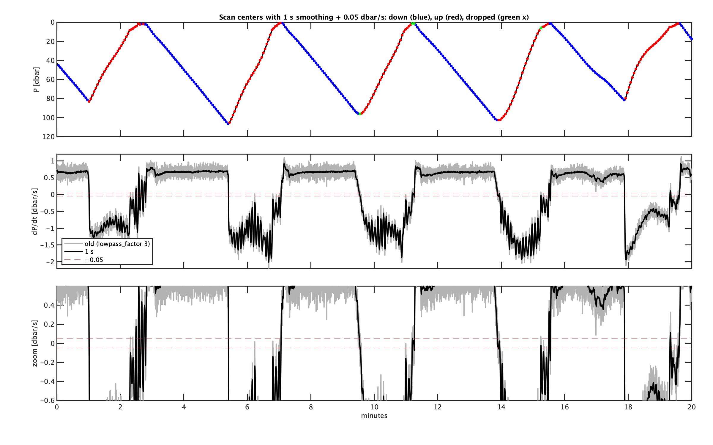

# L1 → L2: direction-gated spectra

**Status:** working, tested against real DeepSolo deployment files. Built on branch `l1_to_l2_conversion`, following [L0 → L1: converting raw counts to physical units](L0_to_L1_conversion.md).

## What this step does, and why it's different from the old approach

The old `mod_fish_lib` L1→L2 step first splits a deployment into discrete `Profile####.mat` casts, then computes spectra on a pressure grid *within* each profile (`get_scan_spectra.m`). This step deliberately does something different for `epsi_deepsolo`: it computes per-scan spectra across an entire L1 file's continuous timeseries, keeping the same one-`.mat`-per-L1-file layout L0 and L1 already use. Scans tile each L1 file's `epsi` timeseries independently - this is "realtime" mode, processing each file as it lands with no cross-file I/O. A "post-processing" mode (either a continuous whole-deployment time grid, or working profile-by-profile off real profile indices once `modProcess_detect_profiles.m`, PLAN.md Section 6.3, exists) is future work - not attempted here. The small coverage gap at each file boundary (a partial window that doesn't reach a full scan length gets dropped, not padded from the next file) is an accepted, documented cost of realtime mode.

**Why DeepSolo needs this at all:** DeepSolo gives us shear and high-resolution temperature only on the way down. It also gives us two CTD products, neither directly usable yet for time-aligning spectra:
- Pressure-binned up/down CTD profiles (P/T/S) - not time-aligned with the epsi/shear timebase, alignment not solved yet.
- A sparse, **time**-binned pressure-only series ("fallrise" data, `ctd/DeepSoloFallrise.mat`) - dense-ish on the way up (~60 s), sparser on the way down (~120 s), occasional multi-hour gaps. This is the only thing available to gate scans by direction, so it's what this step uses.

**Spectra are computed only for scans in the direction(s) `profile_detection.profile_dir` trusts** - `down` (`dPdt_smoothed > speedLim_scan_m_s` at the scan's center), `up` (`dPdt_smoothed < -speedLim_scan_m_s`) or `both`. Start New Deployment's `profiling_direction` sets `profile_dir`; `speedLim_scan_m_s` (default 0.05 dbar/s) is in the cruise yml. A scan slower than that (the surface, turnarounds), in a gap in the pressure record (between two samples more than `ctd_gap_factor` median intervals apart), or outside the record is dropped. This is a rough "going down or up" for realtime processing; the cast table ([Profile detection](profile_detection.md)) has its own speed limits.

This first cut computes **raw, uncorrected power spectra only** - no epsilon, no coherence. Epsilon is a natural next step (shear `Sv` calibration is already resolved in `metadata.AFE`), but is deliberately deferred to keep this step reviewable on its own. Chi was blocked for the same reason `MODprocess_L2_get_scan_spectra.m` below still returns uncorrected spectra: FPO7 `dTdV`/`volts_to_C` needs real, time-aligned CTD temperature to fit in-situ, which DeepSolo's fallrise file doesn't have. **Update (branch `chi_processing`):** for deployments that *do* have a real onboard CTD (e.g. `epsi_mako`), chi is now implemented - see [FP07 calibration and chi](L2_calc_chi.md). `MODprocess_L2_get_scan_spectra.m` itself is unchanged (still raw/uncorrected); the FP07 time-constant deconvolution happens downstream, in `MODprocess_L2_calc_chi.m`. DeepSolo specifically remains blocked, since it still has no CTD T.

## Profiling-direction detection is an L1 concern, not L2

`ctd.P`/`dPdt` are computed in L1 already (`process_ctd_fields`, see [L0 → L1](L0_to_L1_conversion.md)). Classifying up/down from that pressure record is naturally an L1-level derived product too - not something L2 computes for itself. This mirrors the cable-twist-counting pattern (`mod_L1_add_twist.m` computes a per-file field; `MODprocess_L1_accumulate_twist_timeseries.m` chains all files into a deployment-level `meta/twist_time_series.mat`): two functions, called once per deployment from the end of `MODprocess_all_L0_to_L1.m`, build `meta/pressure_time_series.mat`.

This also directly answers "can I process a single L1 file to L2 on its own?" - **yes**, because all the direction information a single L1 file needs already lives in a small, cheap `meta/pressure_time_series.mat`, rather than something L2 has to compute from the whole deployment on the fly.

### `MODprocess_L1_make_pressure_timeseries.m`

```matlab
PressureTimeseries = MODprocess_L1_make_pressure_timeseries(L1_cache)
```

Concatenates every L1 file's `ctd.dnum`/`ctd.P`, sorted by file start time, built from `meta/l1_file_cache.mat` (`MODprocess_L1_update_file_cache.m`), which keeps each L1 file's time span, `ctd.dnum`/`ctd.P` and `twist` and reloads only L1 files that are new or changed - so these deployment-wide files don't reload every L1 file on every realtime pass. Pure - no metadata needed, no file writing. This is the deployment-length pressure record PLAN.md Section 6.3 originally sketched as `modProcess_make_pressure_timeseries.m`.

### `mod_L1_detect_profiling_direction.m`

```matlab
PressureTimeseries = mod_L1_detect_profiling_direction(PressureTimeseries, metadata)
```

Adds `dPdt_smoothed` and a logical `is_down` (descending) to every sample. `mod_L2_tile_scans.m` decides scan direction from `dPdt_smoothed`; `is_down` is used by the FP07 fit ([FP07 calibration and chi](L2_calc_chi.md)). Four steps, in order:

1. **Gap detection first, before any smoothing.** A gap between consecutive samples wider than `metadata.PROFILES.ctd_gap_factor × (whole-record median sample interval)` (default `ctd_gap_factor = 5`) splits the record into independent segments - real DeepSolo data has at least one ~9982 s (2.77 h) gap against a ~60-120 s median, and diffing or filtering straight across it would produce a "dPdt" that isn't a real velocity. The two samples flanking any such gap are always excluded (`is_down = false`), since there's no reliable local rate at the gap edge.

2. **Cheby2 lowpass + `filtfilt`**, per gap-free segment, with a cutoff period of `metadata.PROFILES.lowpass_sec` seconds (default 1) - same shape as the old `MOD_fish_lib` profile-picker (`epsiProcess_get_profiles_from_PressureTimeseries.m`, which used 4 s). The sample rate sets how many samples that is (16 at 16 Hz). If `lowpass_sec` is two samples or less (e.g. DeepSolo's fallrise data, 60-120 s/sample), there's nothing to filter and the pressure is used as it is. Segments too short for `filtfilt`'s edge-padding requirement (fewer than ~13 samples) also use the raw pressure.

   Until 2026-10-16 the cutoff was `lowpass_factor × (median sample interval)`, default 3 samples. That was chosen for DeepSolo's sparse pressure and barely smoothed 16 Hz CTD pressure, so `dPdt_smoothed` flickered in sign near the surface and at turnarounds.

3. `dPdt_smoothed` is computed at segment midpoints from the lowpass-filtered pressure, then linearly interpolated back onto the original per-sample grid (same shape as the old profile-picker's approach) - one value per input sample.

4. **Buffer, on the raw pressure-sample grid, not the epsi scan grid.** Contiguous runs where `dPdt_smoothed > 0` get padded by `metadata.PROFILES.buffer_bins` pressure *samples* (default `1`) on each end before finalizing `is_down`, within each gap-free segment only (never dilating across a gap into an unrelated stretch of the deployment). "A few bins around" is read as bins of the coarse pressure series (60-120 s each) - padding by epsi-scan-sized bins (~3 s) would be far too small relative to the actual timing uncertainty near a turnaround.

The yml's `profile_detection:` block controls all three parameters (see below); namespaced under `metadata.PROFILES` to match the old `Meta_Data.PROFILES.*` convention, so a future full profile-picker port can extend the same section.

### Diagnostic: does the classification look right?

Real output, `epsi_deepsolo/26_0520_ljc` (sandbox test run, 2026-07-26): pressure sawtooths between the surface and ~250-420 dbar, with `is_down` landing cleanly on each steep descending leg and `dPdt_smoothed` crossing zero right at each turnaround - `P`, `dPdt_smoothed`, and `is_down` all visually consistent across the whole 757-sample deployment record (30.1% classified `is_down`). Worth re-plotting (`plot(PressureTimeseries.dnum, PressureTimeseries.P)`, overlay `is_down` as a scatter) any time `lowpass_sec`/`ctd_gap_factor`/`buffer_bins` change or a new deployment's fallrise data looks different in character.

### Diagnostic: scan direction on 16 Hz CTD pressure



20 minutes of `epsi_mako_w_fluor/25_0408_d03_mako1_canyonhead` (sandbox copy, 2026-10-16). Top: pressure, with each scan center (6.4 s scans every 3.2 s) marked down (blue), up (red) or dropped (green x). Middle and bottom: `dPdt_smoothed` with the old 3-sample cutoff (grey) and `lowpass_sec = 1` (black), and the ±0.05 dbar/s limits. On 12 files (1047 scans) the 1 s cutoff cut direction changes from 395 to 172; no scan was called the opposite of the cast it's in, and no scan inside a cast was dropped. What's left is mostly the ~10 s heave on the way up and the fish bobbing at the surface between casts: 87 scans (61 of them shallower than 5 dbar) are kept that aren't in any cast. Profile-mode L2 doesn't keep those, since it only tiles inside casts.

## L2 spectra

### `mod_scan_get_spectra.m` (`processing/scans/`)

```matlab
scan = mod_scan_get_spectra(scan, metadata)
```

Pure function - `scan.epsi` is `data.epsi` already sliced to one scan's `scan_length` samples. For every channel in `metadata.PROCESS.channels`, Welch-averages `fft_length`-length segments (overlapping by a hardcoded 50%, each individually detrended before its own Hamming window/FFT, by `mod_scan_welch_psd.m` - see [Choosing fft_length, fft_segments_per_scan, and scan_overlap](../concepts/spectral_windowing.md) for why per-segment detrend matters and how these parameters combine into `dof`) rather than calling `pwelch` on the whole scan directly. Returns the same `scan` struct with `spectra.f` (shared frequency vector) and `spectra.(channel)_f` added (e.g. `spectra.t1_volt_f`, `spectra.a2_g_f` - matching `MOD_fish_lib`'s `Pt_volt_f`/`Pa_g_f` naming, see [FP07 calibration and chi](L2_calc_chi.md)).

**Every channel gets a spectrum, regardless of `metadata.AFE.(ch).type`** (branch `chi_processing`, follow-up review) - `type: acc` gets the gravity-unit field name (`[ch '_g']`), every other type defaults to the raw-volts field name (`[ch '_volt']`), matching `mod_efe_counts_to_volts_g.m`, which already applies that same acc-vs-everything-else split when converting raw counts to physical units. This is what makes a channel slot repurposed for a sensor this repo has no dedicated processing for yet - e.g. a microconductivity or fluorometer probe wired into a slot that's normally shear (`instrument_manifest.afe.channel_N: {name: c1, type: microconductivity, sn: ...}` instead of the usual `{name: s2, type: shear, sn: ...}`) - still get a real spectrum computed, rather than being silently dropped. `instrument_manifest.afe`'s `name`/`type` fields are free-form strings with no enum validation anywhere in this repo; only `type: shear` triggers automatic SN-based calibration-file lookup (`MODsetup_read_yaml.m`'s `probe_cal_subdir`) - every other type gets no automatic calibration. Channel-specific processing beyond the raw spectrum (calibration, chi, etc.) is added as its own dedicated step later, per channel type, the same precedent `MODprocess_L1_apply_fpo7_calibration.m`/`mod_scan_calc_chi_obs.m` set for `fpo7` - a microconductivity chi/turbulence computation is not yet designed and is not part of this repo today.

### `MODprocess_single_L1_to_L2.m`

```matlab
L2data = MODprocess_single_L1_to_L2(data, metadata, PressureTimeseries)
```

Pure transformation function - `PressureTimeseries` (from `meta/pressure_time_series.mat`) is a **required** argument, not self-loaded, matching `MODprocess_single_L0_to_L1.m`'s `external_ctd`-as-argument precedent. To process one L1 file by hand:

```matlab
PressureTimeseries = load(fullfile(metadata.paths.L1_meta, 'pressure_time_series.mat'));
data = load('L1/modsom_20.mat');
L2data = MODprocess_single_L1_to_L2(data, metadata, PressureTimeseries);
```

1. Tiles `data.epsi` **within this file only**, `scan_length`-sample windows overlapping by `scan_overlap` (`scan_step = (1-scan_overlap)*scan_length`).
2. For each scan's center time, nearest-matches against `PressureTimeseries.dnum`/`.dPdt_smoothed` and keeps the scan if it's faster than `speedLim_scan_m_s` in the `profile_dir` direction(s). Deliberately **no extrapolation** here: a scan center time outside `[min(PressureTimeseries.dnum), max(PressureTimeseries.dnum)]` has no real pressure information at all - e.g. epsi logging that started hours before DeepSolo's pressure record begins (real case: `epsi_deepsolo/26_0520_ljc`'s first 14 L1 files, ~18.5 h of epsi data recorded before the first fallrise pressure sample) - and gets excluded rather than nearest-matched to a potentially far-distant, meaningless sample. This was caught during testing: an earlier version used `interp1(...,'nearest','extrap')`, which would have nearest-matched all of those early scans to whatever the first `PressureTimeseries` sample happened to be classified as, regardless of how many hours away it was.
3. For kept scans (in the `profile_dir` direction), slices `data.epsi` and calls `mod_scan_get_spectra`.
4. Assembles output arrays over the scan dimension: `dnum`, `pressure`/`w` (interpolated from this file's own `data.ctd.P`/`.dzdt` at scan center), `spectra.f` (shared, `1 × nfreq`), per-channel `spectra.(channel)_f` matrices (`nbscan × nfreq`), plus provenance (`fft_length`, `fft_segments_per_scan`, `f_sample_epsi`, `n_samples_scan_epsi`, `scan_step`, and `dof` - `n_samples_scan_epsi` (`scan_length`) derived from `fft_length`/`fft_segments_per_scan` via `processing/scans/mod_scan_length_from_segments.m`, `dof` from `fft_segments_per_scan` alone via `processing/scans/mod_scan_dof.m`, neither a yaml-configurable input itself, see [Choosing fft_length, fft_segments_per_scan, and scan_overlap](../concepts/spectral_windowing.md)). **Update (branch `chi_processing`):** also `temperature`/`salinity` (from `data.ctd.T`/`.S` at scan center, only when this file's CTD has real T/S), `chi_obs`/`chi_obs_kc` (now `chi.<channel>_obs`/`chi.<channel>_obs_kc`) for every fpo7 channel with a resolved `volts_to_C` calibration, and the deconvolved spectrum/cutoff those are computed from (`spectra.k`, `spectra.(channel)_Tg_k`, `spectra.(channel)_fc_index`) - see [FP07 calibration and chi](L2_calc_chi.md).

Returns an all-empty `L2data` (consistent field shapes, `nbscan = 0`) if this file has no epsi data, is too short for even one scan, or no scan lands on a part of the record moving in the `profile_dir` direction - not an error, since that's expected for files recorded entirely during the other direction or before pressure logging started.

An L2 file holds **scans only** - no copy of the L1 time series (the old `L2data.ctd` copy of the file's CTD record is gone). It has the same name as the L1 file it came from, in the same processing run's folder (or the `L1_from` run's L1 - see [Processing data](processing_data.md#processing-runs)), so load both to see a scan in context; `MODvis_spectra` does this.

### `MODprocess_all_L1_to_L2.m`

```matlab
L2_files = MODprocess_all_L1_to_L2(L1_dir, metadata, L2_dir, reprocess_all)
```

Orchestrator, mirrors `MODprocess_all_L0_to_L1.m`'s shape exactly: skips a file if its L2 `.mat` already exists and is newer than the source L1 file, except the most recently modified L1 file (always redone), with a `reprocess_all` override. Loads `meta/pressure_time_series.mat` **once** at the start, then passes it into every `MODprocess_single_L1_to_L2` call - so the per-file work stays a pure function while the file-I/O cost is paid once per batch run. Errors clearly if `meta/pressure_time_series.mat` doesn't exist yet (it's built by `MODprocess_all_L0_to_L1.m` - that must run first).

## `setup.yml` additions

Two new optional blocks, both defaulted if absent (no existing `setup.yml` needs an edit to keep working):

```yaml
afe:
  sample_rate: 320       # Hz, nominal EFE board rate -> metadata.PROCESS.f_sample_epsi

profile_detection:        # -> metadata.PROFILES.*
  lowpass_sec: 1           # lowpass cutoff period [s] before dPdt
  ctd_gap_factor: 5         # gaps > ctd_gap_factor * median(dt) split the record, not interpolated across
  buffer_bins: 1             # pad each descending run by this many raw pressure samples on each side
  speedLim_scan_m_s: 0.05    # a scan is down if dPdt > this at its center, up if dPdt < -this

spectral:                  # -> metadata.PROCESS.fft_length / .fft_segments_per_scan / .scan_overlap
  fft_length: 1024
  fft_segments_per_scan: 3  # -> scan_length = 2048 samples, dof = 5.7 (overlap hardcoded at 50%)
  scan_overlap: 0.5
```

`fft_length`/`fft_segments_per_scan`/`scan_overlap` default to `1024`/`3`/`0.5` if the `spectral:` block is absent - see [Choosing fft_length, fft_segments_per_scan, and scan_overlap](../concepts/spectral_windowing.md) for what these mean and how to pick them for a given platform's fall speed. `f_sample_epsi` defaults to `320` Hz (the standard EFE board rate) if `afe.sample_rate` is absent.

## How to run it

```matlab
addpath('/path/to/MOD_fish_processing/processing');
addpath('/path/to/MOD_fish_processing/setup');
addpath('/path/to/MOD_fish_processing/util');

metadata = MODsetup_read_yaml('/path/to/deployment/meta/setup.yml');

% L0->L1 must already have run - builds meta/pressure_time_series.mat as a side effect
L1_files = MODprocess_all_L0_to_L1(metadata.paths.L0, metadata, metadata.paths.L1);

L2_files = MODprocess_all_L1_to_L2(metadata.paths.L1, metadata, metadata.paths.L2);
```

## Known limitations

- **File-boundary coverage gaps** - a partial window at the end of an L1 file that doesn't reach a full `n_samples_scan_epsi` samples is dropped, not padded from the next file. Accepted cost of "realtime" per-file mode - see "What this step does" above.
- **No epsilon or SOM transfer-function correction yet** - `mod_scan_get_spectra.m`'s spectra are still raw and uncorrected. See PLAN.md Section 6.2/6.4 for what's still open. `chi_obs`/`chi_mle` are now implemented downstream for deployments with a real onboard CTD - see [FP07 calibration and chi](L2_calc_chi.md); DeepSolo itself still can't get chi (no CTD T).
- **Direction classification quality depends entirely on how sparse/gappy the pressure record is for a given deployment** - `lowpass_sec`/`ctd_gap_factor`/`buffer_bins` are tunable in the yml's `profile_detection:` block precisely because a different DeepSolo deployment (or a different vehicle's fallrise-style sparse pressure product) may need different values. Always worth a diagnostic plot (see "Diagnostic" above) after a new deployment's first run.
- **No CTD salinity despiking anywhere, ever** - confirmed (branch `chi_processing`, follow-up review) that legacy `MOD_fish_lib/EPSILOMETER` never despiked Epsi CTD data either, so this isn't a regression - but it is a real, open gap. Legacy FastCTD's version (`FastCTD_GridData.m`) is a low-pass filter on *depth-binned* salinity, so its home is the grid (`MODprocess_grid.m`, built 2026-10-16 without it: raw bin means for now); add it there once the gridded data have been looked at.
- **Microconductivity/fluorometer channels get a raw spectrum, nothing more** - a channel repurposed for one of these (see "L2 spectra" above) gets `spectra.(ch)_volt_f` like any other channel, but no channel-specific processing exists yet (the microconductivity chi/turbulence algorithm itself isn't designed in this repo).

Metadata straight from `MODsetup_read_yaml` is enough: `MODprocess_all_L1_to_L2` adds the derived values (electronics filters, FP07 `volts_to_C` from `meta/fpo7_calibration.mat`) itself with `MODsetup_add_derived_metadata.m`, at the start and after any reread of the yml - see [L0 → L1](L0_to_L1_conversion.md).

## History

**2026-10-16 - Pressure smoothing in seconds; scans need a minimum speed** (branch `main-fork`). `profile_detection.lowpass_factor` is replaced by `lowpass_sec` (default 1 s), and `mod_L2_tile_scans.m` keeps a scan as down or up only if `dPdt_smoothed` at its center is faster than `speedLim_scan_m_s` (default 0.05 dbar/s); before, a scan counted as whichever way it was drifting. `is_down` is no longer used for scans (the FP07 fit still uses it). A yml that still has `lowpass_factor` gets a preflight note, and the two new values are asked for until the cruise yml has them. Tested on a sandbox copy of 8-12 canyonhead files, in both by-file and by-profile mode (`SESSION_LOG.md`, 2026-10-16).

**2026-10-15 - Scans follow profile_dir; L2 holds scans only** (branch `main-fork`). `mod_L2_tile_scans.m` keeps scans in the `profile_detection.profile_dir` direction(s) (down, up or both) instead of always descending; `MODprocess_single_L1_to_L2.m` no longer copies the L1 file's `ctd` record into L2. L1 and L2 now live in `processed/<run>/` - see [Processing data](processing_data.md). Tested in a scratchpad sandbox on copies of the 2026-10-15 FCTD2 deck test and the simulator scenario (`SESSION_LOG.md`, 2026-10-15).

**2026-10-14 (branch `main-fork`)**: calls `MODsetup_add_derived_metadata.m` at the start and on its `yamlUpdated` retry, so a run in a new session (or after a prompted value is saved) still gets FP07 chi and the electronics correction - before, both were silently missing unless the caller's metadata came straight from `MODprocess_all_L0_to_L1` in the same session.

Built on branch `l1_to_l2_conversion` (2026-07-26), following [L0 → L1](L0_to_L1_conversion.md). Prerequisite fixes to L0→L1 code (DeepSolo external CTD reader, `calibrate_ctd` → `process_ctd_fields` rename/guard, `pressure_time_series.mat`) are logged in that doc's History section, not duplicated here. Tested end-to-end against a sandbox copy of `epsi_deepsolo/26_0520_ljc` (45 L1 files, `reprocess_all=true`) - see `SESSION_LOG.md` (2026-07-26) for full numbers, including the file-boundary NaN-extrapolation bug caught and fixed during this test run (see `MODprocess_single_L1_to_L2.m`'s notes above).

**2026-08-28 (branch `chi_processing`)**: `mod_scan_get_spectra.m`'s channel-type switch generalized from a hardcoded `{'shear','fpo7'}` allowlist to "acc gets `_g`, everything else gets `_volt`" - prompted by a question about whether legacy FastCTD's salinity despiking and microconductivity processing were being carried forward, and how CTD (down/up) vs. epsi (one-direction) profiles should be organized. Investigation found: legacy despiking is a post-gridding depth-binned filter with no home in this repo yet (deferred until L3 gridding exists); Epsi CTD data was never despiked, in legacy or here (not a regression); the existing sequential `Profile####.mat` numbering (no direction prefix) already matches legacy precedent and needs no change. Microconductivity/fluorometer probes turn out to just be alternate sensors wired into an existing AFE channel slot (e.g. `c1`/`f1` instead of the usual `s1`/`s2`), going through the same `.modraw` stream every channel already does - `MODprocess_single_L0_to_L1.m`'s `convert_efe_channels` already defaulted to volts for any non-acc type, but `mod_scan_get_spectra.m` didn't match that convention, silently dropping any channel type it didn't recognize. Verified in a sandbox copy of `blt2021_0715`: relabeling a real shear channel (`s2`, SN 306) as `{name: c1, type: microconductivity}` in `setup.yml` produces a real `c1_volt_f` spectrum matching a hand-computed `pwelch` exactly, with no calibration-file lookup attempted and no chi_obs computed for it (both correctly still gated on `type: shear`/`fpo7`); original shear/fpo7/acc channels unaffected (regression-checked). The microconductivity chi/turbulence algorithm itself is not yet designed and is out of scope.

**2026-09-29 (branch `main-fork`)**: `mod_scan_get_spectra.m`'s local `welch_psd_detrend_per_segment` moved out into its own function, `processing/scans/mod_scan_welch_psd.m`, with optional `taper` (hamming/hann) and `detrend` (linear/constant/none) arguments, so the new L0 quick-look viewer `MODvis_spectra_L0.m` uses the same per-segment-detrended Welch estimator. `mod_scan_get_spectra.m` calls it with `'hamming', 'linear'` - unchanged output (verified by rerunning L1 → L2 on the `blt2021_0715` sandbox).
