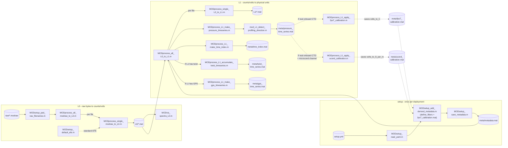
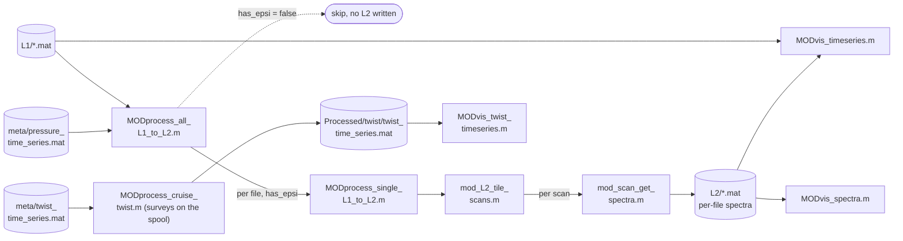
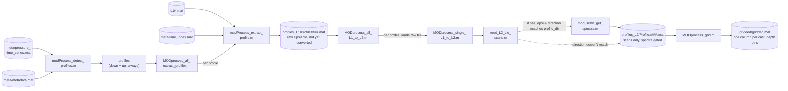
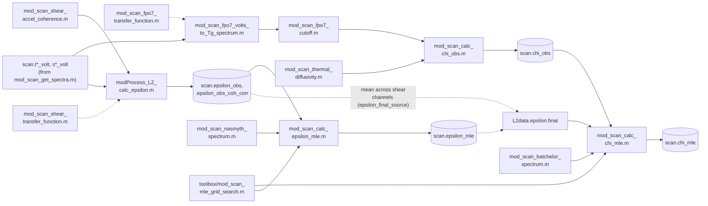

# Pipeline overview: realtime vs. postprocess

Every function this repo runs on an `epsi_mako`-class deployment, split by the two processing
modes (see `PLAN.md` Section 4, "Two processing modes"):

- **Realtime** - `modraw → L0 → L1 → L2` (per file). Runs on each raw file as it lands during a
  deployment - never waits for a complete profile, so it works even mid-cast. This is what the
  on-deployment/at-sea visualization tools consume.
- **Postprocess** - `modraw → L1 → profiles → grid`. Run once a deployment (or a leg of one) is
  done, against a complete L1 dataset - produces the final science-quality output.

L0 is shared by every processing run; L1 belongs to a run, and another run can reuse it
(`L1_from`) when its L1 settings match - the fork happens at the L2 step. Both
L2 paths share the same windowing core (`mod_L2_tile_scans.m`) but compute spectra independently;
that's a deliberate simplicity-over-storage-optimization call, not an oversight.

Diagrams below model an `epsi_mako`-class deployment - manifest details (2×FP07, 2×shear, 3×accel,
VecNav, onboard CTD, no ISAP/GPS) are taken from the one real `epsi_mako` `setup.yml` on disk
(`blt2021_0715`), not a claim that every deployment this repo processes looks exactly like this.

Click any diagram to expand it.

!!! note "Starting point for postprocessing: L1"
    L1 is just the `.modraw` turned into real data - physical units and calibrations, no choices
    about spectra or casts. To postprocess, start from the L1 files; every spectral-processing
    and profile-picking choice happens after L1.

!!! note "One driver for realtime and postprocessing"
    [Processing data](processing_data.md) describes the single manifest-driven driver
    (`MODprocess_deployment.m`): processing runs (one yml in the survey's `meta/` and one
    `processed/<run>/` folder each; raw/ and L0/ shared), the realtime worker, the
    postprocessing templates (`templates/`), an L2 that holds scans only, gridding from one cast
    table (`MODprocess_grid.m`) and a live monitor app (`MODvis_realtime_monitor.m`). This page describes the
    per-step functions.

## Shared foundation: modraw → L0 → L1

Identical for realtime and postprocess. Setup is read once per deployment; L0 strips raw bytes to
counts with zero calibration - except EFE data, which L0 converts to volts/g with the standard EFE
board so spectra can be checked before any setup.yml exists; L1 re-applies setup.yml's EFE names and
applies every calibration this repo has (CTD, altimeter, twist)
and builds the deployment-level indexes (pressure record, file time index, twist timeseries) that
everything downstream depends on.

| Function | In → out | Role |
|---|---|---|
| `MODsetup_read_yaml.m` | setup_yml → metadata | Resolves AFE/CTD/altimeter manifest, calibration lookups, `has_epsi`/`has_isap`/... flags (no `has_vnav`: twist follows the data) |
| `MODsetup_add_derived_metadata.m` | metadata → metadata | Adds what isn't in the yml: electronics filters (`MODsetup_define_filters.m`) and the probe fits listed in `MODsetup_probe_fits.m` - FP07 `volts_to_C` (`meta/fpo7_calibration.mat`) and microconductivity `volts_to_S_per_m` (`meta/ucond_calibration.mat`). Called by the L0 → L1 and L1 → L2 drivers |
| `MODsetup_define_filters.m` | metadata → metadata | Resolves each channel's fixed electronics/ADC transfer function once per deployment |
| `MODprocess_all_modraw_to_L0.m` | raw_dir, L0_dir → L0_files | Batch orchestrator; skips already-converted files. Gives a file without `$DCAL` the `SBE/<SN>.CAL` calibration, keeps one calibration per survey (`meta/ctd_calibration.mat`) and stops processing if it changes All three per-file drivers take `'newest_min_redo_s'` and `'continue_on_error'` (`MODutil_needs_redo.m`) for realtime use |
| `MODprocess_single_modraw_to_L0.m` | modraw_file, (metadata) → L0_data | Parses one raw file: `$`-block regex match, header decode, counts/hex → per-type structs; EFE counts → volts/g + `epsi_conversion`; `$DCAL` → `ctd_cal` |
| `mod_L0_ctd_calibration.m` | text, source → cal | SBE calibration from a `$DCAL` block or a `.CAL` file, by name |
| `MODprocess_reset_survey.m` | survey_folder → deleted | Deletes a survey's `L0/`, `processed/` and `meta/ctd_calibration.mat` (asks first) so it's reprocessed from raw - after a CTD calibration change stops the worker |
| `MODsetup_default_efe.m` | → efe | The standard EFE board (slot names, types, full range, ADC config, Fs, acc constants) - what L0 uses without metadata |
| `mod_efe_conversion.m` | n_slots, (metadata) → conversion | Per-channel counts ↔ volts/g record: names, config, exact scale/offset, plain-text recovery instructions |
| `mod_efe_counts_to_volts_g.m` / `mod_efe_volts_g_to_counts.m` | epsi, metadata / conversion → epsi | EFE counts → `<name>_volt`/`<name>_g`, and the exact inverse |
| `MODvis_spectra_L0.m` | browses L0 folder | Quick-look: timeseries rows, click → EFE spectrum of that window vs ADC bit noise; no setup.yml needed, all spectral settings editable |
| `MODprocess_all_L0_to_L1.m` | L0_dir, metadata → L1_files | Batch orchestrator; also builds every meta/ index below |
| `MODprocess_single_L0_to_L1.m` | L0_data, metadata → data | Epsi: re-apply setup.yml names/config from the exact counts; CTD P/T/C/S, altimeter hab, vnav tilt/spin/pitch/roll/yaw (`mod_L1_add_vnav_attitude.m`), `mod_L1_add_twist.m` |
| `MODprocess_L1_update_file_cache.m` | L1_dir, meta_dir → L1_cache | Per-L1-file time span, `ctd.dnum`/`P` and `twist` in `meta/l1_file_cache.mat`; rereads only new or changed L1 files, so the deployment-wide files below don't reload every L1 file each pass |
| `MODprocess_L1_make_pressure_timeseries.m` + `mod_L1_detect_profiling_direction.m` | L1_cache → PressureTimeseries | Deployment-length pressure record + descending/ascending classification |
| `MODprocess_L1_make_time_index.m` | L1_cache → TimeIndex | Per-L1-file dnum start/end, so a profile's file(s) can be found without loading everything |
| `MODprocess_L1_make_gps_timeseries.m` | L1_cache → GpsTimeseries | Every L1 file's GPS fixes as one track (`meta/gps_time_series.mat`), for the realtime monitor's map |
| `MODprocess_L1_accumulate_twist_timeseries.m` | L1_cache, meta_dir → TwistTimeseries | Re-chains per-file twist counts into one continuous survey count, from 0 at the survey start (no spool resets) - whenever L1 has twist (raw VNAV), not set by the yml |
| `MODprocess_cruise_twist.m` | processed_root → TwistTimeseries | The cruise twist count: every on-spool survey's count joined at 1 s, restarting at each winch spool change (`MODprocess_find_spool_swaps.m`); `Processed/twist/twist_time_series.mat`, run by the worker after every pass |
| `MODprocess_L1_apply_fpo7_calibration.m` | L1_dir, metadata, PressureTimeseries → metadata | In-situ volts→°C fit against real CTD T - only if real onboard CTD |
| `MODprocess_L1_apply_ucond_calibration.m` | L1_dir, metadata, PressureTimeseries → metadata | Microconductivity gain [S/m per V] against the CTD conductivity - only if real onboard CTD and a `microcond` channel ([Microconductivity chi](microconductivity.md)) |

## Realtime: L1 → L2 (per file), live viz

Runs on each L1 file as it lands - never waits for a complete profile. Skips cleanly if the
manifest has no AFE board (`has_epsi = false`). This is what the at-sea/live-monitoring apps
consume.

| Function | In → out | Role |
|---|---|---|
| `MODprocess_all_L1_to_L2.m` | L1_dir, metadata, L2_dir → L2_files | Batch orchestrator; no-ops if `!has_epsi` |
| `MODprocess_single_L1_to_L2.m` | data, metadata, PressureTimeseries → L2data | Thin wrapper around `mod_L2_tile_scans.m` |
| `mod_L2_tile_scans.m` | epsi, ctd, metadata, PressureTimeseries → L2data | 50%-overlap scan tiling, direction-gated by `profile_dir` (down/up/both), shared with postprocess |
| `mod_scan_get_spectra.m` | scan, metadata → scan.spectra | Raw Welch spectrum per AFE channel (`mod_scan_welch_psd.m`, per-segment detrend) - `acc`→`_g`, everything else→`_volt`, uncorrected |
| `mod_scan_welch_psd.m` | x, fft_length, seg_starts, Fs, (taper, detrend) → Pxx, f | Welch average with each segment detrended on its own - shared by `mod_scan_get_spectra.m` and `MODvis_spectra_L0.m` |
| `MODvis_timeseries.m` | browses L0/L1/L2/Profile folder | Any dnum-carrying struct, up to 6 rows, dual y-axis |
| `MODvis_spectra.m` | browses an L2 folder or a run folder, with the matching L1 (`MODutil_level_folders.m`: the run's own, the `L1_from` run's, or `profiles_L1/`) | Click a point → that scan's raw spectrum, all channels |
| `MODvis_twist_timeseries.m` | TwistTimeseries → live axes | Cable-twist count for fin adjustment during the cast; spool changes and survey starts on the cruise count |
| `MODvis_vnav_attitude.m` | L1 folder or survey, time range → figure | Pressure, tilt, spin (with the gyro twist count), pitch, roll, yaw |

## Postprocess: L1 → profiles → grid

Run once against a complete L1 dataset. Every detected cast - both directions - gets a
`Profile####.mat` with its CTD record; `profile_dir` only gates whether that profile also gets
epsi spectra.

Runs as two explicit phases (extraction, then conversion), not one combined pass - see [Profile detection and extraction](profile_detection.md) for why.

| Function | In → out | Role |
|---|---|---|
| `MODprocess_L1_update_cast_table.m` | metadata → casts | The one cast table, `meta/casts.mat` (from `modProcess_detect_profiles.m`), used by realtime and postprocessing; `.complete` false for a cast still going |
| `modProcess_detect_profiles.m` | PressureTimeseries, metadata → profiles | Speed-limit hysteresis, min-length filter, same-direction merge. Always both directions |
| `modProcess_extract_profile.m` | profile, TimeIndex, metadata → profile_data | Stitches raw epsi/ctd across L1 file boundaries; real gap detection via `segment_id` |
| `MODprocess_all_extract_profiles.m` | metadata, profiles_L1_dir → profile_files | Batch orchestrator for extraction only, saves into `metadata.paths.profiles_L1` |
| `MODprocess_all_L1_to_L2.m` | L1_dir, metadata, L2_dir → L2_files | Same driver as realtime; pointed at `metadata.paths.profiles_L1` as input, `metadata.paths.profiles_L2` as output |
| `MODprocess_single_L1_to_L2.m` | data, metadata, PressureTimeseries → L2data | Same function as realtime; carries through profile_number/direction/filenames/dnum_start/dnum_end when present on `data` |
| `mod_L2_tile_scans.m` | epsi, ctd, metadata → L2data | Same core as realtime; `segment_id` skips any window spanning a real gap |
| `mod_scan_get_spectra.m` | scan, metadata → scan.spectra | Identical function, same as realtime path |
| `MODprocess_grid.m` | metadata, by → grid | One column per cast (down and up), depth bins of `grid.z_bin_m`: CTD = mean of the L1 samples in the bin, turbulence = mean of the scans whose center is in it. By file (L1/L2 through `time_index`) or by profile (`profiles_L1/`, `profiles_L2/`); only new or changed casts are rebinned |

## Chi and epsilon - wired into `mod_L2_tile_scans.m`

The actual scientific payload of an `epsi_mako`-class deployment - both chi (FP07 thermal
dissipation) and epsilon (shear TKE dissipation) are now computed inside `mod_L2_tile_scans.m`
itself, called once per scan for every qualifying channel (gated on real onboard CTD T/S -
DeepSolo's P-only external CTD never qualifies for either). See [FP07 calibration and
chi](L2_calc_chi.md) and [Epsilon (shear turbulence)](L2_calc_eps.md) for the full writeups.

| Function | In → out | Role |
|---|---|---|
| `mod_scan_fpo7_volts_to_Tg_spectrum.m` | scan, metadata, channel → scan | Raw FP07 volts spectrum → tau-deconvolved temperature-gradient spectrum |
| `mod_scan_fpo7_transfer_function.m` | f, w, tau0, exponent → H | Thermal time-constant deconvolution filter, fall-speed dependent |
| `mod_scan_fpo7_cutoff.m` | scan, metadata, noise_coefs → scan | Noise-floor cutoff wavenumber (kc) for the integration range |
| `toolbox/seawater/ktemp.m` | SP, SR, T, P → ktemp | Thermal diffusivity via `gsw_rho`/`gsw_cp_t_exact` |
| `mod_scan_calc_chi_obs.m` | scan, metadata, channel, noise_coefs → scan | Direct-integration chi - needs real onboard CTD T |
| `toolbox/theoretical_spectra/batchelor_spectrum.m` | epsilon, chi, nu, ktemp, k → Psg | Theoretical Batchelor (1959) temperature-gradient spectrum |
| `mod_scan_calc_chi_mle.m` | scan, metadata, channel, noise_coefs → scan | Batchelor-spectrum MLE fit - now wired in, fed by epsilon below |
| `mod_scan_ucond_electronics_filter.m` | f, ucond, Fs_epsi, ADCfilter → H2 | Microconductivity electronics: SBE pre-emphasis, SBE7 anti-alias, EFE ADC ([Microconductivity chi](microconductivity.md)) |
| `mod_scan_calc_chi_ucond.m` | scan, metadata, channel → scan | Microconductivity chi: conductivity-gradient spectrum integrated from kmin_cpm to kmax (an underestimate) |
| `mod_scan_shear_transfer_function.m` | f, w, lc → H | Oakey (1982) shear-probe dynamic-response filter |
| `mod_scan_shear_volts_to_shear_spectrum.m` | scan, metadata, channel → scan | Raw shear volts spectrum → shear wavenumber spectrum |
| `mod_scan_shear_accel_coherence.m` | scan, metadata, channel → scan | Coherence vs. accelerometer channel a3, for spectrum cleaning |
| `mod_scan_calc_epsilon_obs.m` | scan, metadata → scan | Direct-integration epsilon (raw + coherence-cleaned), `eps1_mmp`/`epsilon2_correct` port |
| `toolbox/theoretical_spectra/nasmyth_spectrum.m` | epsilon, nu, k → Psg | Theoretical Nasmyth shear spectrum |
| `mod_scan_calc_epsilon_mle.m` | scan, metadata → scan | Nasmyth-spectrum MLE fit epsilon |
| `mod_scan_calc_fom.m` | k, Pobs, Pmodel, klim, dof → fom | Generic figure of merit, used by epsilon (chi's own FOM still not built) |
| `mod_scan_calc_epsilon.m` | scan, metadata, channel → scan | Per-channel epsilon orchestrator, called once per shear channel per scan |
| `processing/scans/mod_scan_mle_grid_search.m` | Pobs, dof, model_fn, seed, ... → best_val | Generic MLE grid search, shared by chi_mle and epsilon_mle |
