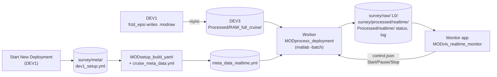

# Processing data: realtime and postprocessing

**Status:** design agreed 2026-10-14. Built so far: [processing runs](#processing-runs),
[Metadata](#metadata), the worker ([Realtime](#realtime)), the [postprocessing
templates](#postprocessing), stages 0-3, the folder READMEs, the simulator, and the [other
pieces](#other-pieces-in-this-round) marked built. Not built yet: the grid, the cruise twist, the
monitor app, microconductivity chi. Each section is updated as its code is built, with an entry
in History below.

The shared parts come first (runs, folders, stages, metadata), then [Realtime](#realtime) and
[Postprocessing](#postprocessing): the same driver, `MODprocess_deployment`, does both.

## Why

MOD_fish_lib's `RUN_Auto_process_data.m` runs either `epsiAuto_process_data` or
`fctdAuto_process_data`. After the shared raw-to-mat step they become two separate stacks:

- two cast detectors;
- two time indices;
- FCTD files written twice;
- two grids with different field names (`GRID.t/s/pr` vs `FCTDgrid.temperature/salinity/depth`);
- two plot scripts that only work with variables already in the workspace.

Microconductivity chi exists only in the FCTD stack. Twist counting runs as its own Matlab
session from its own rsync copy. Any error stops the timer, and the whole grid is rebuilt
every tick.

Here instead:

- **One set of scripts** for realtime and postprocessing, with switches (by file or by profile,
  watch or run once). Nothing is written just for realtime.
- **The manifest decides what runs.** `instrument_manifest` says what's on board, and each step
  runs only for those sensors, in the right order. There is no FCTD or EPSI branch.
- **One file format for every vehicle.** Same structs and field names everywhere; a sensor
  that isn't on board just has no field.
- **A live monitor** with Start / Pause / Stop and a streaming log, which can't stop processing
  even if it crashes.

## Where postprocessing starts: L1

L1 is just the `.modraw` turned into real data: physical units, calibrations, and sensor
responses removed (for example the microconductivity pre-emphasis). It contains **no choices
about spectra or casts**. To postprocess a deployment, start from its L1 files. Every
spectral-processing and profile-picking choice (fft length, scan length, cast detection
parameters, gridding) happens after L1, so it can be redone from L1 without going back to the
raw files.

## Processing runs

A **processing run** is one yml plus one output folder. The realtime worker's run is called
`realtime`; any other name is a postprocessing run - e.g. `nfft512` to try another fft length -
so trying something new never overwrites what's there:

```
<survey>/
  meta/
    dev1_setup.yml           ship record (Start New Deployment), never edited
    meta_data_realtime.yml   one yml per run: meta_data_<run>.yml
    meta_data_nfft512.yml
  raw/                       links to RAW_full_cruise/ - shared by every run
  L0/                        shared by every run (L0 makes no choices; L1 re-applies the manifest)
  processed/
    realtime/  meta/  L1/  L2/  profiles_L1/  profiles_L2/
    nfft512/   meta/  L2/    (its L1 is realtime's - L1_from: realtime)
```

- **Every path comes from where the yml is.** The survey is the folder holding `meta/`, and the
  run's output is `processed/<run>/`, so a copied survey folder (a laptop, a hard drive, the share)
  works with no edits. `data_root` in `dev1_setup.yml` (and copied into the run yml) is the ship's
  path, kept as a record; processing doesn't use it.
- **`calibrations_root`** is the one absolute path. If it isn't a folder on this computer,
  postprocessing asks for it with a folder picker and writes it into the run yml (and a working
  one there is kept when the yml is rebuilt). When any run yml is built, a reachable `calibrations_root` from
  another run of the same survey is used, so it's asked for once per copy of a survey. The
  realtime worker never asks: the survey shows an error in `status.json` until it's fixed.
- **Reusing another run's L1** (`L1_from`): L1 doesn't depend on spectral settings, so a run that
  only changes, say, `fft_length` can use realtime's L1 instead of making its own. It's allowed only
  when everything L0 → L1 reads is the same in both runs (`MODsetup_L1_settings.m`: instrument
  manifest, AFE channels and probe calibrations, CTD calibration, latitude, altimeter geometry,
  gap factors and the profiling-direction smoothing); otherwise preflight refuses and lists what
  differs. Such a run skips L0 and L1.
- **A run's yml is `dev1_setup.yml` + one cruise yml,** rebuilt every time (see
  [Metadata](#metadata)) - edit those two, not the run yml. To try other values (e.g. another
  `fft_length`), copy `cruise_meta_data.yml`, change the copy, and run it under a new run name with
  that file as `'cruise_yml'`. **Continuing a run** means giving the same run name (or its yml):
  it remembers its cruise yml and `L1_from`.
- **Old layout:** a survey processed before this (L1/, L2/, profiles_L1/, profiles_L2/ and
  `meta/depl_meta_data.yml` directly in the survey folder) gets a note from preflight; those folders aren't used or changed. Its L0/ is in
  the right place already and is reused. The first `meta_data_realtime.yml` carries over values
  saved in `depl_meta_data.yml`.

Preflight says which yml a run uses and what it reads and writes, every time:

```
Run nfft512 - .../26_1015_fctd2_deck_test/meta/meta_data_nfft512.yml
  survey  .../26_1015_fctd2_deck_test
  raw     raw (4 files)
  L0      L0 (4 files, shared by every run)
  L1      processed/realtime/L1 (4 files, from run realtime)
  out     processed/nfft512
  stages  casts, L2
  calibrations_root /Users/ncouto/GitHub/modscripps/MOD_fish_calibrations
  missing parameters: none
```

## Levels and folders

| Folder | What's in each file |
|---|---|
| `raw/` | Symlinks to this survey's `.modraw` files in the cruise-wide `RAW_full_cruise/` |
| `L0/` | Parsed blocks: counts, and EFE volts/g from the standard board |
| `processed/<run>/L1/` | Physical-unit timeseries: `epsi`, `ctd`, `alt`, `vnav`, `gps`, `fluor`, `twist`, ... |
| `processed/<run>/L2/` | **Scans only**, one file per L1 file with the **same name**: spectra, FP07 chi, epsilon and CTD values at each scan (microconductivity chi and fluorometer scan means later, steps 7-8). The time series stay in the L1 file, so nothing is stored twice; the viewers load both (`MODutil_level_folders.m`). |
| `processed/<run>/profiles_L1/`, `profiles_L2/` | By-profile runs: `Profile####.mat` cut by cast (time series), and its scans under the same name |
| `processed/<run>/grid/` | `grid.mat`: one column per cast, binned in pressure (not built yet) |
| `processed/<run>/meta/` | Files built from this run's L1 (`time_index.mat`, `pressure_time_series.mat`, `twist_time_series.mat`, `fpo7_calibration.mat`, `l1_file_cache.mat` - with the L1 they came from), this run's `casts.mat`, `metadata.mat`, and `log/` (`processing.log`, `problems.json`) |

L1 is never rewritten after it's made.

**Every data file says what it was made from.** Each L0, L1, L2, `profiles_L1` and `profiles_L2`
file has a `provenance` field (`MODutil_provenance.m`):

| Field | What it holds |
|---|---|
| `files` | The file(s) it was made from: L0 ← `raw/<name>.modraw`, L1 ← `L0/<name>.mat`, L2 ← `processed/<run>/L1/<name>.mat` (the `L1_from` run's for such a run), profiles_L1 ← the L1 files the cast was cut from, profiles_L2 ← `processed/<run>/profiles_L1/Profile####.mat` |
| `yml` | The run yml it was made with, e.g. `meta/meta_data_realtime.yml` (for L0, whichever run made it - L0 is shared, and doesn't depend on the yml) |
| `yml_sha256` | The yml's SHA-256 when it was read - compare it with the yml now to see whether the yml has changed since |
| `run`, `survey`, `made_utc`, `code` | The run, the survey folder's name, when it was made, and the code's git commit |

Paths are relative to the survey folder, so they still point to the right files in a copy of the
survey. This is a record only: a changed yml doesn't make anything be redone (reprocess for that).

Every folder gets an auto-written `_README.txt` listing:
- what's in the files;
- the run and its yml, and for L2, profiles_L1 and profiles_L2 which run's L1 they came from (an
  `L1_from` run has no L1/ of its own, so no L1 README);
- the steps applied;
- the parameters used;
- the git commit of the code.

So it's clear from the folder what has been done.

## Stages

Each stage is an existing `MODprocess_all_*` function unless marked new. The by-file/by-profile
switch only changes what goes in and where the result goes. `'from'` and `'until'` (`L0`, `L1`,
`casts`, `L2`) run only some of stages 2-3; `'until', 'yml'` runs stage 1 only.

| # | Stage | Function | What it does |
|---|---|---|---|
| 0 | Route raw files (**built**) | `MODutil_route_raw_by_survey` | Reads each new file's `CTD.survey` from its header (once; kept in `Processed/raw_routing.mat`) and symlinks it into `<survey>/raw/`. Symlinks follow a growing file, and the new file rsync swaps in when it updates one; hard links would keep the old one. A file with no `CTD.survey` line (fctd_epsi before 2025, SOM-only vehicles) is reported as unrouted. Nothing in `RAW_full_cruise/` is ever changed. |
| 1 | Metadata (**built**) | `MODsetup_build_yaml`, `MODsetup_preflight` | Builds the run yml, `meta/meta_data_<run>.yml` (realtime: each pass, rewritten only if a source changed; other runs: once), checks it and prints the run's plan; see [Metadata](#metadata). |
| 2 | modraw → L0 → L1 (**built**) | `MODprocess_all_modraw_to_L0`, `MODprocess_all_L0_to_L1` | L0 into the survey's `L0/` (shared); L1 into the run's `L1/`, with physical units and calibrations. Per-file errors don't stop the run (`'continue_on_error'`), the growing file is throttled (`'newest_min_redo_s'`), and the FP07 refit runs every 10 new L1 files while watching (`'fpo7_refit_new_files'`; a one-off pass refits every time). The files built from L1 in the run's `meta/` (`time_index`, `pressure_time_series`, `twist_time_series`) are rebuilt from `l1_file_cache.mat` (`MODprocess_L1_update_file_cache`), which rereads only new or changed L1 files; L1 files are never changed. Skipped for a run with `L1_from`. Microconductivity pre-emphasis removal will move here (new `mod_L1_ucond_remove_preemphasis`, step 7). |
| 2b | Casts (**built**) | `MODprocess_L1_update_cast_table` | **One cast table** per run (`processed/<run>/meta/casts.mat`) for both modes, from `modProcess_detect_profiles` on the L1's pressure record. A cast that runs into the end of the record is `complete = false` (still going); realtime leaves it out, postprocessing keeps it. Key per-cast results by `dnum_start` - numbers can change as the record grows. Postprocessing cuts `profiles_L1/` from it (`MODprocess_all_extract_profiles`). |
| 3 | → L2 (**built**) | `MODprocess_all_L1_to_L2` | Scans only, one file per L1 file (or per `profiles_L1/` profile) with the same name. The modules that run depend on the manifest: `fpo7` → FP07 chi; `shear` → epsilon; `microcond` → microconductivity chi (new `mod_scan_ucond_*`, step 7); `fluor` → scan means (step 8); CTD scan values always. By file, scans are kept for down, up or both per `profile_detection.profile_dir` (from Start New Deployment's `profiling_direction`). |
| 4 | Grid | new `MODprocess_grid(metadata, 'by', 'file'\|'profile')` | Columns always come from the cast table. By file, each cast's data is found in the L2 files through `time_index`; by profile, it's read from `profiles_L2/`. Bins in pressure (dz from `grid.dz_m`); only new or changed casts are rebinned. Despiking and salinity cleanup happen here for now, as a separate function the grid calls, because despiking may move to L2 later (per scan, before spectra). |
| 5 | Cruise twist | `MODprocess_L1_accumulate_twist_timeseries` (generalized to a list of L1 folders) | One winch and one spool serve every vehicle, so this chains **every survey of the cruise** in time order into one series. The count restarts at each spool change, from `MODprocess_find_spool_swaps` (**built**), which checks two sources against each other so a deleted file doesn't lose a change: every survey's `dev1_setup.yml` (`winch_spool`, and when it was written) and the cruise `Processed/spool_swap_log.csv` (Start New Deployment adds a row when the spool changes; a mid-deployment change is added by hand). It uses the log's time when both agree, falls back to whichever one has the change, and warns when they disagree. Output: `Processed/twist/twist_time_series.mat`. Each L1 file's own count still starts at 0; only this chained file carries the running total. |
| - | Folder READMEs (**built**) | `MODutil_write_folder_readme` | `_README.txt` in `raw/`, `L0/`, `L1/`, `L2/` (and `profiles_L1/`, `profiles_L2/`): what the files hold, the run and its yml, the steps, the parameters used, the vehicle, and the code's git commit. Rewritten only when that changes. |

## One format for every vehicle

`grid/grid.mat` contains:
- axes `time`, `pressure`, `z`, `cast_direction`, `cast_start`, `cast_end`;
- `source` (by file or by profile);
- CTD always (`T`, `SP`, `CT`, `SR`, `sigma0`, `w`);
- then only what's on board: `epsilon_final`, `chi_t1`/`chi_t2`/`chi_c1`, fluorometer channels, `alt_hab`;
- `variables` (name, unit and description from `setup/MODunits_L3.m`) and the manifest.

The monitor app and any later viewer loop over `variables`, so a Mako, an FCTD with
microconductivity and an FCTD with fluorometer all display with the same code.

## Metadata

**Built.** `MODsetup_build_yaml(survey_meta_dir, [], 'run', name)` writes the run yml,
`meta/meta_data_<run>.yml` - the file processing reads - from two files:

- `meta/dev1_setup.yml`: written by [Start New Deployment](start_new_deployment.md); says
  what's on the vehicle;
- `<processed_root>/cruise_meta_data.yml`: the cruise's processing parameters per sensor type
  (spectral, chi, epsilon, profile detection, grid, sample rates).

**Before the cruise:** copy `setup/cruise_meta_data_template.yml` to
`<processed_root>/cruise_meta_data.yml` and review every value. The template is generated from
`MODsetup_metadata_field_registry.m` by `MODsetup_write_cruise_meta_data_template.m`, with each
parameter's description as a comment. Its values are the registry's suggested defaults, which
are historical starting points, not choices made for this cruise. Rerun the generator after
changing the registry.
`acquisition/check_software/check_ship_setup.sh` reports whether `cruise_meta_data.yml` is there (see
[Start New Deployment](start_new_deployment.md), setup step 6).

How the merge works (done on the text, so both files' comments are kept):

- `dev1_setup.yml` comes first, unchanged.
- Each cruise section that dev1 doesn't have is appended. For a section both have (`afe:`), only
  the missing keys are added. On a key both set, dev1 wins.
- dev1's `profiling_direction` is written to `profile_detection.profile_dir`, which is what
  processing reads.
- A `run:` block records the run's `name`, `L1_from`, `cruise_yml` and `created_utc`.

**Every run's yml** (`meta_data_<run>.yml`) is rebuilt this way every time it's used (each pass of
the worker for `realtime`). The cruise yml is the one given, or the one the run was built with
(`run.cruise_yml`; in a copy of the survey, the same file name next to the survey folder), or
`cruise_meta_data.yml` for a new run. `L1_from` is given, or kept from the run's yml.
From the old run yml:
- A parameter that only the old file had (e.g. one saved from a prompt) is carried over. If the
  sources now give a registry parameter a different value than the old file had, it's reported,
  and the sources win.
- Its `calibrations_root` is kept when it's a folder on this computer and dev1's isn't (a copy
  on a laptop, once it has been asked for); failing that, a reachable one from another run of the
  survey is used.
- For `realtime`, the first time, an old-layout `meta/depl_meta_data.yml` stands in as the old file.
- The old file is kept as `.replaced_<UTC stamp>`.
- If nothing would change, the file isn't rewritten, so the worker can call it every loop.

```matlab
M = '/Volumes/DEV3_HD/.../Processed/<survey>/meta';
[yml, info] = MODsetup_build_yaml(M);                       % meta_data_realtime.yml
yml = MODsetup_build_yaml(M, 'cruise_meta_data_nfft512.yml', 'nfft512', ...
    'L1_from', 'realtime');                                 % another run, its own cruise yml
MODsetup_preflight(yml)                % prints the plan and what's missing, or OK
MODsetup_preflight(yml, true)          % asks for each missing value and saves it
```

Those two files are enough: besides the registry parameters, `MODsetup_read_yaml` only reads
the optional `ctd.type` and `ctd.sample_per_record`.

**Preflight** (`MODsetup_preflight`; every pass of the worker and of postprocessing, and later as a
button in the monitor app) prints the run's plan (which yml, where raw, L0 and L1 come from, where output
goes - see [Processing runs](#processing-runs)) and checks every registry parameter the stages
about to run need, for this manifest:
- L1: `afe`, `ctd`, `spectral`, `profile_detection` (L0 → L1 needs `fft_length`/`Fs_epsi` even on
  a CTD-only vehicle, and detects the profiling direction);
- casts: `profile_detection`;
- L2: `afe`, `ctd`, `spectral`, `profile_detection`, plus `chi` with an fpo7 slot and `epsilon`
  with a shear slot;
- `ctd.sample_rate` only when `ctd.compute_spectra` is true. `grid` parameters will be needed
  once the grid stage exists.
- Sensor types are matched ignoring case, the same way processing matches them.

It also reports problems: a `calibrations_root` that isn't a folder here (asked for in
postprocessing - see [Processing runs](#processing-runs)), a yml or calibration file that can't
be read, an `L1_from` run that's missing, has no L1 yet or has different L1 settings, and, for
L2, shear probes with no calibration file (no epsilon for them) or no charge-amp filter file. And
it notes a survey still holding the old layout. The worker lists anything missing in
`status.json`; in postprocessing (with a display) the usual prompt dialogs ask and save to the
run yml.

**Derived values** that aren't in any yml - the AFE electronics filters and the FP07 `volts_to_C`
fit - are added by `MODsetup_add_derived_metadata.m` at the start of the L0 → L1 and L1 → L2
drivers. The fit is read from `fpo7_calibration.mat` in the meta/ next to the L1 it was fit on
(`metadata.paths.L1_meta`), so every stage, in any session and in any run using that L1, sees it.
- Each channel's fit is saved with its probe SN and fit time. A fit is applied only to a
  channel with the same SN; otherwise a warning says that channel gets no chi until the next
  refit.
- A channel that can't be refit keeps its previous fit and fit time, with a warning.

See [L0 → L1](L0_to_L1_conversion.md).

If a source file doesn't parse (for example, 4-space indentation), `MODsetup_build_yaml` stops
with a message naming that file. The run yml is left as it was, and a bad merge is kept as
`meta_data_<run>.yml.building` so you can look at it.

## Realtime



There are two Matlab processes on DEV3. They talk only through files.

**Worker (built):** `MODprocess_deployment(processed_root, 'watch', true)`, started by
`Start Realtime Processing.command` (double-click; it reads `processed_root` from
`acquisition/config.yml`) or later by the monitor app's **Start** button, with `matlab -batch`.
It has no windows. Each pass:

1. links new raw files from `RAW_full_cruise/` into their survey's `raw/`;
2. for each survey that has something new (oldest first; the newest is the active one), runs
   every stage below as the `realtime` run;
3. writes status;
4. waits `poll_s` (default 30 s), checking `control.json` every second.

The wait starts **after** a pass finishes. A pass that takes 3 minutes is followed by a 30 s
pause; passes never overlap and nothing is skipped. `poll_s` only sets how fast new data is
noticed when the worker is idle.

The raw file that's still being written is redone only once it's out of date and its outputs are
at least `regrow_min_s` old (default 120 s), so it and everything after it aren't redone on every
pass. In the simulator test (4 files, each written over 30 s, `poll_s` 5 s) each file went
through L0 → L1 → L2 twice over 22 passes. `status.json` reports how long each pass took and the
lag of the newest product behind the newest raw data. A survey is skipped once it's caught up
(nothing to do, and `raw/` unchanged for longer than twice `regrow_min_s` plus a pass) until
`raw/` changes. An edit to its yml or a calibration file alone doesn't wake a caught-up survey;
run a one-pass `MODprocess_deployment(survey_folder)` (or touch a raw file) to apply it.

Nothing stops the worker except **Stop**:
- A bad file is logged, listed in the run's `problems.json`, and retried on later passes (the
  log only shows it again if the error changes). Once it goes through, the log says so and it's
  removed from the list.
- A stage that fails as a whole is listed the same way, and the next stage still runs; it's
  cleared once that stage goes through.
- Anything else that goes wrong in a pass is logged (once, not every pass), and the worker waits
  and tries again.
- Output files are written to `<file>.tmp` and then moved into place, so a Matlab killed mid-save
  (Terminal closed, power cut) never leaves a half-written `.mat`; an unreadable L0 or L1 file is
  redone or retried rather than blocking the survey.
- A raw file deleted from `RAW_full_cruise/` leaves a broken link in `raw/`; it's listed in
  `status.json` (`broken_links`) and otherwise left out, not processed.
- The worker never prompts, since `-batch` can't. A survey whose parameters are incomplete
  shows "waiting for parameters" (with the list) until they're added to `cruise_meta_data.yml`
  or `meta_data_realtime.yml`; a survey with no raw files yet shows "waiting for raw files". The
  parameters checked are the ones the stages need (see [Metadata](#metadata)).
- **Stop** (`{"command": "stop"}` in `control.json`) finishes the current stage and exits; the
  survey shows "stopped mid-pass" and is picked up where it left off next time. **pause** keeps
  the worker alive without processing.
- One worker per processed folder: `realtime/worker.lock` holds the running worker's PID, and a
  second one refuses to start while that PID is alive. A lock left by a crashed worker is taken
  over automatically; `'force', true` (or `--force` on the `.command`) overrides it anyway.
- `RAW_full_cruise/` is looked for on every pass, so the worker can be started before the first
  rsync creates it.

**Monitor app (not built yet):** `MODvis_realtime_monitor`, a uifigure. It only reads what the
worker writes, so a slow redraw or a crash can't stop processing. You can close and reopen it,
or run another copy on a computer that mounts DEV3.

A Matlab `timer` inside one session isn't used for two reasons: long processing freezes the
plots, and one error in the timer callback stops it.

**Files** in `<processed_root>/realtime/` (the worker only - a one-off pass on one survey writes
none of these):

| File | What's in it |
|---|---|
| `control.json` | `{"command": "run" \| "pause" \| "stop"}` - written by the app or by hand; set to `run` when the worker starts |
| `worker.lock` | PID, host and start time of the running worker; removed when it exits |
| `status.json` | Worker state, active survey, pass time, and per survey: state, file counts (raw/L0/L1/L2), casts, newest raw file time, lag, problems count, missing parameters, calibration notes; also unrouted raw files and broken links |
| `cruise_log.txt` | One line per notable event for the whole cruise: worker start/stop, files linked, new problems, problems cleared |

and in `<survey>/processed/<run>/meta/log/` (each run, realtime or not):

| File | What's in it |
|---|---|
| `processing.log` | Everything printed while that run was processed (Matlab's `diary`), warnings included |
| `problems.json` | Files or stages currently failing: `file`, `stage`, `identifier`, `message`, `first_seen_utc`, `last_seen_utc` |

### Monitor app layout (not built yet)

Laid out after the 2018 FastCTD GUI, with epsi variables added:

- **Top status strip:** survey, vehicle and winch spool; worker state; file counts per stage; lag;
  last update; problems count.
- **Left, colour sections:** time vs pressure, one column per cast, sigma0 contours. Variables
  are picked from `variables`: T, SP, log10 epsilon, log10 chi (t1/t2/c1), fluorometer.
- **Middle:**
  - pressure vs time;
  - TS of the last ~5 casts, coloured by age, to catch conductivity problems;
  - cruise twist count vs time (all vehicles - one winch spool), with spool changes marked;
  - space left for more panels.
- **Bottom, streaming log**, with errors highlighted (click one for the full message).
- **Right, control panel:** Start / Pause / Stop, Preflight, time span, depth range, colour
  limits and colormaps per variable, open the selected time in `MODvis_timeseries` /
  `MODvis_spectra`, Save PNG. Every plot setting is editable here and shown on the plot.

### Testing: the simulator

**Built:** `MODutil_simulate_acquisition(source_raw_dir, incoming_dir, 'first', i, 'n_files', n,
'file_s', s, 'chunks', c)` copies a real deployment's raw files into a test `RAW_full_cruise/`
one at a time, writing each in `c` pieces over `s` seconds the way `fctd_epsi` grows a file. Run
it in a second Matlab while the worker watches. Use copies of real deployments only; the source
is only read.

Tested in a scratchpad sandbox (2026-10-15), worker with `poll_s` 5 s and `regrow_min_s` 20 s:

- **Survey A** (MAKO1, files 40-43 of `epsi_mako_w_fluor/25_0408_d03_mako1_canyonhead`, each
  written over 30 s): routed by their `CTD.survey` header, L0 → L1 → L2 as they grew, 11 casts
  in `meta/casts.mat`.
- **A corrupt raw file** (a real header plus 300 kB of random bytes): parsed without an error;
  its readable part gave L1 data and 0 scans, with nothing odd in the pressure record. After it
  was replaced with valid data, it was redone (42 scans).
- **Survey B** (FCTD1, `fctd_w_ucond_fluor/25_0409_d05_fctd1_dye_survey`), set up mid-run while
  `cruise_meta_data.yml` was hidden: the newest survey became the active one. When it was
  restored and three files arrived, they were routed and processed, and survey A was left alone
  (caught up).
- **Stop** through `control.json`: the worker finished the stage and exited; `status.json` says
  `stopped`.
- **A survey set up while `cruise_meta_data.yml` is missing** shows "waiting for parameters" (15
  missing for an FCTD2: no chi or epsilon needed) before any raw data arrives, and "waiting for
  raw files" once the file is back.
- **An earlier run** (4 growing files from the start of the canyonhead deployment) checked the
  throttle: each file went through L0 → L1 → L2 twice over 22 passes, not on every pass.

Repeated in the processing-runs layout (2026-10-15, `poll_s` 5 s, `regrow_min_s` 10 s, each file
written over 20 s): survey A's 4 files and a damaged file (a real 70 kB start plus 3 MB of random
bytes, so its readable part repeats the first 4 s of another file) went to
`processed/realtime/`, 10 casts; survey B waited for parameters (14 missing - `grid` is no longer
asked for before the grid stage exists), then its 3 files went through (8 casts); a second worker
was refused; Stop exited in 4 s. The damaged file first showed that two L1 files with the same
times broke the FP07 refit and L2 ("Sample points must be unique"); the pressure record and the
FP07 fit now keep each time once (60 samples left out here). A one-off pass on a copy of survey
A then gave the same cast table and the same L2 files as the worker, except the FP07-dependent
fields (`t1_Tg_k`, `t2_Tg_k`, chi): the worker fits FP07 every 10 new files, so its fit came from
the first file, and the one-off pass's from all five.

Still to test on the simulator: `fctd_w_ucond` (a 2023 FCTD, no `CTD.survey` line, so its files
are reported as unrouted) and a mid-run raw file that never finishes.

## Postprocessing

Postprocessing runs the same stages with the same code as the worker - `MODprocess_deployment`
on one survey, one pass, with a run name. Two templates in `templates/` (copy one, edit its
settings block, run it):

- **`MODtemplate_postprocess.m`** - checks the run (builds its yml and prints the plan above), runs
  it, and opens the viewers on its folder.
- **`MODtemplate_postprocess_by_stage.m`** - the same settings, then one section per stage (L0,
  L1, casts, L2), so each stage's output can be looked at before the next. Each section calls the
  driver with `'from'` and `'until'` set to that stage, so the stages and their order are the
  driver's.
- **`MODtemplate_postprocess_steps.m`** - postprocessing only, one line per level, calling the
  processing functions themselves instead of the driver:

  ```matlab
  run_yml  = MODsetup_build_yaml(fullfile(survey_folder, 'meta'), cruise_yml, run_name, 'L1_from', L1_from);
  [report, metadata] = MODsetup_preflight(run_yml, true);
  L0_files = MODprocess_all_modraw_to_L0(metadata.paths.raw, metadata.paths.L0, [], metadata);
  L1_files = MODprocess_all_L0_to_L1(metadata.paths.L0, metadata, metadata.paths.L1);
  casts    = MODprocess_L1_update_cast_table(metadata);
  profiles_L1_files = MODprocess_all_extract_profiles(metadata);
  profiles_L2_files = MODprocess_all_L1_to_L2(metadata.paths.profiles_L1, metadata, metadata.paths.profiles_L2);
  ```

  then the folder READMEs and the viewers. An error stops it at that line. With `L1_from`, skip
  the L0 and L1 lines. Tested to give the same cast table and `profiles_L2` files as the driver
  with the same settings.

Their settings block:

| Setting | Meaning |
|---|---|
| `survey_folder` | The survey (holds `meta/dev1_setup.yml`, `raw/`, `L0/`) - the ship's, or a copy |
| `run_name` | The run (letters, digits, `_`, `-`): a new name makes a new run, the same name continues it |
| `cruise_yml` | The cruise yml with this run's processing values; `''` = the one the run was built with, or `cruise_meta_data.yml` next to the survey folder for a new run |
| `L1_from` | Use this run's L1 instead of making one (L1 settings must match); `''` = its own L1 |
| `by` | `'file'` (whole L1 files tiled into scans, as realtime) or `'profile'` (per cast: `profiles_L1/` from the cast table, then `profiles_L2/`) |
| `until_stage` | Last stage: `'yml'` (check only), `'L0'`, `'L1'`, `'casts'` or `'L2'` |

The same thing without a template:

```matlab
S = '/path/to/Processed/26_1015_fctd2_deck_test';
MODprocess_deployment(S, 'until', 'L1')                               % run 'realtime'
MODprocess_deployment(S, 'run', 'nfft512', 'L1_from', 'realtime', ...
    'cruise_yml', '/path/to/cruise_meta_data_nfft512.yml')           % another run
MODprocess_deployment(fullfile(S, 'meta', 'meta_data_nfft512.yml'))   % continue that run
MODvis_spectra(fullfile(S, 'processed', 'nfft512'))                   % its L2, with realtime's L1
```

- With a display (not `-batch`), missing parameters are asked for with the usual dialogs and saved
  into the run yml; `'ask', false` turns that off.
- A one-off pass on one survey (a survey folder or a run yml as target) writes nothing outside the
  survey folder (no `realtime/` status files), so a copy of a survey can be processed wherever it
  is. Given the processed folder of every survey, it writes them as the worker does.
- `'until', 'yml'` checks every stage from `'from'` on; the processing call itself only needs the
  parameters of the stages it runs.

## Other pieces in this round

- **Built:** `MODutil_read_som3(modraw_file)` prints (or returns) a raw file's `$SOM3` block: the
  SOM's own settings - mission name, vehicle name, firmware, the other text after it (git id,
  revision, SN), and each module (`CAL`, `EFE4`, `SB49`, `SDIO`, `VOLT`, `ACTU`, `ALTI`, `VNAV`).
  EFE4 is decoded per channel (name, probe SN, stored cal value); add `'hex', true` for the raw
  bytes. Checked on raw files from blt2021_0715, canyonhead, fctd_w_ucond, DeepSolo and Minnow.
  Firmware from 2023 on records probe SN `000` for every EFE channel, so `$SOM3` doesn't say
  which probes were on; Setup and `dev1_setup.yml` do. The 2025 FCTD fluorometer files have no
  `$SOM3` block.
- **Built:** `MODprocess_find_spool_swaps(processed_root)` lists the spool changes for the cruise
  twist count from the `dev1_setup.yml` files and `spool_swap_log.csv` together (see stage 5).
  Tested with both sources, a deleted `dev1_setup.yml`, a deleted log, a hand-added
  mid-deployment change, and a missing log row.
- **Built:** Start New Deployment has a `winch_spool` field. There's one winch with one spool
  on it, used by every vehicle, so it's cruise-wide: it's filled in from the last Create
  Setup (any vehicle), written to `dev1_setup.yml` and the deployment log, and warned about
  when it's empty or changes (the twist count restarts there). Setup now has one comment line
  (provenance) instead of the section notes. Setup keeps every key, because it's copied into
  every `.modraw` header.
- **Built:** by-file scan selection in `mod_L2_tile_scans.m` follows `profile_detection.profile_dir`
  (`down`, `up` or `both`) instead of always keeping descending scans. "Up" is not descending and
  `dPdt_smoothed < 0`; gaps and times outside the pressure record are dropped in every case.
  There's no speed threshold yet: a slow, nearly stationary stretch counts as whichever way it's
  drifting (with `both`, almost every scan with a pressure rate is kept), and `is_down` is
  widened by `buffer_bins` while "up" isn't.

## History

**2026-10-14 - Design agreed** (branch `main-fork`). Written from the planning discussion with
Nicole, after reading MOD_fish_lib's `RUN_Auto_process_data.m`, `epsiAuto_process_data.m`,
`fctdAuto_process_data.m`, the FCTD formatting/gridding chain and `FastCTD_GUI.m`. Not built
yet.

**2026-10-14 (later) - Step 1 built** (branch `main-fork`): `MODsetup_build_yaml`,
`setup/cruise_meta_data_template.yml` (from `MODsetup_write_cruise_meta_data_template`),
`MODsetup_preflight` (with a no-prompt mode added to `MODsetup_validate_metadata`),
`MODsetup_add_derived_metadata` + `meta/fpo7_calibration.mat`, the prompt retry in L0 → L1,
`MODutil_read_som3`, and the Start New Deployment winch spool field and Setup comment cleanup. Also:
`MODsetup_read_yaml` now reads every processing parameter with one registry loop. Tested in a
scratchpad sandbox - see `SESSION_LOG.md` (2026-10-14, step 1).

**2026-10-15 - Step 2 built** (branch `main-fork`): the worker and one-pass driver
(`MODprocess_deployment`), raw routing, the L1 file cache behind the deployment-wide files, the
cast table, per-file error handling and redo throttling in the three per-file drivers, atomic
saves, folder READMEs, the simulator and the `.command` launcher. Reviewed by an agent (9 bugs
fixed) and tested on the simulator - see `SESSION_LOG.md` (2026-10-15, step 2).

**2026-10-15 (later) - Processing runs; postprocessing templates; L2 scans only** (branch
`main-fork`). Page renamed from `realtime_processing.md`, with shared sections first and then
Realtime and Postprocessing. A processing run is `meta/meta_data_<run>.yml` plus
`processed/<run>/`; raw/ and L0/ are shared; every path comes from where the yml is (copies work
anywhere), and `calibrations_root` is asked for once per copy when it isn't a folder there.
`MODsetup_build_yaml` builds run ymls (realtime rebuilt each pass; other runs made once, from the
sources or a base run, with `L1_from` and overrides); `MODsetup_preflight` prints the run's plan,
checks only what the stages need, and refuses `L1_from` when the L1 settings differ
(`MODsetup_L1_settings.m`); `MODprocess_deployment` takes `'run'`, `'from'`/`'until'` and the
rest, and writes no worker files for a one-off pass. L2 holds scans only; by-file scans follow
`profile_dir`; repeated times across L1 files are handled. Templates in `templates/`; the viewers
take a run folder (`MODutil_level_folders.m`). Tested on copies of the 2026-10-15 FCTD2 deck test
and on the simulator - see `SESSION_LOG.md` (2026-10-15).

**2026-10-15 (later) - Provenance in every data file** (branch `main-fork`). Each L0, L1, L2,
profiles_L1 and profiles_L2 file records the file(s) and run yml it was made from (relative to the
survey), the yml's SHA-256, the run, the time and the code commit (`MODutil_provenance.m`; the git
lookup moved to `MODutil_code_version.m`). A record only - nothing is redone when the yml changes.
Tested on a sandbox copy of 4 canyonhead files: a realtime run and a by-profile run with `L1_from`
recorded the right source at every level, and the recorded hashes match the yml files.

**2026-10-16 - Simpler run ymls** (branch `main-fork`). Nicole: "Why doesn't the function just
combine dev1 yml with cruise yml? Why do you need an override field if you probably made a
different yml with different values?" Every run's yml is now `dev1_setup.yml` + one cruise yml,
rebuilt the same way every time (no "made once" runs); other values come from another cruise yml
(`'cruise_yml'`). `MODsetup_build_yaml(survey_meta_dir, cruise_yml, run, 'L1_from', x)`; the
`'base'`, `'overrides'` and `'calibrations_root'` arguments are gone (preflight still asks for an
unreachable calibrations folder, and a working one in the run yml is kept). A run remembers its
cruise yml and `L1_from`. New template `MODtemplate_postprocess_steps.m` (one line per level, no
driver).
