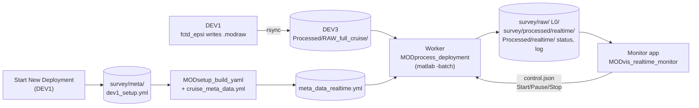

# Processing data: realtime and postprocessing

**Status:** design agreed 2026-10-14. Built so far: [processing runs](#processing-runs),
[Metadata](#metadata), the worker ([Realtime](#realtime)), the [postprocessing
templates](#postprocessing), stages 0-4 (through the grid), the folder READMEs, the simulator,
the [monitor app](#monitor-app-built-modvis_realtime_monitor), and the [other
pieces](#other-pieces-in-this-round) marked built, and the [cruise twist](#stages) (stage 5).
Not built yet: microconductivity chi. Each section is updated as its code is built, with an entry
in History below.

The shared parts come first (runs, folders, stages, metadata), then [Realtime](#realtime) and
[Postprocessing](#postprocessing): the same driver, `MODprocess_deployment`, does both.

## Why

MOD_fish_lib's `RUN_Auto_process_data.m` runs either `epsiAuto_process_data` or
`fctdAuto_process_data`. After the shared raw-to-mat step they become two separate stacks:

- two cast detectors;
- two time indices;
- FCTD files written twice;
- two grids with different field names (`GRID.t/s/pr` vs `FCTDgrid.temperature/salinity/depth`);
- two plot scripts that only work with variables already in the workspace.

Microconductivity chi exists only in the FCTD stack. Twist counting runs as its own Matlab
session from its own rsync copy. Any error stops the timer, and the whole grid is rebuilt
every tick.

Here instead:

- **One set of scripts** for realtime and postprocessing, with switches (by file or by profile,
  watch or run once). Nothing is written just for realtime.
- **The manifest decides what runs.** `instrument_manifest` says what's on board, and each step
  runs only for those sensors, in the right order. There is no FCTD or EPSI branch.
- **One file format for every vehicle.** Same structs and field names everywhere; a sensor
  that isn't on board just has no field.
- **A live monitor** with Start / Pause / Stop and a streaming log, which can't stop processing
  even if it crashes.

## Where postprocessing starts: L1

L1 is just the `.modraw` turned into real data: physical units, calibrations, and sensor
responses removed (for example the microconductivity pre-emphasis). It contains **no choices
about spectra or casts**. To postprocess a deployment, start from its L1 files. Every
spectral-processing and profile-picking choice (fft length, scan length, cast detection
parameters, gridding) happens after L1, so it can be redone from L1 without going back to the
raw files.

## Processing runs

A **processing run** is one yml plus one output folder. The realtime worker's run is called
`realtime`; any other name is a postprocessing run - e.g. `nfft512` to try another fft length -
so trying something new never overwrites what's there:

```
<survey>/
  meta/
    dev1_setup.yml           ship record (Start New Deployment), never edited
    meta_data_realtime.yml   one yml per run: meta_data_<run>.yml
    meta_data_nfft512.yml
    ctd_calibration.mat      the survey's SBE calibration (first L0 file; see SBE calibration)
  raw/                       hard links to RAW_full_cruise/ (real files) - shared by every run
  L0/                        shared by every run (L0 makes no choices; L1 re-applies the manifest)
  processed/
    realtime/  meta/  L1/  L2/  profiles_L1/  profiles_L2/
    nfft512/   meta/  L2/    (its L1 is realtime's - L1_from: realtime)
```

- **Every path comes from where the yml is.** The survey is the folder holding `meta/`, and the
  run's output is `processed/<run>/`, so a copied survey folder (a laptop, a hard drive, the share)
  works with no edits. `data_root` in `dev1_setup.yml` (and copied into the run yml) is the ship's
  path, kept as a record; processing doesn't use it.
- **`calibrations_root`** is the one absolute path. If it isn't a folder on this computer,
  postprocessing asks for it with a folder picker and writes it into the run yml (and a working
  one there is kept when the yml is rebuilt). When any run yml is built, a reachable `calibrations_root` from
  another run of the same survey is used, so it's asked for once per copy of a survey. The
  realtime worker never asks: the survey shows an error in `status.json` until it's fixed.
- **Reusing another run's L1** (`L1_from`): L1 doesn't depend on spectral settings, so a run that
  only changes, say, `fft_length` can use realtime's L1 instead of making its own. It's allowed only
  when everything L0 → L1 reads is the same in both runs (`MODsetup_L1_settings.m`: instrument
  manifest, AFE channels and probe calibrations, latitude, altimeter geometry, gap factors and the
  profiling-direction smoothing - the SBE calibration is in the shared L0, so it's the same for
  every run); otherwise preflight refuses and lists what
  differs. Such a run skips L0 and L1.
- **A run's yml is `dev1_setup.yml` + one cruise yml,** rebuilt every time (see
  [Metadata](#metadata)) - edit those two, not the run yml. To try other values (e.g. another
  `fft_length`), copy `cruise_meta_data.yml`, change the copy, and run it under a new run name with
  that file as `'cruise_yml'`. **Continuing a run** means giving the same run name (or its yml):
  it remembers its cruise yml and `L1_from`.
- **Old layout:** a survey processed before this (L1/, L2/, profiles_L1/, profiles_L2/ and
  `meta/depl_meta_data.yml` directly in the survey folder) gets a note from preflight; those folders aren't used or changed. Its L0/ is in
  the right place already and is reused. The first `meta_data_realtime.yml` carries over values
  saved in `depl_meta_data.yml`.

Preflight says which yml a run uses and what it reads and writes, every time:

```
Run nfft512 - .../26_1015_fctd2_deck_test/meta/meta_data_nfft512.yml
  survey  .../26_1015_fctd2_deck_test
  raw     raw (4 files)
  L0      L0 (4 files, shared by every run)
  L1      processed/realtime/L1 (4 files, from run realtime)
  out     processed/nfft512
  stages  casts, L2
  calibrations_root /Users/ncouto/GitHub/modscripps/MOD_fish_calibrations
  missing parameters: none
```

## Levels and folders

| Folder | What's in each file |
|---|---|
| `raw/` | This survey's `.modraw` files: real files, hard links to the same files in the cruise-wide `RAW_full_cruise/` |
| `L0/` | Parsed blocks: counts, and EFE volts/g from the standard board |
| `processed/<run>/L1/` | Physical-unit timeseries: `epsi`, `ctd`, `alt`, `vnav`, `gps`, `fluor`, `twist`, ... |
| `processed/<run>/L2/` | **Scans only**, one file per L1 file with the **same name**: spectra, FP07 chi, epsilon and CTD values at each scan (microconductivity chi and fluorometer scan means later, steps 7-8). The time series stay in the L1 file, so nothing is stored twice; the viewers load both (`MODutil_level_folders.m`). |
| `processed/<run>/profiles_L1/`, `profiles_L2/` | By-profile runs: `Profile####.mat` cut by cast (time series), and its scans under the same name |
| `processed/<run>/gridded/` | `gridded.mat`: one column per cast (down and up), in depth bins of `grid.z_bin_m` - see [The grid](#the-grid) |
| `processed/<run>/meta/` | Files built from this run's L1 (`time_index.mat`, `pressure_time_series.mat`, `twist_time_series.mat`, `gps_time_series.mat`, `fpo7_calibration.mat`, `l1_file_cache.mat` - with the L1 they came from), this run's `casts.mat`, `metadata.mat`, and `log/` (`processing.log`, `problems.json`) |
| `Processed/twist/` (cruise-wide) | `twist_time_series.mat`: the cruise twist count, every survey on the winch spool at 1 s, restarting at each spool change (stage 5); `twist_by_survey.mat`: the 1 s copy of each survey's twist, so a survey file is reread only when it changes |

L1 is never rewritten after it's made.

**Every data file says what it was made from.** Each L0, L1, L2, `profiles_L1` and `profiles_L2`
file has a `provenance` field (`MODutil_provenance.m`):

| Field | What it holds |
|---|---|
| `files` | The file(s) it was made from: L0 ← `raw/<name>.modraw`, L1 ← `L0/<name>.mat`, L2 ← `processed/<run>/L1/<name>.mat` (the `L1_from` run's for such a run), profiles_L1 ← the L1 files the cast was cut from, profiles_L2 ← `processed/<run>/profiles_L1/Profile####.mat` |
| `yml` | The run yml it was made with, e.g. `meta/meta_data_realtime.yml` (for L0, whichever run made it - L0 is shared, and doesn't depend on the yml) |
| `yml_sha256` | The yml's SHA-256 when it was read - compare it with the yml now to see whether the yml has changed since |
| `run`, `survey`, `made_utc`, `code` | The run, the survey folder's name, when it was made, and the code's git commit |

Paths are relative to the survey folder, so they still point to the right files in a copy of the
survey. This is a record only: a changed yml doesn't make anything be redone (reprocess for that).

Every folder gets an auto-written `_README.txt` listing:
- what's in the files;
- the run and its yml, and for L2, profiles_L1 and profiles_L2 which run's L1 they came from (an
  `L1_from` run has no L1/ of its own, so no L1 README);
- the steps applied;
- the parameters used;
- the git commit of the code.

So it's clear from the folder what has been done.

## Stages

Each stage is an existing `MODprocess_all_*` function unless marked new. The by-file/by-profile
switch only changes what goes in and where the result goes. `'from'` and `'until'` (`L0`, `L1`,
`casts`, `L2`, `grid`) run only some of stages 2-4; `'until', 'yml'` runs stage 1 only.

| # | Stage | Function | What it does |
|---|---|---|---|
| 0 | Route raw files (**built**) | `MODutil_route_raw_by_survey` | Reads each new file's `CTD.survey` from its header (once; kept in `Processed/raw_routing.mat`) and hard-links it into `<survey>/raw/`, so each `raw/` file is a real file (the same file as in `RAW_full_cruise/`, no extra space) and any copy of a survey gets real files. When rsync updates a growing file it writes a new one, so the next pass links it again (up to one pass behind). A file with no `CTD.survey` line (fctd_epsi before 2025, SOM-only vehicles) is reported as unrouted. Nothing in `RAW_full_cruise/` is ever changed. |
| 1 | Metadata (**built**) | `MODsetup_build_yaml`, `MODsetup_preflight` | Builds the run yml, `meta/meta_data_<run>.yml` (rebuilt from `dev1_setup.yml` + the cruise yml every call, rewritten only if something changed), checks it and prints the run's plan; see [Metadata](#metadata). |
| 2 | modraw → L0 → L1 (**built**) | `MODprocess_all_modraw_to_L0`, `MODprocess_all_L0_to_L1` | L0 into the survey's `L0/` (shared); L1 into the run's `L1/`, with physical units and calibrations. Per-file errors don't stop the run (`'continue_on_error'`), the growing file is throttled (`'newest_min_redo_s'`), and the FP07 refit runs every 10 new L1 files while watching (`'fpo7_refit_new_files'`; a one-off pass refits every time). The files built from L1 in the run's `meta/` (`time_index`, `pressure_time_series`, `twist_time_series`) are rebuilt from `l1_file_cache.mat` (`MODprocess_L1_update_file_cache`), which rereads only new or changed L1 files; L1 files are never changed. Skipped for a run with `L1_from`. Microconductivity pre-emphasis removal will move here (new `mod_L1_ucond_remove_preemphasis`, step 7). |
| 2b | Casts (**built**) | `MODprocess_L1_update_cast_table` | **One cast table** per run (`processed/<run>/meta/casts.mat`) for both modes, from `modProcess_detect_profiles` on the L1's pressure record. A cast that runs into the end of the record is `complete = false` (still going); the grid keeps it as `cast_complete` false and rebins it until it ends. Key per-cast results by `dnum_start` - numbers can change as the record grows. Postprocessing cuts `profiles_L1/` from it (`MODprocess_all_extract_profiles`). |
| 3 | → L2 (**built**) | `MODprocess_all_L1_to_L2` | Scans only, one file per L1 file (or per `profiles_L1/` profile) with the same name. The modules that run depend on the manifest: `fpo7` → FP07 chi; `shear` → epsilon; `microcond` → microconductivity chi (new `mod_scan_ucond_*`, step 7); `fluor` → scan means (step 8); CTD scan values always. By file, scans are kept for down, up or both per `profile_detection.profile_dir` (from Start New Deployment's `profiling_direction`). |
| 4 | Grid (**built**) | `MODprocess_grid(metadata, by)` | Columns come from the cast table, down and up casts both. By file, each cast's L1 and L2 files are found through `time_index`; by profile, they're its `profiles_L1/` and `profiles_L2/` files. Depth bins of `grid.z_bin_m`; only new or changed casts are rebinned. See [The grid](#the-grid). No despiking or salinity smoothing yet: that will be its own step, once the gridded data have been looked at. |
| 5 | Cruise twist (**built**) | `MODprocess_cruise_twist(processed_root)` | One winch and one spool serve every vehicle, so this joins **every survey on the winch spool** in time order (Start New Deployment's ON THE WINCH SPOOL / LAB TEST switch, `on_winch_spool` in `dev1_setup.yml`; a lab test keeps its own twist but isn't summed) into one series at 1 s (mean of the 40 Hz VNAV count in each second): each survey carries on from where the one before ended, and the count restarts from 0 at each spool change. Spool changes come from `MODprocess_find_spool_swaps`, which checks two sources against each other so a deleted file doesn't lose a change: every survey's `dev1_setup.yml` (`winch_spool`, and when it was written) and the one cruise log, `Processed/spool_swap_log.csv` (Start New Deployment adds a row when the spool changes; a mid-deployment change is added by hand). It uses the log's time when both agree, falls back to whichever one has the change, and warns when they disagree (in `cruise_log.txt` and `status.json`). Made from each survey's realtime-run `meta/twist_time_series.mat` (from 0 at the survey start, no spool resets: those are only applied here). The worker runs it after every pass; it rereads only the survey files that changed and rewrites `Processed/twist/twist_time_series.mat` only when something did. Run it by hand to rebuild a copied `Processed/`. |
| - | Folder READMEs (**built**) | `MODutil_write_folder_readme` | `_README.txt` in `raw/`, `L0/`, `L1/`, `L2/`, `gridded/` (and `profiles_L1/`, `profiles_L2/`): what the files hold, the run and its yml, the steps, the parameters used, the vehicle, and the code's git commit. Rewritten only when that changes. |

## One format for every vehicle

### The grid

`MODprocess_grid(metadata, by)` writes `processed/<run>/gridded/gridded.mat` (not `grid`: that's Matlab's `grid on`): one column per cast in the
run's cast table (down and up casts both), one row per depth bin of `grid.z_bin_m` meters
(Nicole's choices, 2026-10-16). Every value is a bin mean. Names are long-form (2026-10-20), and
L2's per-channel values are `<L2 name>_<channel>`:

- **CTD**: the mean of every L1 CTD sample in the bin, at the CTD's full rate (like the old FCTD grid).

    | Grid field | L1 |
    |---|---|
    | `pressure` | `ctd.P` |
    | `temperature` | `ctd.T` |
    | `conductivity` | `ctd.C` |
    | `salinity_practical` | `ctd.SP` |
    | `salinity_reference` | `ctd.SR` (used in place of Absolute Salinity - [why](../concepts/units_and_seawater.md)) |
    | `temperature_conservative` | `ctd.CT` |
    | `sigma0` | `ctd.sigma0` |
    | `fall_speed` | `ctd.dzdt` |

- **Attitude and height above bottom**: `pitch`, `tilt` and `roll` from L1 `vnav`, and
  `height_above_bottom` from `isap.hab` (or `alt.hab` without an isap). Each sample is put at the CTD
  depth at its time, then binned. `roll` is a circular mean, because it wraps at +-180. Altimeter
  samples pegged at the maximum range are left out: with no bottom in range, the ISA500 reads a
  flat 120 m. A maximum that repeats exactly counts as pegged, since a real range varies, so a bin
  with no bottom in range is NaN. yaw and spin are headings and aren't gridded.
- **Fluorometer**: `fluor.bb`, `fluor.chla` and `fluor.fdom` from L1 `fluor` (the ECOP's bb, chla,
  fDOM, in the L1's raw units), each sample at the CTD depth at its time, then binned.
- **Scans**: each scan of the cast (its center in the cast) fills every bin of its footprint, from
  the shallowest to the deepest L1 CTD depth during the scan
  (`n_samples_scan_afe`/`fs_afe` long), and a bin is the mean of the scans covering it:
  `viscosity_kinematic` (`nu`),
  `diffusivity_thermal_molecular` (`ktemp`), and L2's five turbulence structs under the same
  names, each leaf `<channel>_<variant>`:
  - `epsilon`: `final` (and per cast `final_source`, which epsilon `final` is), and per shear
    channel `<s>_obs`, `<s>_obs_coh_corr`, `<s>_mle`, `<s>_fom_obs_coh_corr`, `<s>_fom_mle`
  - `chi`: per fpo7 channel `<t>_obs`, `<t>_mle`
  - `microconductivity` (one probe, so no channel): `chi_obs`, `chi_tot`, `eps_chi`, `n2`
    ([Microconductivity chi](microconductivity.md))
  - `kc`: the cutoff wavenumbers [cpm], named for the value they bound: `<s>_obs`,
    `<s>_obs_coh_corr` (shear integration cutoffs), `<t>_obs` (the fpo7 noise-floor cutoff),
    `<c>_chi_obs` (microconductivity's upper integration bound, e.g. `kc.c1_chi_obs`)
  - `qc`: per shear channel `<s>_coherence_a3_sum`
  e.g. `gridded.epsilon.final`, `gridded.chi.t1_obs`. `gridded.variables` names them the same way
  (`'epsilon.s1_mle'`).
  - On FCTD2 a scan is 6.4 s, about 24 m at 3.8 m/s, and with 50% overlap most bins are covered by
    2 scans, so a cast's turbulence is continuous from its first scan to its last. A bin no scan
    covers is NaN; `n_scans` says how many scans cover each bin. Only `profile_dir` casts have
    scans (`profiling_direction` in Start New Deployment: down, up or both).
  - A struct holds only what L2 computed, and the grid has a struct only when some cast has a
    value in it: an FCTD grid has no `epsilon`, `chi` or `qc`, an Epsi grid no
    `microconductivity` or `fluor`. An L2 file in an older layout (flat names, `Fs_epsi`, or
    cutoffs inside `epsilon`/`chi`/`microconductivity` instead of `kc`) stops the grid with an
    error: reprocess L2.
  - L2's scan-center CTD values (`pressure`, `w`, `temperature`, `salinity`, `SR`) aren't gridded.
    Each is the L1 CTD interpolated at one scan's center. L2 needs them for that scan's `nu`, `ktemp`
    and wavenumbers, but the CTD bin means above use every sample. They are also the background
    stratification for diffusivities, which can be computed from the binned epsilon and chi.
- **Position** (`latitude`, `longitude`, one per cast), from the L1 GPS fixes during the cast:

    | Cast | Position | Why |
    |---|---|---|
    | Epsi downcast from the ship (`platform: ship`, `fish_flag: EPSI`) | first GPS fix | Epsi free falls with slack in the line, so it stays where it was dropped whatever the ship does |
    | Epsi upcast | mean of the cast's fixes | the winch hauls it in, so the ship pulls it along |
    | Every FCTD cast | mean of the cast's fixes | FCTD falls quickly but the ship pulls it along - no slack in the line |
    | Any other platform | mean of the cast's fixes | |

  NaN for a cast with none. Taken from the L1 files whether the grid is by file or by profile.
  `platform` is how the vehicle is deployed: Start New Deployment always writes `platform: ship`
  (it's only used on the ship, in realtime); for a postprocessed platform (`wirewalker`,
  `deepsolo`, `uuv`, `apex`, ...) type it into the yml. A yml without it is `ship`, or
  `deepsolo`/`wirewalker` when `vehicle_name` is one. Changing `platform` or `fish_flag` rebins
  the casts whose rule changes.

`gridded.mat` contains:
- axes `z` (bin centers, m, positive down) and `z_bin_m`; per cast `time`, `latitude`, `longitude`,
  `cast_start`, `cast_end`, `cast_direction`, `cast_complete`, `profile_number`;
- the fields above, only those that exist (the data decide);
- `variables` (name, unit and description from `setup/MODunits_L3.m`), `source` (`'file'` or
  `'profile'`), `source_stamp` and `provenance`.

A cast keeps its column while its start, end and source files (their times) don't change, so
each call only rebins new or changed casts, and `gridded.mat` isn't rewritten when none changed; a
cast still in progress (`cast_complete` false) is rebinned every call until it ends. A different
`by`, `z_bin_m` or yml `latitude` (the scans' depth uses it; it's part of each cast's stamp, not
saved on its own), or a grid from another `grid_version`, rebins every cast. `by` must match how the run made its L2: a `by`
with no files to read is refused, so it can't replace a run's grid with an empty one. Call the
output `gridded` (as the templates do), not `grid`: `grid` is Matlab's `grid on`. Fluorometer channels come later (steps 8 and after).

Tested on a sandbox copy of 8 canyonhead raw files (2026-10-16): 20 casts, 107 bins of 1 m, by
file and by profile; a CTD bin and a scan bin matched their direct means; the steps template's
grid was identical to the driver's; a second call rebinned only the casts touching the newest
file (always redone in a one-off pass).

The monitor app and any later viewer loop over `variables`, so a Mako, an FCTD with
microconductivity and an FCTD with fluorometer all display with the same code.

## Metadata

**Built.** `MODsetup_build_yaml(survey_meta_dir, [], 'run', name)` writes the run yml,
`meta/meta_data_<run>.yml` - the file processing reads - from two files:

- `meta/dev1_setup.yml`: written by [Start New Deployment](start_new_deployment.md); says
  what's on the vehicle;
- `<processed_root>/cruise_meta_data.yml`: the cruise's processing parameters per sensor type
  (spectral, chi, epsilon, profile detection, grid, sample rates).

**Before the cruise:** copy `setup/cruise_meta_data_template.yml` to
`<processed_root>/cruise_meta_data.yml` and review every value. The template is generated from
`MODsetup_metadata_field_registry.m` by `MODsetup_write_cruise_meta_data_template.m`. The top of
the file is just the sections and their `key: value` lines; what each parameter is for is in a
"Field descriptions" block at the bottom. Its values are the registry's suggested defaults, which
are historical starting points, not choices made for this cruise. Rerun the generator after
changing the registry.
`acquisition/check_software/check_ship_setup.sh` reports whether `cruise_meta_data.yml` is there (see
[Start New Deployment](start_new_deployment.md), setup step 6).

How the merge works (done on the text, so both files' comments are kept):

- `dev1_setup.yml` comes first, unchanged.
- Each cruise section that dev1 doesn't have is appended. For a section both have (`afe:`), only
  the missing keys are added. On a key both set, dev1 wins.
- dev1's `profiling_direction` is written to `profile_detection.profile_dir`, which is what
  processing reads.
- A `run:` block records the run's `name`, `L1_from`, `cruise_yml` and `created_utc`.
- The cruise yml's "Field descriptions" block goes last. Values saved to the run yml later (from
  a prompt) go above it.

**Every run's yml** (`meta_data_<run>.yml`) is rebuilt this way every time it's used (each pass of
the worker for `realtime`). The cruise yml is the one given, or the one the run was built with
(`run.cruise_yml`; in a copy of the survey, the same file name next to the survey folder), or
`cruise_meta_data.yml` for a new run. `L1_from` is given, or kept from the run's yml.
From the old run yml:
- A parameter that only the old file had (e.g. one saved from a prompt) is carried over. If the
  sources now give a registry parameter a different value than the old file had, it's reported,
  and the sources win.
- Its `calibrations_root` is kept when it's a folder on this computer and dev1's isn't (a copy
  on a laptop, once it has been asked for); failing that, a reachable one from another run of the
  survey is used.
- For `realtime`, the first time, an old-layout `meta/depl_meta_data.yml` stands in as the old file.
- The old file is kept as `.replaced_<UTC stamp>`.
- If nothing would change, the file isn't rewritten, so the worker can call it every loop.

```matlab
M = '/Volumes/DEV3_HD/.../Processed/<survey>/meta';
[yml, info] = MODsetup_build_yaml(M);                       % meta_data_realtime.yml
yml = MODsetup_build_yaml(M, 'cruise_meta_data_nfft512.yml', 'nfft512', ...
    'L1_from', 'realtime');                                 % another run, its own cruise yml
MODsetup_preflight(yml)                % prints the plan and what's missing, or OK
MODsetup_preflight(yml, true)          % asks for each missing value and saves it
```

Those two files are enough: besides the registry parameters, `MODsetup_read_yaml` only reads
the optional `ctd.type` and `ctd.sample_per_record`.

**Preflight** (`MODsetup_preflight`; every pass of the worker and of postprocessing, and later as a
button in the monitor app) prints the run's plan (which yml, where raw, L0 and L1 come from, where output
goes - see [Processing runs](#processing-runs)) and checks every registry parameter the stages
about to run need, for this manifest:
- L1: `afe`, `spectral`, `profile_detection` (L0 → L1 needs `fft_length`/`fs_afe` even on
  a CTD-only vehicle, and detects the profiling direction);
- casts: `profile_detection`;
- L2: `afe`, `spectral`, `profile_detection`, plus `chi` with an fpo7 slot and `epsilon`
  with a shear slot;
- The grid stage needs the `grid` section.
- Sensor types are matched ignoring case, the same way processing matches them.

It also reports problems: a `calibrations_root` that isn't a folder here (asked for in
postprocessing - see [Processing runs](#processing-runs)), a yml or calibration file that can't
be read, an `L1_from` run that's missing, has no L1 yet or has different L1 settings, and, for
L2, shear probes with no calibration file (no epsilon for them) or no charge-amp filter file. And
it notes a survey still holding the old layout. The worker lists anything missing in
`status.json`; in postprocessing (with a display) the usual prompt dialogs ask and save to the
run yml.

**Derived values** that aren't in any yml - the AFE electronics filters and the FP07 `volts_to_C`
fit - are added by `MODsetup_add_derived_metadata.m` at the start of the L0 → L1 and L1 → L2
drivers. The fit is read from `fpo7_calibration.mat` in the meta/ next to the L1 it was fit on
(`metadata.paths.L1_meta`), so every stage, in any session and in any run using that L1, sees it.
- Each channel's fit is saved with its probe SN and fit time. A fit is applied only to a
  channel with the same SN; otherwise a warning says that channel gets no chi until the next
  refit.
- A channel that can't be refit keeps its previous fit and fit time, with a warning.

See [L0 → L1](L0_to_L1_conversion.md).

If a source file doesn't parse (for example, 4-space indentation), `MODsetup_build_yaml` stops
with a message naming that file. The run yml is left as it was, and a bad merge is kept as
`meta_data_<run>.yml.building` so you can look at it.

## Realtime



There are two Matlab processes on DEV3. They talk only through files.

**Worker (built):** `MODprocess_deployment(processed_root, 'watch', true)`, started by
`Start Realtime Processing.command` (double-click; it reads `processed_root` from
`acquisition/config.yml`) or later by the monitor app's **Start** button, with `matlab -batch`.
It has no windows. On an Apple Silicon Mac with an Intel-only MATLAB (`bin/maci64`, no
`bin/maca64` - releases before R2023b), both start it with `arch -x86_64` (Rosetta); without that
MATLAB stops with "No MATLAB bin directory for this machine architecture, ARCH = maca64"
(seen on DEV3, 2026-10-17). Its Terminal window turns dark red, titled "REALTIME PROCESSING - DO
NOT CLOSE": closing it stops the worker. (`Start Realtime Monitor.command`'s window is dark blue;
closing that one stops nothing.) The first time, macOS may ask to let osascript control Terminal -
allow it; refusing only leaves the window uncoloured. Each pass:

1. links new raw files from `RAW_full_cruise/` into their survey's `raw/`;
2. for each survey that has something new (oldest first; the newest is the active one), runs
   every stage below as the `realtime` run;
3. writes status;
4. waits `poll_s` (default 30 s), checking `control.json` every second.

The wait starts **after** a pass finishes. A pass that takes 3 minutes is followed by a 30 s
pause; passes never overlap and nothing is skipped. `poll_s` only sets how fast new data is
noticed when the worker is idle.

The raw file that's still being written is redone only once it's out of date and its outputs are
at least `regrow_min_s` old (default 120 s), so it and everything after it aren't redone on every
pass. In the simulator test (4 files, each written over 30 s, `poll_s` 5 s) each file went
through L0 → L1 → L2 twice over 22 passes. `status.json` reports how long each pass took and the
lag of the newest product behind the newest raw data. A survey is skipped once it's caught up
(nothing to do, and `raw/` unchanged for longer than twice `regrow_min_s` plus a pass) until
`raw/` changes. An edit to its yml or a calibration file alone doesn't wake a caught-up survey;
run a one-pass `MODprocess_deployment(survey_folder)` (or touch a raw file) to apply it.

Nothing stops the worker except **Stop**:
- A bad file is logged, listed in the run's `problems.json`, and retried on later passes (the
  log only shows it again if the error changes). Once it goes through, the log says so and it's
  removed from the list.
- A stage that fails as a whole is listed the same way, and the next stage still runs; it's
  cleared once that stage goes through.
- Anything else that goes wrong in a pass is logged (once, not every pass), and the worker waits
  and tries again.
- Output files are written to `<file>.tmp` and then moved into place, so a Matlab killed mid-save
  (Terminal closed, power cut) never leaves a half-written `.mat`; an unreadable L0 or L1 file is
  redone or retried rather than blocking the survey.
- A raw file deleted from `RAW_full_cruise/` stays in `raw/` (a hard link is a real file). A
  symlink left from before 2026-10-16 is replaced by a hard link; one whose file is gone is
  listed in `status.json` (`broken_links`) and left out, not processed.
- The worker never prompts, since `-batch` can't. A survey whose parameters are incomplete
  shows "waiting for parameters" (with the list) until they're added to `cruise_meta_data.yml`
  or `meta_data_realtime.yml`; a survey with no raw files yet shows "waiting for raw files". The
  parameters checked are the ones the stages need (see [Metadata](#metadata)).
- **A CTD calibration that changes partway through a survey stops the worker** (another SBE
  serial number or calibration date than its first file - e.g. an out-of-date `SBE/<SN>.CAL` used
  for a file without `$DCAL`, then a newer `$DCAL`). It's ALL STOP: `control.json` is set to
  `stop`, `status.json` says "stopped: CTD calibration changed", and the cruise log and
  `problems.json` give both calibrations and the fix - update the `.CAL`,
  `MODprocess_reset_survey(survey_folder)` (deletes that survey's `L0/`, `processed/` and
  `meta/ctd_calibration.mat`, after asking), restart the worker. See [SBE calibration](modraw_to_L0_conversion.md#sbe-calibration-dcal-else-the-cal-file).
- **Stop** (`{"command": "stop"}` in `control.json`) finishes the current stage and exits; the
  survey shows "stopped mid-pass" and is picked up where it left off next time. **pause** keeps
  the worker alive without processing.
- One worker per processed folder: `realtime/worker.lock` holds the running worker's PID, and a
  second one refuses to start while that PID is alive. A lock left by a crashed worker is taken
  over automatically; `'force', true` (or `--force` on the `.command`) overrides it anyway.
  When the `.command` is refused, its window says **Worker did NOT start**. It shows the running
  worker's PID, start time and `ps` line, and how to stop it (Stop in the monitor, or `kill <PID>`,
  then `pgrep -fl MODprocess_deployment` prints nothing). If that PID isn't a worker any more, it
  says to start with `--force`. A worker is a windowless `matlab -batch`, so closing the MATLAB
  app doesn't stop it. Before a `git pull`, stop the worker and check with `pgrep` that it's gone,
  because a worker started before the pull may keep running the old code.
- `RAW_full_cruise/` is looked for on every pass, so the worker can be started before the first
  rsync creates it.

**Monitor app (built):** `MODvis_realtime_monitor`, a uifigure. It only reads what the
worker writes, so a slow redraw or a crash can't stop processing. You can close and reopen it,
or run another copy on a computer that mounts DEV3.

Processing doesn't run on a Matlab `timer` inside the monitor's session, for two reasons: long
processing would freeze the plots, and one error in the timer callback stops it. (The monitor
does use a timer, only to redraw every 10 s.)

**Files** in `<processed_root>/realtime/` (the worker only - a one-off pass on one survey writes
none of these):

| File | What's in it |
|---|---|
| `control.json` | `{"command": "run" \| "pause" \| "stop"}` - written by the app or by hand; set to `run` when the worker starts |
| `worker.lock` | PID, host and start time of the running worker; removed when it exits |
| `status.json` | Worker state, active survey, pass time, and per survey: state, file counts (raw/L0/L1/L2), casts, newest raw file time, lag, problems count, missing parameters, calibration notes; also unrouted raw files and broken links |
| `cruise_log.txt` | One line per notable event for the whole cruise: worker start/stop, files linked, new problems, problems cleared |

and in `<survey>/processed/<run>/meta/log/` (each run, realtime or not):

| File | What's in it |
|---|---|
| `processing.log` | Everything printed while that run was processed (Matlab's `diary`), warnings included |
| `problems.json` | Files or stages currently failing: `file`, `stage`, `identifier`, `message`, `first_seen_utc`, `last_seen_utc` |

### Monitor app (built: `MODvis_realtime_monitor`)

Open it by double-clicking `Start Realtime Monitor.command` (a second MATLAB, next to the
worker's), or with `MODvis_realtime_monitor()` (or the processed folder) in a MATLAB that's
already open. How to use it, with an example: see
[Plots and visualization](../visualization/index.md#modvis_realtime_monitorm). It reads the
worker's files every 10 s and writes only `control.json` and saved PNGs, so it can't stop
processing even if it crashes. Laid out after the 2018 FastCTD GUI, with epsi variables added:

- **Top status strip:** survey, vehicle and winch spool; worker state; file counts per stage; lag;
  last update; problems count; missing parameters.
- **Far left, profiles:** the clicked cast's profile of each section's variable (the newest cast
  until a click), on the section's colour range, each at its section's height and depths.
- **Left, 4 colour sections:** depth vs time, one column per cast, sigma0 contours (turn
  them off or set the interval in kg/m^3 - empty = 10 levels); shared
  depth and time limits, each with its own variable, colormap and colour range. Variables
  are picked from `variables`: T, SP, log10 epsilon, log10 chi (t1/t2/c1), fluorometer.
- **Middle, 3 x 2:**
  - left: pressure vs time over the cruise twist count (all vehicles - one winch spool), on the
    same, linked time limits, with spool changes (dashed) and survey starts (dotted) marked; the
    twist title gives the count now, the spool and when it went on; row 3: a map of the casts
    (`v` down, `^` up, at the grid's positions) and the GPS track between the first and last cast,
    over the sections' time window, the latest fix bigger and red (no bathymetry yet);
  - right, square: the last ~5 casts' T profiles and C profiles, offset like a waterfall, and
    their T-S, coloured by age, to catch conductivity problems.
- **Bottom, streaming log**, with errors highlighted (click one for the full message).
- **Right, control panel:** Start / Pause / Stop, Preflight, time span, depth range, colour
  limits and colormap, open the run in `MODvis_timeseries` / `MODvis_spectra` (clicking the
  section shows which L1/L2 file holds that time), Save PNG. Every plot setting is editable here
  and shown on the plot.

### Before the cruise: dry run on DEV1 and DEV3

Run once on the ship computers, with the code that will be used at sea:

1. **Code, on DEV1 and on DEV3.** In `Software_current_cruise/MOD_fish_processing`: `git switch
   main-fork`, `git pull`, then `bash acquisition/check_software/check_ship_setup.sh` and fix
   every `FIX` line (it also says which MATLAB architecture each install has). In
   `MOD_fish_calibrations`: `git pull` and `git fetch --tags`.
2. **The cruise yml** (`Processed/cruise_meta_data.yml` on DEV3): compare it with
   `setup/cruise_meta_data_template.yml`. Values added or renamed since it was made are listed by
   preflight as missing, or in a "no longer used" note (2026-10-16: `lowpass_sec` and
   `speedLim_scan_m_s` new, `lowpass_factor` and `dz_m` gone, `dz_m` is now `grid.z_bin_m`).
3. **The simulator on DEV3**, in a test folder (not `Current_Cruise`), so nothing under
   `FCTD_EPSI_DATA` is written. In `Simulated_Data/Processed/`: copy `cruise_meta_data.yml`, and
   make `<survey>/meta/dev1_setup.yml` for the survey being replayed (its name must match the
   raw files' `CTD.survey`). Start the worker on that folder:
   `"./Start Realtime Processing.command" /Users/Shared/EPSI_PROCESSING/Simulated_Data/Processed`.
   In a second Matlab, replay a copy of a real deployment into its `RAW_full_cruise/` with
   `MODutil_simulate_acquisition` (above). Check `realtime/status.json` and `cruise_log.txt`;
   in the survey: `raw/` files are real files (`stat -f %l <file>` is 2), and L0, L1, L2,
   `casts.mat` and `gridded/gridded.mat` are made. Stop it with `{"command": "stop"}` in
   `realtime/control.json`. If `status.json` lists the files as unrouted ("could not link"),
   hard links don't work on that path: `acquisition/config.yml` has `processed_root` as
   `/Volumes/DEV3_HD/...`, and if that is a network mount on DEV3 itself, use DEV3's local
   path (`/Users/Shared/...`) there instead. (Not checked yet.)
4. **The real path, DEV1 to DEV3.** Start New Deployment on DEV1 for a short deck test, record a
   few minutes, and start the worker on DEV3 with no argument (`Current_Cruise/Processed`). The
   files should arrive through `sync_data_dev1_to_dev3.sh`, be routed into the survey's `raw/`,
   and go through L0 and L1. On deck the fish isn't profiling, so there are no casts and no
   scans, and the grid is empty.
5. **The share drive**, 5 minutes later: the deck-test survey is in `RR2609/MOD/03_raw_data/`
   with real files in `raw/`. Copy it to a laptop and run `templates/MODtemplate_postprocess_steps.m`
   on the copy (see [Where to postprocess](#where-to-postprocess-a-copy-not-dev3-or-the-share)).

### Testing: the simulator

**Built:** `MODutil_simulate_acquisition(source_raw_dir, incoming_dir, 'first', i, 'n_files', n,
'file_s', s, 'chunks', c)` copies a real deployment's raw files into a test `RAW_full_cruise/`
one at a time, writing each in `c` pieces over `s` seconds the way `fctd_epsi` grows a file. Run
it in a second Matlab while the worker watches. Use copies of real deployments only; the source
is only read.

Tested in a scratchpad sandbox (2026-10-15), worker with `poll_s` 5 s and `regrow_min_s` 20 s:

- **Survey A** (MAKO1, files 40-43 of `epsi_mako_w_fluor/25_0408_d03_mako1_canyonhead`, each
  written over 30 s): routed by their `CTD.survey` header, L0 → L1 → L2 as they grew, 11 casts
  in `meta/casts.mat`.
- **A corrupt raw file** (a real header plus 300 kB of random bytes): parsed without an error;
  its readable part gave L1 data and 0 scans, with nothing odd in the pressure record. After it
  was replaced with valid data, it was redone (42 scans).
- **Survey B** (FCTD1, `fctd_w_ucond_fluor/25_0409_d05_fctd1_dye_survey`), set up mid-run while
  `cruise_meta_data.yml` was hidden: the newest survey became the active one. When it was
  restored and three files arrived, they were routed and processed, and survey A was left alone
  (caught up).
- **Stop** through `control.json`: the worker finished the stage and exited; `status.json` says
  `stopped`.
- **A survey set up while `cruise_meta_data.yml` is missing** shows "waiting for parameters" (15
  missing for an FCTD2: no chi or epsilon needed) before any raw data arrives, and "waiting for
  raw files" once the file is back.
- **An earlier run** (4 growing files from the start of the canyonhead deployment) checked the
  throttle: each file went through L0 → L1 → L2 twice over 22 passes, not on every pass.

Repeated in the processing-runs layout (2026-10-15, `poll_s` 5 s, `regrow_min_s` 10 s, each file
written over 20 s): survey A's 4 files and a damaged file (a real 70 kB start plus 3 MB of random
bytes, so its readable part repeats the first 4 s of another file) went to
`processed/realtime/`, 10 casts; survey B waited for parameters (14 missing - `grid` is no longer
asked for before the grid stage exists), then its 3 files went through (8 casts); a second worker
was refused; Stop exited in 4 s. The damaged file first showed that two L1 files with the same
times broke the FP07 refit and L2 ("Sample points must be unique"); the pressure record and the
FP07 fit now keep each time once (60 samples left out here). A one-off pass on a copy of survey
A then gave the same cast table and the same L2 files as the worker, except the FP07-dependent
fields (`t1_Tg_k`, `t2_Tg_k`, chi): the worker fits FP07 every 10 new files, so its fit came from
the first file, and the one-off pass's from all five.

Still to test on the simulator: `fctd_w_ucond` (a 2023 FCTD, no `CTD.survey` line, so its files
are reported as unrouted) and a mid-run raw file that never finishes.

## Postprocessing

Postprocessing runs the same stages with the same code as the worker - `MODprocess_deployment`
on one survey, one pass, with a run name. Two templates in `templates/` (copy one, edit its
settings block, run it):

- **`MODtemplate_postprocess.m`** - checks the run (builds its yml and prints the plan above), runs
  it, and opens the viewers on its folder.
- **`MODtemplate_postprocess_by_stage.m`** - the same settings, then one section per stage (L0,
  L1, casts, L2), so each stage's output can be looked at before the next. Each section calls the
  driver with `'from'` and `'until'` set to that stage, so the stages and their order are the
  driver's.
- **`MODtemplate_postprocess_steps.m`** - postprocessing only, one line per level, calling the
  processing functions themselves instead of the driver:

  ```matlab
  run_yml  = MODsetup_build_yaml(fullfile(survey_folder, 'meta'), cruise_yml, run_name, 'L1_from', L1_from);
  [report, metadata] = MODsetup_preflight(run_yml, true);
  L0_files = MODprocess_all_modraw_to_L0(metadata.paths.raw, metadata.paths.L0, [], metadata);
  L1_files = MODprocess_all_L0_to_L1(metadata.paths.L0, metadata, metadata.paths.L1);
  casts    = MODprocess_L1_update_cast_table(metadata);
  profiles_L1_files = MODprocess_all_extract_profiles(metadata);
  profiles_L2_files = MODprocess_all_L1_to_L2(metadata.paths.profiles_L1, metadata, metadata.paths.profiles_L2);
  ```

  then the folder READMEs and the viewers. An error stops it at that line. With `L1_from`, skip
  the L0 and L1 lines. Tested to give the same cast table and `profiles_L2` files as the driver
  with the same settings.

Their settings block:

| Setting | Meaning |
|---|---|
| `survey_folder` | The survey (holds `meta/dev1_setup.yml`, `raw/`, `L0/`) - the ship's, or a copy |
| `run_name` | The run (letters, digits, `_`, `-`): a new name makes a new run, the same name continues it |
| `cruise_yml` | The cruise yml with this run's processing values; `''` = the one the run was built with, or `cruise_meta_data.yml` next to the survey folder for a new run |
| `L1_from` | Use this run's L1 instead of making one (L1 settings must match); `''` = its own L1 |
| `by` | `'file'` (whole L1 files tiled into scans, as realtime) or `'profile'` (per cast: `profiles_L1/` from the cast table, then `profiles_L2/`) |
| `until_stage` | Last stage: `'yml'` (check only), `'L0'`, `'L1'`, `'casts'` or `'L2'` |

The same thing without a template:

```matlab
S = '/path/to/Processed/26_1015_fctd2_deck_test';
MODprocess_deployment(S, 'until', 'L1')                               % run 'realtime'
MODprocess_deployment(S, 'run', 'nfft512', 'L1_from', 'realtime', ...
    'cruise_yml', '/path/to/cruise_meta_data_nfft512.yml')           % another run
MODprocess_deployment(fullfile(S, 'meta', 'meta_data_nfft512.yml'))   % continue that run
MODvis_spectra(fullfile(S, 'processed', 'nfft512'))                   % its L2, with realtime's L1
```

- With a display (not `-batch`), missing parameters are asked for with the usual dialogs and saved
  into the run yml; `'ask', false` turns that off.
- A one-off pass on one survey (a survey folder or a run yml as target) writes nothing outside the
  survey folder (no `realtime/` status files), so a copy of a survey can be processed wherever it
  is. Given the processed folder of every survey, it writes them as the worker does.
- `'until', 'yml'` checks every stage from `'from'` on; the processing call itself only needs the
  parameters of the stages it runs.

### Where to postprocess: a copy, not DEV3 or the share

- DEV1 and DEV3 are for acquisition and the realtime worker - don't postprocess on them.
- Every 5 minutes a cron job (`muri2026_rsync_to_sharedrive.sh`, `rsync -au --delete`) copies
  DEV3's `Processed/` to the share drive (`RR2609/MOD/03_raw_data/`). Anything written into a
  folder on the share that isn't on DEV3 is deleted by the next sync, so don't process there
  either.
- Copy what you need from the share to your own computer and process the copy: one raw file, a
  few, or a whole survey folder. Since 2026-10-16 each survey's `raw/` holds real files (hard
  links on DEV3), so any copy has the data.
- For a copied survey, `survey_folder` is the copy. Copy `cruise_meta_data.yml` too and put it
  next to the survey folder (it's found there by name), or give its path as `cruise_yml`.
  Preflight asks once for the calibrations folder if the ship's isn't on your computer.

## Other pieces in this round

- **Built:** `MODutil_read_som3(modraw_file)` prints (or returns) a raw file's `$SOM3` block: the
  SOM's own settings - mission name, vehicle name, firmware, the other text after it (git id,
  revision, SN), and each module (`CAL`, `EFE4`, `SB49`, `SDIO`, `VOLT`, `ACTU`, `ALTI`, `VNAV`).
  EFE4 is decoded per channel (name, probe SN, stored cal value); add `'hex', true` for the raw
  bytes. Checked on raw files from blt2021_0715, canyonhead, fctd_w_ucond, DeepSolo and Minnow.
  Firmware from 2023 on records probe SN `000` for every EFE channel, so `$SOM3` doesn't say
  which probes were on; Setup and `dev1_setup.yml` do. The 2025 FCTD fluorometer files have no
  `$SOM3` block.
- **Built:** `MODprocess_find_spool_swaps(processed_root)` lists the spool changes for the cruise
  twist count from the `dev1_setup.yml` files and `spool_swap_log.csv` together (see stage 5).
  Tested with both sources, a deleted `dev1_setup.yml`, a deleted log, a hand-added
  mid-deployment change, and a missing log row.
- **Built:** Start New Deployment has a `winch_spool` field. There's one winch with one spool
  on it, used by every vehicle, so it's cruise-wide: it's filled in from the last Create
  Setup (any vehicle), written to `dev1_setup.yml` and the deployment log, and warned about
  when it's empty or changes (the twist count restarts there). Setup now has one comment line
  (provenance) instead of the section notes. Setup keeps every key, because it's copied into
  every `.modraw` header.
- **Built:** by-file scan selection in `mod_L2_tile_scans.m` follows `profile_detection.profile_dir`
  (`down`, `up` or `both`) instead of always keeping descending scans. Since 2026-10-16 a scan is
  down if `dPdt_smoothed > speedLim_scan_m_s` (0.05 dbar/s) at its center and up if it's below
  `-speedLim_scan_m_s`, with the pressure smoothed over `lowpass_sec` (1 s); slower scans,
  gaps and times outside the pressure record are dropped. See
  [L1 → L2](L1_to_L2_conversion.md#diagnostic-scan-direction-on-16-hz-ctd-pressure).

## History

**2026-10-14 - Design agreed** (branch `main-fork`). Written from the planning discussion with
Nicole, after reading MOD_fish_lib's `RUN_Auto_process_data.m`, `epsiAuto_process_data.m`,
`fctdAuto_process_data.m`, the FCTD formatting/gridding chain and `FastCTD_GUI.m`. Not built
yet.

**2026-10-14 (later) - Step 1 built** (branch `main-fork`): `MODsetup_build_yaml`,
`setup/cruise_meta_data_template.yml` (from `MODsetup_write_cruise_meta_data_template`),
`MODsetup_preflight` (with a no-prompt mode added to `MODsetup_validate_metadata`),
`MODsetup_add_derived_metadata` + `meta/fpo7_calibration.mat`, the prompt retry in L0 → L1,
`MODutil_read_som3`, and the Start New Deployment winch spool field and Setup comment cleanup. Also:
`MODsetup_read_yaml` now reads every processing parameter with one registry loop. Tested in a
scratchpad sandbox - see `SESSION_LOG.md` (2026-10-14, step 1).

**2026-10-15 - Step 2 built** (branch `main-fork`): the worker and one-pass driver
(`MODprocess_deployment`), raw routing, the L1 file cache behind the deployment-wide files, the
cast table, per-file error handling and redo throttling in the three per-file drivers, atomic
saves, folder READMEs, the simulator and the `.command` launcher. Reviewed by an agent (9 bugs
fixed) and tested on the simulator - see `SESSION_LOG.md` (2026-10-15, step 2).

**2026-10-15 (later) - Processing runs; postprocessing templates; L2 scans only** (branch
`main-fork`). Page renamed from `realtime_processing.md`, with shared sections first and then
Realtime and Postprocessing. A processing run is `meta/meta_data_<run>.yml` plus
`processed/<run>/`; raw/ and L0/ are shared; every path comes from where the yml is (copies work
anywhere), and `calibrations_root` is asked for once per copy when it isn't a folder there.
`MODsetup_build_yaml` builds run ymls (realtime rebuilt each pass; other runs made once, from the
sources or a base run, with `L1_from` and overrides); `MODsetup_preflight` prints the run's plan,
checks only what the stages need, and refuses `L1_from` when the L1 settings differ
(`MODsetup_L1_settings.m`); `MODprocess_deployment` takes `'run'`, `'from'`/`'until'` and the
rest, and writes no worker files for a one-off pass. L2 holds scans only; by-file scans follow
`profile_dir`; repeated times across L1 files are handled. Templates in `templates/`; the viewers
take a run folder (`MODutil_level_folders.m`). Tested on copies of the 2026-10-15 FCTD2 deck test
and on the simulator - see `SESSION_LOG.md` (2026-10-15).

**2026-10-15 (later) - Provenance in every data file** (branch `main-fork`). Each L0, L1, L2,
profiles_L1 and profiles_L2 file records the file(s) and run yml it was made from (relative to the
survey), the yml's SHA-256, the run, the time and the code commit (`MODutil_provenance.m`; the git
lookup moved to `MODutil_code_version.m`). A record only - nothing is redone when the yml changes.
Tested on a sandbox copy of 4 canyonhead files: a realtime run and a by-profile run with `L1_from`
recorded the right source at every level, and the recorded hashes match the yml files.

**2026-10-16 - Simpler run ymls** (branch `main-fork`). Nicole: "Why doesn't the function just
combine dev1 yml with cruise yml? Why do you need an override field if you probably made a
different yml with different values?" Every run's yml is now `dev1_setup.yml` + one cruise yml,
rebuilt the same way every time (no "made once" runs); other values come from another cruise yml
(`'cruise_yml'`). `MODsetup_build_yaml(survey_meta_dir, cruise_yml, run, 'L1_from', x)`; the
`'base'`, `'overrides'` and `'calibrations_root'` arguments are gone (preflight still asks for an
unreachable calibrations folder, and a working one in the run yml is kept). A run remembers its
cruise yml and `L1_from`. New template `MODtemplate_postprocess_steps.m` (one line per level, no
driver).

**2026-10-16 - raw/ holds real files (hard links); where to postprocess** (branch `main-fork`). Nicole: the files in `<survey>/raw/` must be real files people can copy, one, a few or a whole survey, and readable from the hard drive after the cruise. `MODutil_route_raw_by_survey` now makes hard links instead of symlinks, and links a file again when rsync has replaced it (a growing file) or when it's an old symlink. New "Where to postprocess" section: copy from the share, don't process on DEV3 or on the share (`--delete`). Scan direction now uses `lowpass_sec` and `speedLim_scan_m_s` (see [L1 → L2](L1_to_L2_conversion.md)). Tested in a scratchpad sandbox (`SESSION_LOG.md`, 2026-10-16).

**2026-10-17 - Cruise twist built** (branch `main-fork`). `MODprocess_cruise_twist(processed_root)`
joins every survey's realtime twist into `Processed/twist/twist_time_series.mat` at 1 s
(Nicole's choice: the 40 Hz count would pass 1 GB over a cruise), carrying the count from one
survey to the next and restarting it at each spool change from `MODprocess_find_spool_swaps`.
The worker runs it after every pass, and the monitor's twist panel shows it over the sections'
time span. Each survey's own `twist_time_series.mat` no longer reads a `spool_swap_log.csv` in
its `meta/`: there is one log per cruise (Nicole: "Each survey does not need its own spool swap
log"). Tested on a sandbox `Processed/` with three fake surveys, a spool change between
surveys and one logged by hand during a survey (`SESSION_LOG.md`, 2026-10-17).

**2026-10-17 (later) - Twist follows the data; ON THE WINCH SPOOL / LAB TEST switch** (branch `main-fork`). The
10-17 ocean test had VNAV and twist in every L1 file, but no survey twist file, because the
VectorNav box wasn't ticked (`has_vnav`). Nicole: "The run yml should not determine whether or
not to process vnav data." The survey twist is now made whenever L1 has twist; `has_vnav` and
the VectorNav box are gone. Start New Deployment has an ON THE WINCH SPOOL / LAB TEST switch at
the top instead: a lab test is left out of the cruise twist. Also fixed: the raw-file
reader could lose a file's VNAV ("VNAV chokes") because of a loop counter left over from an
earlier block type.

**2026-10-17 (later) - Monitor middle as 3 x 2; conductivity in the grid** (branch `main-fork`).
Nicole: pressure and the twist count need the same x-limits. They're now stacked on the left,
linked, and stretch to fill the width; the right column (kept square) has the last casts' T
profiles, new C profiles and the T-S. The grid gets `C` (S/m) and a `grid_version` (2); a grid
from before rebins every cast once.

**2026-10-17 (night) - Grid: GPS position per cast, no empty epsilon_final; one-cast sections**
(branch `main-fork`). Nicole, on the FCTD ocean test's grid: "Why is epsilon_final there ... We
don't have shear probes on FCTD", "we need lat and lon in the grid", and choosing down or up in
the monitor made the sections disappear. L2 wrote an all-NaN `epsilon_final` when there were no
shear channels; it no longer writes it ("L2 should not write epsilon_final if there are not
shear probes"), and the grid skips the all-NaN one in older L2 files. New per-cast
`latitude`/`longitude` (mean GPS fix during the cast); the single latitude for depth is no
longer saved ("Only gps lat/lon"); it's in each cast's source stamp instead, so changing it still
rebins (at 2000 dbar, 0 vs 35 degrees moves a scan 3.4 m). `grid_version` 3, so existing grids rebin once. The sections
needed 2 casts and the ocean test has one down and one up; a single cast is now drawn across its
own start to end. Tested on sandbox copies of 8 ocean-test raw files: 2 casts at 35.4888 N,
121.89 W, no `epsilon_final`, and the monitor draws all 4 sections for both, down and up.

**2026-10-18 - CTD calibration from the fish** (branch `main-fork`). L0 takes each raw file's
`$DCAL` (the SBE's own calibration), and `SBE/<SN>.CAL` only for a file without one; the yml
read no longer loads a calibration. A calibration change within a survey stops the whole
worker ("stopped: CTD calibration changed"); `MODprocess_reset_survey.m` clears that survey for
reprocessing from raw. L0 files made before this are redone once, so
every survey's L0 and L1 are remade on the first pass. See
[SBE calibration](modraw_to_L0_conversion.md#sbe-calibration-dcal-else-the-cal-file).

**2026-10-18 (later) - Monitor map; first GPS fix for Epsi downcasts** (branch `main-fork`). The
monitor's middle row 3 is a map of the survey's GPS track (`meta/gps_time_series.mat`, new, made
with L1) over the sections' time window, the latest fix bigger and red; sigma0 contours can be
turned off or given an interval; the twist count is one line. Nicole: a cast's position "should be
the first position of the profile for downward Epsi casts and the mean position for FCTD casts.
This is because Epsi free falls ... Epsi always has slack in the line, FCTD does not"; upcasts keep
the mean. New `platform` key (Start New Deployment writes `ship`; "every other platform we use does
post-processed data so the user can manually type the platform into the .yml"). `grid_version` 4,
so existing grids rebin once.

**2026-10-19 - Cruise yml: fields up top, descriptions at the bottom** (branch `main-fork`).
Nicole: easier to use "if it's just the fields". The template lists only sections (one heading
line each) and `key: value` lines; each field's description is in a "Field descriptions" block at
the bottom. Run ymls get that block last too; values saved to a run yml later go above it.

**2026-10-20 - Grid: long-form names, every L2 per-scan value, attitude and height above bottom**
(branch `main-fork`). Nicole: "grid should have more things in it - basically everything from L2
that you can put into cast format. Let's also keep the long-form variable names ... Keep all the
different forms of epsilon and chi."
- The CTD fields are renamed: `P`, `T`, `C`, `SP`, `SR`, `CT` and `w` became `pressure`,
  `temperature`, `conductivity`, `salinity_practical`, `salinity_reference`,
  `temperature_conservative` and `fall_speed`. `sigma0` keeps its name.
- New fields: every L2 per-channel epsilon and chi with their cutoffs, fom and coherence_sum;
  `viscosity_kinematic`, `diffusivity_thermal_molecular` and per-cast `epsilon_final_source`; and
  `pitch`, `tilt`, `roll` (a circular mean) and `height_above_bottom` (without the samples pegged at
  the maximum range).
- L2's scan-center CTD copies are left out.
- `grid_version` is now 5, so every grid rebins once. The monitor's defaults and its T-S and
  waterfall plots use the new names.

**2026-10-20 (evening) - "Worker did NOT start"** (branch `main-fork`). Nicole: "The worker stopped and it says hit any key to close. But I don't want to close it in case new data comes in, right? Is it really stopped?" A worker started at 19:33 was still running (closing the MATLAB app doesn't stop a `matlab -batch` worker), so every new start was refused but still printed "Worker stopped". `Start Realtime Processing.command` now tells three cases apart:
- Refused (MATLAB exits 3 on `MODprocess_deployment:otherWorker`): prints "Worker did NOT start" and the lock's PID, host and start time.
  - On this Mac, with a `ps` line that is a worker: how to stop it (Stop in the monitor, or `kill <PID>`, check with `pgrep`, `kill -9` if needed) and start again.
  - On this Mac, but the PID isn't a worker: start with `--force`.
  - On another Mac: stop it there.
- An error: "Worker stopped with an error (above)".
- A normal stop: "Worker stopped".

**2026-10-20 (night) - Microconductivity chi in L2 and the grid** (branch `main-fork`). Nicole
asked where s1/s2 and epsilon are decided (each channel's type in the yml, not the fish) and for
a path for FCTD microconductivity (`c1`). L0 → L1 fits the `microcond` channel's gain
(`meta/ucond_calibration.mat`), L2 adds `chi_ucond.(ch)` and `chi_ucond_kmax.(ch)`, and the grid
`chi_ucond_<ch>` and `chi_ucond_kmax_<ch>`; `grid_version` is now 6. The cruise yml gets a
`ucond` block, needed whenever a channel is `microcond`. See
[Microconductivity chi](microconductivity.md).

**2026-10-21 - Turbulence grouped in L2 and the grid** (branch `main-fork`). Nicole: "L2 and grid
are getting busy and I would like to combine like-variables ... a structure of epsilon with .final,
.s1, .s1_co, etc. And a chi structure and a microconductivity structure." L2 and the grid now hold
`epsilon`, `chi`, `microconductivity` and `qc` structs with leaves `<channel>_<variant>`
(`epsilon.s1_obs_coh_corr`, `epsilon.s1_fom_mle`, `chi.t1_obs_kc`, `microconductivity.c1_obs`,
`qc.s1_coherence_a3_sum`; the full list is above). `fom` is `<s>_fom_obs_coh_corr` (the fit it
scores) and the coherence sum moved out of epsilon into `qc`. `nu`/`ktemp` stay top-level. No old
layout support: Nicole reprocesses everything, and an old flat L2 stops the grid with an error.
`grid_version` is now 7. The monitor reads grouped names (`epsilon.final` is a default section);
`MODvis_spectra` maps the new L2 structs in `normalizeL2`.

**2026-10-21 (later) - `gridded`, not `grid`** (branch `main-fork`). Nicole: "grid is a somewhat
commonly used function in matlab, so we need to call our data grid something else. Maybe just
'gridded'." The data and its folder are renamed: `processed/<run>/gridded/gridded.mat`
(`metadata.paths.gridded`), and the struct is `gridded` in the code, docs and folder README
(`gridded.epsilon.final`, `gridded.variables`). The stage (`'grid'` in `'from'`/`'until'`), the
yml's `grid` block (`z_bin_m`) and `MODprocess_grid` keep their names. An existing
`processed/<run>/grid/` is no longer read or written; delete it when reprocessing.

**2026-10-21 (night) - Microconductivity chi_tot and eps_chi** (branch `main-fork`). L2 and the
gridded data's `microconductivity` struct is now `chi_obs`, `chi_obs_kmax`, `chi_tot`, `eps_chi`
and `n2`, with no channel in the names (one probe). `grid_version` 8. See
[Microconductivity chi](microconductivity.md).

**2026-10-21 (evening) - Fix: reused casts kept only `chi`** (branch `main-fork`). Nicole, after
the 26_1021 FCTD2 test deployment: "In the realtime monitor, I only ever see the last profile of
microconductivity chi." Every L2 file had it; the grid lost it. When a cast was copied back out of
the previous grid (`column_from_grid`), `intersect` of a row and a column came back as a column,
so the `for` over it ran once and only the first group, `chi`, was copied: `epsilon`,
`microconductivity` and `qc` of every reused cast went NaN whenever another cast was rebinned (an
Epsi grid would have lost epsilon the same way). The NaN padding of an L2 file missing a field
(`bin_cast`, a `setdiff`) had the same bug. Both now loop over rows. `grid_version` 9, so a grid made
before the fix is rebinned in full on the next pass. Tested on a sandbox copy of
26_1021_fctd2_rupture_disc: a one-cast rebin now equals a full rebin, field for field.

**2026-10-21 (evening) - Turbulence over each scan's footprint** (branch `main-fork`). Nicole: "I
don't love the look of all the white space between microcond chi values (same thing with epsilon
and chi) ... I do think we should bin average or interpolate to the same bins as CTD data." Each
scan's value went only in the bin holding its center: with 1 m bins and an FCTD2 scan every ~12 m,
most bins were white. Now a scan fills every bin it spans (its L1 CTD depths during the scan), the
bins it shares with the next scan are averaged, and `n_scans` counts the scans covering a bin
(Nicole chose this over interpolating between scan centers: no values are made up). `grid_version`
10.

**2026-10-21 (night) - Sample-rate names** (branch `main-fork`). Nicole: "What do you suppose the s in
Fs_ctd and Fs_epsi stand for? I think sampling." `Fs_epsi`, `N_epsi` and `Fs_ctd` are now `fs_afe`,
`n_samples_scan_afe` and `fs_ctd` (in L2, `metadata.PROCESS` and the L0/L1 `epsi_conversion`
record; the yml key is still `afe.sample_rate`): the AFE board's rate, which also covers
microconductivity on FCTD. `grid_version` 11. Remake L0, L1 and L2: an old L2 file stops the grid
and MODvis_spectra with "reprocess L2", and MODvis_spectra_L0 asks to remake an old L0/L1 file.

**2026-10-22 - Fluorometer in the grid; cutoffs in `kc`** (branch `main-fork`). Nicole: "There are
still some values from L1 that don't end up in the grid, like all the fluor fields for FCTD. A FCTD
does not need a chi or epsilon structure in the grid - they end up blank anyway," and "Instead of
putting kc in with epsilon or chi, pull them into their own structure." The grid gets
`fluor.bb`, `fluor.chla`, `fluor.fdom` (L1 `fluor`, binned like pitch), and a group only when some
cast has a value in it. L2 and the grid move every cutoff wavenumber into `kc`: `kc.<s>_obs`,
`kc.<s>_obs_coh_corr`, `kc.<t>_obs`, `kc.<c>_chi_obs` (was `microconductivity.chi_obs_kmax`).
`grid_version` 12. Reprocess L2: an L2 with cutoffs inside `epsilon`/`chi`/`microconductivity`
stops the grid and MODvis_spectra with "reprocess L2". Sandbox copies of 26_1021_fctd2_rupture_disc
and MAKO2: L2 and grid values equal the v11 ones (the cutoffs mapped to `kc`; MAKO2 L2 within 7e-8,
rounding), fluor bin means equal a hand calculation, the FCTD grid has `fluor`, `kc`,
`microconductivity` only and the Epsi grid `epsilon`, `chi`, `kc`, `qc` only.

**2026-10-22 - Monitor: profiles of the clicked cast** (branch `main-fork`). Nicole: "When I click
on something in one of the pcolors, I want to plot the profile in the left column. Do it for all 4
of whatever variables we're plotting at once." A narrow column left of the sections shows the
clicked cast's 4 profiles (the newest cast until a click), each on its section's colour range, at its
section's height and depth limits, with no x label (Nicole: the section's title says it); to
keep the sections wide the middle column is narrower (3 : 5) and the control panel's text smaller.
