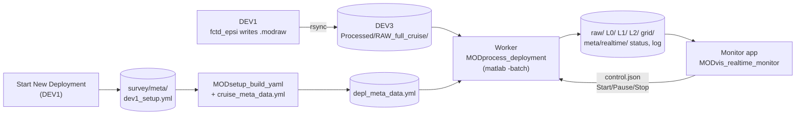

# Realtime and postprocessing: one driver for every vehicle

**Status:** design agreed 2026-10-14. Built so far: [Metadata](#metadata) (`MODsetup_build_yaml`,
the cruise template, `MODsetup_preflight`) and the [other pieces](#other-pieces-in-this-round)
marked built. The worker, grid and monitor app are not built yet. Each section is updated as its
code is built, with an entry in History below.

## Why

MOD_fish_lib's `RUN_Auto_process_data.m` runs either `epsiAuto_process_data` or
`fctdAuto_process_data`. After the shared raw-to-mat step they become two separate stacks:

- two cast detectors;
- two time indices;
- FCTD files written twice;
- two grids with different field names (`GRID.t/s/pr` vs `FCTDgrid.temperature/salinity/depth`);
- two plot scripts that only work with variables already in the workspace.

Microconductivity chi exists only in the FCTD stack. Twist counting runs as its own Matlab
session from its own rsync copy. Any error stops the timer, and the whole grid is rebuilt
every tick.

Here instead:

- **One set of scripts** for realtime and postprocessing, with switches (by file or by profile,
  watch or run once). Nothing is written just for realtime.
- **The manifest decides what runs.** `instrument_manifest` says what's on board, and each step
  runs only for those sensors, in the right order. There is no FCTD or EPSI branch.
- **One file format for every vehicle.** Same structs and field names everywhere; a sensor
  that isn't on board just has no field.
- **A live monitor** with Start / Pause / Stop and a streaming log, which can't stop processing
  even if it crashes.

## Where postprocessing starts: L1

L1 is just the `.modraw` turned into real data: physical units, calibrations, and sensor
responses removed (for example the microconductivity pre-emphasis). It contains **no choices
about spectra or casts**. To postprocess a deployment, start from its L1 files. Every
spectral-processing and profile-picking choice (fft length, scan length, cast detection
parameters, gridding) happens after L1, so it can be redone from L1 without going back to the
raw files.

## Levels and folders

| Folder | What's in each file |
|---|---|
| `raw/` | Symlinks to this survey's `.modraw` files in the cruise-wide `RAW_full_cruise/` |
| `L0/` | Parsed blocks: counts, and EFE volts/g from the standard board |
| `L1/` | Physical-unit timeseries: `epsi`, `ctd`, `alt`, `vnav`, `gps`, `fluor`, `twist`, ... |
| `L2/` | The **same timeseries as L1 plus `scans`**: spectra, FP07 chi, epsilon, microconductivity chi, fluorometer and CTD scan means (the same layout as a `Profile####.mat`) |
| `profiles_L1/`, `profiles_L2/` | Postprocessing only: the same contents, cut by cast instead of by file |
| `grid/` | `grid.mat`: one column per cast, binned in pressure |
| `meta/` | `depl_meta_data.yml` and the deployment-wide files (`time_index.mat`, `pressure_time_series.mat`, `twist_time_series.mat`, `casts.mat`), plus `realtime/` (status, log, problems, control) |

L1 is never rewritten after it's made. L2 carries the timeseries along so one file holds both
the data and what was computed from it, at about L1 + 15% on disk.

Every folder gets an auto-written `_README.txt` listing:
- what's in the files;
- the steps applied;
- the parameters used;
- the git commit of the code.

So it's clear from the folder what has been done.

## How it runs on the ship



There are two Matlab processes on DEV3. They talk only through files.

**Worker:** `MODprocess_deployment(depl_meta_data_yml, 'by', 'file', 'watch', true)`, started by
the monitor app's **Start** button (or `Start Realtime Processing.command`) with `matlab -batch`.
It has no windows. Each loop:

1. finds new or grown raw files;
2. runs every stage on each one;
3. writes status;
4. waits `poll_s` (default 30 s).

The wait starts **after** a loop finishes. A loop that takes 3 minutes is followed by a 30 s
pause; loops never overlap and nothing is skipped. `poll_s` only sets how fast new data is
noticed when the worker is idle.

The raw file that's still being written gets redone only after it has grown by `regrow_min_s`
of data (e.g. 2 min), or once it has closed. Without that, it and everything after it would be
redone on every loop. `status.json` reports how long each loop took, so you can see if
processing falls behind.

Every file and stage is wrapped in `try/catch`:
- A bad file is logged, listed in `problems.json`, and retried when it changes. The loop
  carries on.
- The worker never prompts, since `-batch` can't. If parameters are missing, the survey shows
  "waiting for parameters".
- **Stop** finishes the current file and exits cleanly.

**Monitor app:** `MODvis_realtime_monitor`, a uifigure. It only reads what the worker writes,
so a slow redraw or a crash can't stop processing. You can close and reopen it, or run another
copy on a computer that mounts DEV3.

A Matlab `timer` inside one session isn't used for two reasons: long processing freezes the
plots, and one error in the timer callback stops it.

**Files** in `<survey>/meta/realtime/`:

| File | What's in it |
|---|---|
| `status.json` | Active survey and worker state, file counts per stage, last file, lag behind the newest raw file, loop time |
| `realtime.log` | Every action and error, appended. Also copied into `Processed/cruise_log.txt` for the whole cruise |
| `problems.json` | Files that failed, with the error |
| `control.json` | Written by the app: run, pause or stop |

**Postprocessing** is the same call with `'by', 'profile', 'watch', false`: one pass, no other code.

## Stages

Each stage is an existing `MODprocess_all_*` function unless marked new. The by-file/by-profile
switch only changes what goes in and where the result goes.

| # | Stage | Function | What it does |
|---|---|---|---|
| 0 | Route raw files | new `MODutil_route_raw_by_survey` | Reads each new file's `CTD.survey` from its header and symlinks it into `<survey>/raw/`. Symlinks follow a growing file, while hard links break when rsync replaces it. The active survey is the newest `depl_meta_data.yml`; a new one switches the worker over once the old survey's last files are done. |
| 1 | modraw → L0 | `MODprocess_all_modraw_to_L0` | Already handles growing files. |
| 2 | L0 → L1 | `MODprocess_all_L0_to_L1` | Physical units and calibrations. Microconductivity pre-emphasis removal moves here (new `mod_L1_ucond_remove_preemphasis`). The deployment-wide files in `meta/` (`time_index`, `pressure_time_series`, `twist_time_series`) are **appended to**, not rebuilt from every L1 file. The FP07 refit runs every N files. |
| 2b | Casts | `modProcess_detect_profiles` on `pressure_time_series` | **One cast table** (`meta/casts.mat`) for both modes. Casts are keyed by start time, not by number, so they survive renumbering. A cast still in progress is left out until it ends. Realtime and postprocessing differ only in the parameters and any hand edits. Postprocessing also cuts `profiles_L1/` from it (`MODprocess_all_extract_profiles`). |
| 3 | → L2 | `MODprocess_all_L1_to_L2` | Copies the timeseries and adds `scans`. The modules that run depend on the manifest: CTD always; `fpo7` → FP07 chi; `shear` → epsilon; `microcond` → microconductivity chi (new `mod_scan_ucond_*`); `fluor` → scan means. Scans are kept for up, down or both per `profiling_direction`. |
| 4 | Grid | new `MODprocess_grid(metadata, 'by', 'file'\|'profile')` | Columns always come from the cast table. By file, each cast's data is found in the L2 files through `time_index`; by profile, it's read from `profiles_L2/`. Bins in pressure (dz from `grid.dz_m`); only new or changed casts are rebinned. Despiking and salinity cleanup happen here for now, as a separate function the grid calls, because despiking may move to L2 later (per scan, before spectra). |
| 5 | Cruise twist | `MODprocess_L1_accumulate_twist_timeseries` (generalized to a list of L1 folders) | One winch and one spool serve every vehicle, so this chains **every survey of the cruise** in time order into one series. The count restarts at each spool change, from `MODprocess_find_spool_swaps` (**built**), which checks two sources against each other so a deleted file doesn't lose a change: every survey's `dev1_setup.yml` (`winch_spool`, and when it was written) and the cruise `Processed/spool_swap_log.csv` (Start New Deployment adds a row when the spool changes; a mid-deployment change is added by hand). It uses the log's time when both agree, falls back to whichever one has the change, and warns when they disagree. Output: `Processed/twist/twist_time_series.mat`. Each L1 file's own count still starts at 0; only this chained file carries the running total. |

## One format for every vehicle

`grid/grid.mat` contains:
- axes `time`, `pressure`, `z`, `cast_direction`, `cast_start`, `cast_end`;
- `source` (by file or by profile);
- CTD always (`T`, `SP`, `CT`, `SR`, `sigma0`, `w`);
- then only what's on board: `epsilon_final`, `chi_t1`/`chi_t2`/`chi_c1`, fluorometer channels, `alt_hab`;
- `variables` (name, unit and description from `setup/MODunits_L3.m`) and the manifest.

The monitor app and any later viewer loop over `variables`, so a Mako, an FCTD with
microconductivity and an FCTD with fluorometer all display with the same code.

## Metadata

**Built.** `MODsetup_build_yaml(survey_meta_dir)` writes `meta/depl_meta_data.yml`, the file
processing reads, from two files:

- `meta/dev1_setup.yml`: written by [Start New Deployment](start_new_deployment.md); says
  what's on the vehicle;
- `<processed_root>/cruise_meta_data.yml`: the cruise's processing parameters per sensor type
  (spectral, chi, epsilon, profile detection, grid, sample rates).

**Before the cruise:** copy `setup/cruise_meta_data_template.yml` to
`<processed_root>/cruise_meta_data.yml` and review every value. The template is generated from
`MODsetup_metadata_field_registry.m` by `MODsetup_write_cruise_meta_data_template.m`, with each
parameter's description as a comment. Its values are the registry's suggested defaults, which
are historical starting points, not choices made for this cruise. Rerun the generator after
changing the registry.

How the merge works (done on the text, so both files' comments are kept):

- `dev1_setup.yml` comes first, unchanged.
- Each cruise section that dev1 doesn't have is appended. For a section both have (`afe:`), only
  the missing keys are added. On a key both set, dev1 wins.
- dev1's `profiling_direction` is written to `profile_detection.profile_dir`, which is what
  processing reads.
- A parameter that only the old `depl_meta_data.yml` had (e.g. one saved from a prompt) is
  carried over. If the sources now give a registry parameter a different value than the old
  file had, it's reported, and the sources win.
- The old file is kept as `.replaced_<UTC stamp>`.
- If nothing would change, the file isn't rewritten, so the worker can call it every loop.

```matlab
[depl_yml, info] = MODsetup_build_yaml('/Volumes/DEV3_HD/.../Processed/<survey>/meta');
MODsetup_preflight(depl_yml)            % prints what's missing, or OK
MODsetup_preflight(depl_yml, true)      % asks for each missing value and saves it
```

Those two files are enough: besides the registry parameters, `MODsetup_read_yaml` only reads
the optional `ctd.type` and `ctd.sample_per_record`.

**Preflight** (`MODsetup_preflight`; when the worker starts, and as a button in the app) checks
every registry parameter the manifest needs:
- always: `afe`, `ctd`, `spectral`, `profile_detection`, `grid`. L0 → L1 needs `fft_length`/`Fs_epsi` even on a CTD-only vehicle.
  The exception is `ctd.sample_rate`, which is needed only when `ctd.compute_spectra` is true.
- `chi`: only with an fpo7 slot.
- `epsilon`: only with a shear slot.
- Sensor types are matched ignoring case, the same way processing matches them.

It also reports problems: a yml or calibration file that can't be read, and shear probes with
no calibration file (no epsilon for them). The worker lists anything missing in `status.json`;
the app opens the usual prompt dialogs, which save to `depl_meta_data.yml`.

**Derived values** that aren't in any yml - the AFE electronics filters and the FP07 `volts_to_C`
fit - are added by `MODsetup_add_derived_metadata.m` at the start of the L0 → L1 and L1 → L2
drivers. The fit is read from `meta/fpo7_calibration.mat`, so every stage of the worker, in any
session, sees it.
- Each channel's fit is saved with its probe SN and fit time. A fit is applied only to a
  channel with the same SN; otherwise a warning says that channel gets no chi until the next
  refit.
- A channel that can't be refit keeps its previous fit and fit time, with a warning.

See [L0 → L1](L0_to_L1_conversion.md).

If a source file doesn't parse (for example, 4-space indentation), `MODsetup_build_yaml` stops
with a message naming that file. `depl_meta_data.yml` is left as it was, and a bad merge is
kept as `depl_meta_data.yml.building` so you can look at it.

## Monitor app

Laid out after the 2018 FastCTD GUI, with epsi variables added:

- **Top status strip:** survey, vehicle and winch spool; worker state; file counts per stage; lag;
  last update; problems count.
- **Left, colour sections:** time vs pressure, one column per cast, sigma0 contours. Variables
  are picked from `variables`: T, SP, log10 epsilon, log10 chi (t1/t2/c1), fluorometer.
- **Middle:**
  - pressure vs time;
  - TS of the last ~5 casts, coloured by age, to catch conductivity problems;
  - cruise twist count vs time (all vehicles - one winch spool), with spool changes marked;
  - space left for more panels.
- **Bottom, streaming log**, with errors highlighted (click one for the full message).
- **Right, control panel:** Start / Pause / Stop, Preflight, time span, depth range, colour
  limits and colormaps per variable, open the selected time in `MODvis_timeseries` /
  `MODvis_spectra`, Save PNG. Every plot setting is editable here and shown on the plot.

## Testing: the simulator

New `MODutil_simulate_acquisition(source_raw_dir, sandbox_incoming)` copies a real deployment's
raw files into a sandbox `RAW_full_cruise/` over time, growing the last file the way
`fctd_epsi` does. The worker and app run against it. It's tested on copies of:
- `epsi_mako/blt2021_0715`;
- `fctd_w_ucond`;
- `fctd_w_ucond_fluor`.

Each run includes a new survey mid-run, a deliberately corrupt raw file, and a missing
parameter.

## Other pieces in this round

- **Built:** `MODutil_read_som3(modraw_file)` prints (or returns) a raw file's `$SOM3` block: the
  SOM's own settings - mission name, vehicle name, firmware, the other text after it (git id,
  revision, SN), and each module (`CAL`, `EFE4`, `SB49`, `SDIO`, `VOLT`, `ACTU`, `ALTI`, `VNAV`).
  EFE4 is decoded per channel (name, probe SN, stored cal value); add `'hex', true` for the raw
  bytes. Checked on raw files from blt2021_0715, canyonhead, fctd_w_ucond, DeepSolo and Minnow.
  Firmware from 2023 on records probe SN `000` for every EFE channel, so `$SOM3` doesn't say
  which probes were on; Setup and `dev1_setup.yml` do. The 2025 FCTD fluorometer files have no
  `$SOM3` block.
- **Built:** `MODprocess_find_spool_swaps(processed_root)` lists the spool changes for the cruise
  twist count from the `dev1_setup.yml` files and `spool_swap_log.csv` together (see stage 5).
  Tested with both sources, a deleted `dev1_setup.yml`, a deleted log, a hand-added
  mid-deployment change, and a missing log row.
- **Built:** Start New Deployment has a `winch_spool` field. There's one winch with one spool
  on it, used by every vehicle, so it's cruise-wide: it's filled in from the last Create
  Setup (any vehicle), written to `dev1_setup.yml` and the deployment log, and warned about
  when it's empty or changes (the twist count restarts there). Setup now has one comment line
  (provenance) instead of the section notes. Setup keeps every key, because it's copied into
  every `.modraw` header.
- Fix: scan selection in `mod_L2_tile_scans.m` currently always keeps descending scans; it
  will follow `profiling_direction`.

## History

**2026-10-14 - Design agreed** (branch `main-fork`). Written from the planning discussion with
Nicole, after reading MOD_fish_lib's `RUN_Auto_process_data.m`, `epsiAuto_process_data.m`,
`fctdAuto_process_data.m`, the FCTD formatting/gridding chain and `FastCTD_GUI.m`. Not built
yet.

**2026-10-14 (later) - Step 1 built** (branch `main-fork`): `MODsetup_build_yaml`,
`setup/cruise_meta_data_template.yml` (from `MODsetup_write_cruise_meta_data_template`),
`MODsetup_preflight` (with a no-prompt mode added to `MODsetup_validate_metadata`),
`MODsetup_add_derived_metadata` + `meta/fpo7_calibration.mat`, the prompt retry in L0 → L1,
`MODutil_read_som3`, and the Start New Deployment winch spool field and Setup comment cleanup. Also:
`MODsetup_read_yaml` now reads every processing parameter with one registry loop. Tested in a
scratchpad sandbox - see `SESSION_LOG.md` (2026-10-14, step 1).
