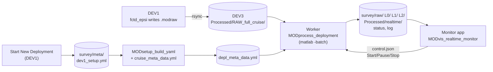

# Realtime and postprocessing: one driver for every vehicle

**Status:** design agreed 2026-10-14. Built so far: [Metadata](#metadata), the worker
(`MODprocess_deployment`, [How it runs](#how-it-runs-on-the-ship)), stages 0-2b, the folder
READMEs, the simulator, and the [other pieces](#other-pieces-in-this-round) marked built. Not built
yet: L2 = L1 + scans, the grid, the cruise twist, the monitor app, microconductivity chi. Each section is updated as its
code is built, with an entry in History below.

## Why

MOD_fish_lib's `RUN_Auto_process_data.m` runs either `epsiAuto_process_data` or
`fctdAuto_process_data`. After the shared raw-to-mat step they become two separate stacks:

- two cast detectors;
- two time indices;
- FCTD files written twice;
- two grids with different field names (`GRID.t/s/pr` vs `FCTDgrid.temperature/salinity/depth`);
- two plot scripts that only work with variables already in the workspace.

Microconductivity chi exists only in the FCTD stack. Twist counting runs as its own Matlab
session from its own rsync copy. Any error stops the timer, and the whole grid is rebuilt
every tick.

Here instead:

- **One set of scripts** for realtime and postprocessing, with switches (by file or by profile,
  watch or run once). Nothing is written just for realtime.
- **The manifest decides what runs.** `instrument_manifest` says what's on board, and each step
  runs only for those sensors, in the right order. There is no FCTD or EPSI branch.
- **One file format for every vehicle.** Same structs and field names everywhere; a sensor
  that isn't on board just has no field.
- **A live monitor** with Start / Pause / Stop and a streaming log, which can't stop processing
  even if it crashes.

## Where postprocessing starts: L1

L1 is just the `.modraw` turned into real data: physical units, calibrations, and sensor
responses removed (for example the microconductivity pre-emphasis). It contains **no choices
about spectra or casts**. To postprocess a deployment, start from its L1 files. Every
spectral-processing and profile-picking choice (fft length, scan length, cast detection
parameters, gridding) happens after L1, so it can be redone from L1 without going back to the
raw files.

## Levels and folders

| Folder | What's in each file |
|---|---|
| `raw/` | Symlinks to this survey's `.modraw` files in the cruise-wide `RAW_full_cruise/` |
| `L0/` | Parsed blocks: counts, and EFE volts/g from the standard board |
| `L1/` | Physical-unit timeseries: `epsi`, `ctd`, `alt`, `vnav`, `gps`, `fluor`, `twist`, ... |
| `L2/` | The **same timeseries as L1 plus `scans`**: spectra, FP07 chi, epsilon, microconductivity chi, fluorometer and CTD scan means (the same layout as a `Profile####.mat`) |
| `profiles_L1/`, `profiles_L2/` | Postprocessing only: the same contents, cut by cast instead of by file |
| `grid/` | `grid.mat`: one column per cast, binned in pressure |
| `meta/` | `depl_meta_data.yml` and the deployment-wide files (`time_index.mat`, `pressure_time_series.mat`, `twist_time_series.mat`, `casts.mat`), plus `realtime/` (status, log, problems, control) |

L1 is never rewritten after it's made. L2 carries the timeseries along so one file holds both
the data and what was computed from it, at about L1 + 15% on disk.

Every folder gets an auto-written `_README.txt` listing:
- what's in the files;
- the steps applied;
- the parameters used;
- the git commit of the code.

So it's clear from the folder what has been done.

## How it runs on the ship



There are two Matlab processes on DEV3. They talk only through files.

**Worker (built):** `MODprocess_deployment(processed_root, 'watch', true)`, started by
`Start Realtime Processing.command` (double-click; it reads `processed_root` from
`acquisition/config.yml`) or later by the monitor app's **Start** button, with `matlab -batch`.
It has no windows. Each pass:

1. links new raw files from `RAW_full_cruise/` into their survey's `raw/`;
2. for each survey that has something new (oldest first; the newest is the active one), runs
   every stage below;
3. writes status;
4. waits `poll_s` (default 30 s), checking `control.json` every second.

The wait starts **after** a pass finishes. A pass that takes 3 minutes is followed by a 30 s
pause; passes never overlap and nothing is skipped. `poll_s` only sets how fast new data is
noticed when the worker is idle.

The raw file that's still being written is redone only once it's out of date and its outputs are
at least `regrow_min_s` old (default 120 s), so it and everything after it aren't redone on every
pass. In the simulator test (4 files, each written over 30 s, `poll_s` 5 s) each file went
through L0 → L1 → L2 twice over 22 passes. `status.json` reports how long each pass took and the
lag of the newest product behind the newest raw data. A survey is skipped once it's caught up
(nothing to do, and `raw/` unchanged for longer than twice `regrow_min_s` plus a pass) until
`raw/` changes. An edit to its yml or a calibration file alone doesn't wake a caught-up survey;
run a one-pass `MODprocess_deployment(survey_folder)` (or touch a raw file) to apply it.

Nothing stops the worker except **Stop**:
- A bad file is logged, listed in the survey's `problems.json`, and retried on later passes (the
  log only shows it again if the error changes). Once it goes through, the log says so and it's
  removed from the list.
- A stage that fails as a whole is listed the same way, and the next stage still runs; it's
  cleared once that stage goes through.
- Anything else that goes wrong in a pass is logged (once, not every pass), and the worker waits
  and tries again.
- Output files are written to `<file>.tmp` and then moved into place, so a Matlab killed mid-save
  (Terminal closed, power cut) never leaves a half-written `.mat`; an unreadable L0 or L1 file is
  redone or retried rather than blocking the survey.
- A raw file deleted from `RAW_full_cruise/` leaves a broken link in `raw/`; it's listed in
  `status.json` (`broken_links`) and otherwise left out, not processed.
- The worker never prompts, since `-batch` can't. A survey whose parameters are incomplete
  shows "waiting for parameters" (with the list) until they're added to `cruise_meta_data.yml`
  or `depl_meta_data.yml`; a survey with no raw files yet shows "waiting for raw files".
- **Stop** (`{"command": "stop"}` in `control.json`) finishes the current stage and exits; the
  survey shows "stopped mid-pass" and is picked up where it left off next time. **pause** keeps
  the worker alive without processing.
- One worker per processed folder: `realtime/worker.lock` holds the running worker's PID, and a
  second one refuses to start while that PID is alive. A lock left by a crashed worker is taken
  over automatically; `'force', true` (or `--force` on the `.command`) overrides it anyway.
- `RAW_full_cruise/` is looked for on every pass, so the worker can be started before the first
  rsync creates it.

**Monitor app (not built yet):** `MODvis_realtime_monitor`, a uifigure. It only reads what the
worker writes, so a slow redraw or a crash can't stop processing. You can close and reopen it,
or run another copy on a computer that mounts DEV3.

A Matlab `timer` inside one session isn't used for two reasons: long processing freezes the
plots, and one error in the timer callback stops it.

**Files** in `<processed_root>/realtime/` (the worker):

| File | What's in it |
|---|---|
| `control.json` | `{"command": "run" \| "pause" \| "stop"}` - written by the app or by hand; set to `run` when the worker starts |
| `worker.lock` | PID, host and start time of the running worker; removed when it exits |
| `status.json` | Worker state, active survey, pass time, and per survey: state, file counts (raw/L0/L1/L2), casts, newest raw file time, lag, problems count, missing parameters, calibration notes; also unrouted raw files and broken links |
| `cruise_log.txt` | One line per notable event for the whole cruise: worker start/stop, files linked, new problems, problems cleared |

and in `<survey>/meta/realtime/` (each survey):

| File | What's in it |
|---|---|
| `realtime.log` | Everything printed while that survey was processed (Matlab's `diary`), warnings included |
| `problems.json` | Files or stages currently failing: `file`, `stage`, `identifier`, `message`, `first_seen_utc`, `last_seen_utc` |

**Postprocessing** is the same call with `'by', 'profile'` and no `'watch'`, on a survey folder
or yml: one pass, no other code.

## Stages

Each stage is an existing `MODprocess_all_*` function unless marked new. The by-file/by-profile
switch only changes what goes in and where the result goes.

| # | Stage | Function | What it does |
|---|---|---|---|
| 0 | Route raw files (**built**) | `MODutil_route_raw_by_survey` | Reads each new file's `CTD.survey` from its header (once; kept in `Processed/raw_routing.mat`) and symlinks it into `<survey>/raw/`. Symlinks follow a growing file, and the new file rsync swaps in when it updates one; hard links would keep the old one. A file with no `CTD.survey` line (fctd_epsi before 2025, SOM-only vehicles) is reported as unrouted. Nothing in `RAW_full_cruise/` is ever changed. |
| 1 | Metadata (**built**) | `MODsetup_build_yaml`, `MODsetup_preflight` | Builds `depl_meta_data.yml` each pass (rewritten only if a source changed) and checks it; see [Metadata](#metadata). |
| 2 | modraw → L0 → L1 (**built**) | `MODprocess_all_modraw_to_L0`, `MODprocess_all_L0_to_L1` | Physical units and calibrations; per-file errors don't stop the run (`'continue_on_error'`), the growing file is throttled (`'newest_min_redo_s'`), and the FP07 refit runs every 10 new L1 files (`'fpo7_refit_new_files'`). The deployment-wide files in `meta/` (`time_index`, `pressure_time_series`, `twist_time_series`) are rebuilt from `meta/l1_file_cache.mat` (`MODprocess_L1_update_file_cache`), which rereads only new or changed L1 files; L1 files are never changed. Microconductivity pre-emphasis removal will move here (new `mod_L1_ucond_remove_preemphasis`, step 7). |
| 2b | Casts (**built**) | `MODprocess_L1_update_cast_table` | **One cast table** (`meta/casts.mat`) for both modes, from `modProcess_detect_profiles`. A cast that runs into the end of the record is `complete = false` (still going); realtime leaves it out, postprocessing keeps it. Key per-cast results by `dnum_start` - numbers can change as the record grows. Postprocessing cuts `profiles_L1/` from it (`MODprocess_all_extract_profiles`). |
| 3 | → L2 (**built as today's L2; step 3 changes it**) | `MODprocess_all_L1_to_L2` | Step 3 makes it copy the timeseries and add `scans`. The modules that run depend on the manifest: CTD always; `fpo7` → FP07 chi; `shear` → epsilon; `microcond` → microconductivity chi (new `mod_scan_ucond_*`); `fluor` → scan means. Scans are kept for up, down or both per `profiling_direction`. |
| 4 | Grid | new `MODprocess_grid(metadata, 'by', 'file'\|'profile')` | Columns always come from the cast table. By file, each cast's data is found in the L2 files through `time_index`; by profile, it's read from `profiles_L2/`. Bins in pressure (dz from `grid.dz_m`); only new or changed casts are rebinned. Despiking and salinity cleanup happen here for now, as a separate function the grid calls, because despiking may move to L2 later (per scan, before spectra). |
| 5 | Cruise twist | `MODprocess_L1_accumulate_twist_timeseries` (generalized to a list of L1 folders) | One winch and one spool serve every vehicle, so this chains **every survey of the cruise** in time order into one series. The count restarts at each spool change, from `MODprocess_find_spool_swaps` (**built**), which checks two sources against each other so a deleted file doesn't lose a change: every survey's `dev1_setup.yml` (`winch_spool`, and when it was written) and the cruise `Processed/spool_swap_log.csv` (Start New Deployment adds a row when the spool changes; a mid-deployment change is added by hand). It uses the log's time when both agree, falls back to whichever one has the change, and warns when they disagree. Output: `Processed/twist/twist_time_series.mat`. Each L1 file's own count still starts at 0; only this chained file carries the running total. |
| - | Folder READMEs (**built**) | `MODutil_write_folder_readme` | `_README.txt` in `raw/`, `L0/`, `L1/`, `L2/` (and `profiles_L1/`, `profiles_L2/`): what the files hold, the steps, the parameters used, the vehicle, and the code's git commit. Rewritten only when that changes. |

## One format for every vehicle

`grid/grid.mat` contains:
- axes `time`, `pressure`, `z`, `cast_direction`, `cast_start`, `cast_end`;
- `source` (by file or by profile);
- CTD always (`T`, `SP`, `CT`, `SR`, `sigma0`, `w`);
- then only what's on board: `epsilon_final`, `chi_t1`/`chi_t2`/`chi_c1`, fluorometer channels, `alt_hab`;
- `variables` (name, unit and description from `setup/MODunits_L3.m`) and the manifest.

The monitor app and any later viewer loop over `variables`, so a Mako, an FCTD with
microconductivity and an FCTD with fluorometer all display with the same code.

## Metadata

**Built.** `MODsetup_build_yaml(survey_meta_dir)` writes `meta/depl_meta_data.yml`, the file
processing reads, from two files:

- `meta/dev1_setup.yml`: written by [Start New Deployment](start_new_deployment.md); says
  what's on the vehicle;
- `<processed_root>/cruise_meta_data.yml`: the cruise's processing parameters per sensor type
  (spectral, chi, epsilon, profile detection, grid, sample rates).

**Before the cruise:** copy `setup/cruise_meta_data_template.yml` to
`<processed_root>/cruise_meta_data.yml` and review every value. The template is generated from
`MODsetup_metadata_field_registry.m` by `MODsetup_write_cruise_meta_data_template.m`, with each
parameter's description as a comment. Its values are the registry's suggested defaults, which
are historical starting points, not choices made for this cruise. Rerun the generator after
changing the registry.
`acquisition/check_software/check_ship_setup.sh` reports whether `cruise_meta_data.yml` is there (see
[Start New Deployment](start_new_deployment.md), setup step 6).

How the merge works (done on the text, so both files' comments are kept):

- `dev1_setup.yml` comes first, unchanged.
- Each cruise section that dev1 doesn't have is appended. For a section both have (`afe:`), only
  the missing keys are added. On a key both set, dev1 wins.
- dev1's `profiling_direction` is written to `profile_detection.profile_dir`, which is what
  processing reads.
- A parameter that only the old `depl_meta_data.yml` had (e.g. one saved from a prompt) is
  carried over. If the sources now give a registry parameter a different value than the old
  file had, it's reported, and the sources win.
- The old file is kept as `.replaced_<UTC stamp>`.
- If nothing would change, the file isn't rewritten, so the worker can call it every loop.

```matlab
[depl_yml, info] = MODsetup_build_yaml('/Volumes/DEV3_HD/.../Processed/<survey>/meta');
MODsetup_preflight(depl_yml)            % prints what's missing, or OK
MODsetup_preflight(depl_yml, true)      % asks for each missing value and saves it
```

Those two files are enough: besides the registry parameters, `MODsetup_read_yaml` only reads
the optional `ctd.type` and `ctd.sample_per_record`.

**Preflight** (`MODsetup_preflight`; when the worker starts, and as a button in the app) checks
every registry parameter the manifest needs:
- always: `afe`, `ctd`, `spectral`, `profile_detection`, `grid`. L0 → L1 needs `fft_length`/`Fs_epsi` even on a CTD-only vehicle.
  The exception is `ctd.sample_rate`, which is needed only when `ctd.compute_spectra` is true.
- `chi`: only with an fpo7 slot.
- `epsilon`: only with a shear slot.
- Sensor types are matched ignoring case, the same way processing matches them.

It also reports problems: a yml or calibration file that can't be read, and shear probes with
no calibration file (no epsilon for them). The worker lists anything missing in `status.json`;
the app opens the usual prompt dialogs, which save to `depl_meta_data.yml`.

**Derived values** that aren't in any yml - the AFE electronics filters and the FP07 `volts_to_C`
fit - are added by `MODsetup_add_derived_metadata.m` at the start of the L0 → L1 and L1 → L2
drivers. The fit is read from `meta/fpo7_calibration.mat`, so every stage of the worker, in any
session, sees it.
- Each channel's fit is saved with its probe SN and fit time. A fit is applied only to a
  channel with the same SN; otherwise a warning says that channel gets no chi until the next
  refit.
- A channel that can't be refit keeps its previous fit and fit time, with a warning.

See [L0 → L1](L0_to_L1_conversion.md).

If a source file doesn't parse (for example, 4-space indentation), `MODsetup_build_yaml` stops
with a message naming that file. `depl_meta_data.yml` is left as it was, and a bad merge is
kept as `depl_meta_data.yml.building` so you can look at it.

## Monitor app

Laid out after the 2018 FastCTD GUI, with epsi variables added:

- **Top status strip:** survey, vehicle and winch spool; worker state; file counts per stage; lag;
  last update; problems count.
- **Left, colour sections:** time vs pressure, one column per cast, sigma0 contours. Variables
  are picked from `variables`: T, SP, log10 epsilon, log10 chi (t1/t2/c1), fluorometer.
- **Middle:**
  - pressure vs time;
  - TS of the last ~5 casts, coloured by age, to catch conductivity problems;
  - cruise twist count vs time (all vehicles - one winch spool), with spool changes marked;
  - space left for more panels.
- **Bottom, streaming log**, with errors highlighted (click one for the full message).
- **Right, control panel:** Start / Pause / Stop, Preflight, time span, depth range, colour
  limits and colormaps per variable, open the selected time in `MODvis_timeseries` /
  `MODvis_spectra`, Save PNG. Every plot setting is editable here and shown on the plot.

## Testing: the simulator

**Built:** `MODutil_simulate_acquisition(source_raw_dir, incoming_dir, 'first', i, 'n_files', n,
'file_s', s, 'chunks', c)` copies a real deployment's raw files into a test `RAW_full_cruise/`
one at a time, writing each in `c` pieces over `s` seconds the way `fctd_epsi` grows a file. Run
it in a second Matlab while the worker watches. Use copies of real deployments only; the source
is only read.

Tested in a scratchpad sandbox (2026-10-15), worker with `poll_s` 5 s and `regrow_min_s` 20 s:

- **Survey A** (MAKO1, files 40-43 of `epsi_mako_w_fluor/25_0408_d03_mako1_canyonhead`, each
  written over 30 s): routed by their `CTD.survey` header, L0 → L1 → L2 as they grew, 11 casts
  in `meta/casts.mat`.
- **A corrupt raw file** (a real header plus 300 kB of random bytes): parsed without an error;
  its readable part gave L1 data and 0 scans, with nothing odd in the pressure record. After it
  was replaced with valid data, it was redone (42 scans).
- **Survey B** (FCTD1, `fctd_w_ucond_fluor/25_0409_d05_fctd1_dye_survey`), set up mid-run while
  `cruise_meta_data.yml` was hidden: the newest survey became the active one. When it was
  restored and three files arrived, they were routed and processed, and survey A was left alone
  (caught up).
- **Stop** through `control.json`: the worker finished the stage and exited; `status.json` says
  `stopped`.
- **A survey set up while `cruise_meta_data.yml` is missing** shows "waiting for parameters" (15
  missing for an FCTD2: no chi or epsilon needed) before any raw data arrives, and "waiting for
  raw files" once the file is back.
- **An earlier run** (4 growing files from the start of the canyonhead deployment) checked the
  throttle: each file went through L0 → L1 → L2 twice over 22 passes, not on every pass.

Still to test on the simulator: `fctd_w_ucond` (a 2023 FCTD, no `CTD.survey` line, so its files
are reported as unrouted) and a mid-run raw file that never finishes.

## Other pieces in this round

- **Built:** `MODutil_read_som3(modraw_file)` prints (or returns) a raw file's `$SOM3` block: the
  SOM's own settings - mission name, vehicle name, firmware, the other text after it (git id,
  revision, SN), and each module (`CAL`, `EFE4`, `SB49`, `SDIO`, `VOLT`, `ACTU`, `ALTI`, `VNAV`).
  EFE4 is decoded per channel (name, probe SN, stored cal value); add `'hex', true` for the raw
  bytes. Checked on raw files from blt2021_0715, canyonhead, fctd_w_ucond, DeepSolo and Minnow.
  Firmware from 2023 on records probe SN `000` for every EFE channel, so `$SOM3` doesn't say
  which probes were on; Setup and `dev1_setup.yml` do. The 2025 FCTD fluorometer files have no
  `$SOM3` block.
- **Built:** `MODprocess_find_spool_swaps(processed_root)` lists the spool changes for the cruise
  twist count from the `dev1_setup.yml` files and `spool_swap_log.csv` together (see stage 5).
  Tested with both sources, a deleted `dev1_setup.yml`, a deleted log, a hand-added
  mid-deployment change, and a missing log row.
- **Built:** Start New Deployment has a `winch_spool` field. There's one winch with one spool
  on it, used by every vehicle, so it's cruise-wide: it's filled in from the last Create
  Setup (any vehicle), written to `dev1_setup.yml` and the deployment log, and warned about
  when it's empty or changes (the twist count restarts there). Setup now has one comment line
  (provenance) instead of the section notes. Setup keeps every key, because it's copied into
  every `.modraw` header.
- Fix: scan selection in `mod_L2_tile_scans.m` currently always keeps descending scans; it
  will follow `profiling_direction`.

## History

**2026-10-14 - Design agreed** (branch `main-fork`). Written from the planning discussion with
Nicole, after reading MOD_fish_lib's `RUN_Auto_process_data.m`, `epsiAuto_process_data.m`,
`fctdAuto_process_data.m`, the FCTD formatting/gridding chain and `FastCTD_GUI.m`. Not built
yet.

**2026-10-14 (later) - Step 1 built** (branch `main-fork`): `MODsetup_build_yaml`,
`setup/cruise_meta_data_template.yml` (from `MODsetup_write_cruise_meta_data_template`),
`MODsetup_preflight` (with a no-prompt mode added to `MODsetup_validate_metadata`),
`MODsetup_add_derived_metadata` + `meta/fpo7_calibration.mat`, the prompt retry in L0 → L1,
`MODutil_read_som3`, and the Start New Deployment winch spool field and Setup comment cleanup. Also:
`MODsetup_read_yaml` now reads every processing parameter with one registry loop. Tested in a
scratchpad sandbox - see `SESSION_LOG.md` (2026-10-14, step 1).

**2026-10-15 - Step 2 built** (branch `main-fork`): the worker and one-pass driver
(`MODprocess_deployment`), raw routing, the L1 file cache behind the deployment-wide files, the
cast table, per-file error handling and redo throttling in the three per-file drivers, atomic
saves, folder READMEs, the simulator and the `.command` launcher. Reviewed by an agent (9 bugs
fixed) and tested on the simulator - see `SESSION_LOG.md` (2026-10-15, step 2).
